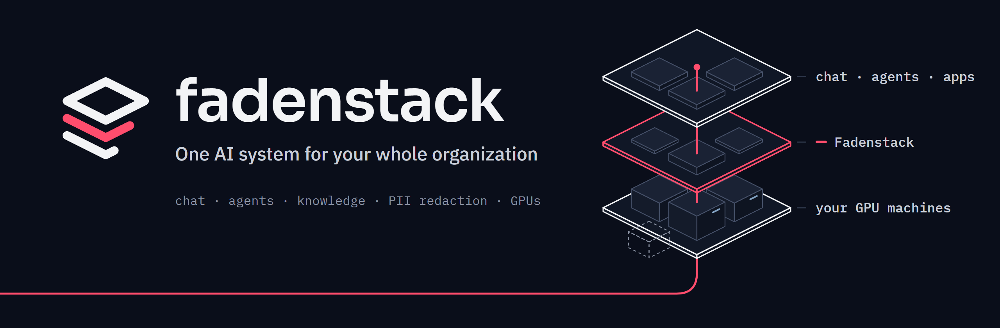
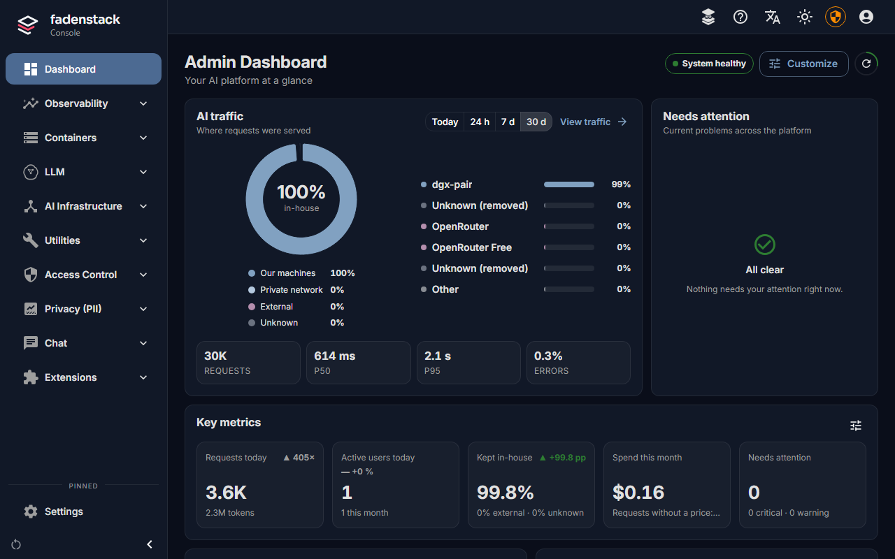
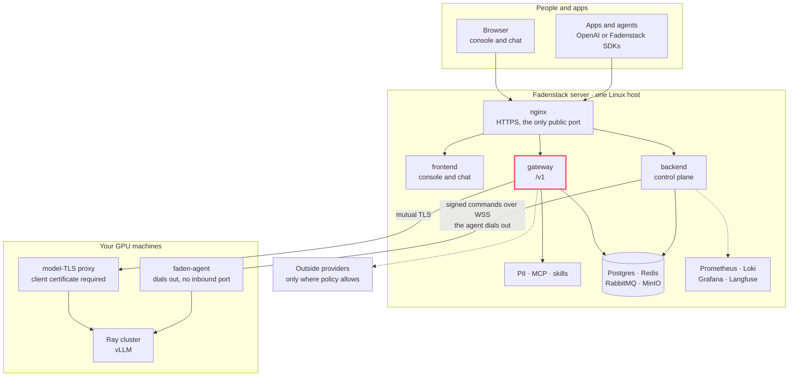

<p align="center">
  <picture>
    <source media="(prefers-color-scheme: dark)" srcset="docs/images/readme/banner-dark.png">
    <source media="(prefers-color-scheme: light)" srcset="docs/images/readme/banner-light.png">
    
  </picture>
</p>

<h3 align="center">One AI system for your whole organization.</h3>

<p align="center">
  Chat for everyone, an OpenAI-compatible API for your apps and agents,<br>
  and the models on your own GPUs. Your IT department runs it all as one system.
</p>

<p align="center">
  <a href="#quick-start"><b>Quick start</b></a> ·
  <a href="docs/help/pages/operate/installing.md">Install guide</a> ·
  <a href="#documentation">Documentation</a> ·
  <a href="#moving-from-llmport">Moving from LLM.Port</a> ·
  <a href="https://github.com/fadenstack">All repositories</a>
</p>

<p align="center">
  
  
  
  
</p>

---

This repository is the Fadenstack server and everything that installs and runs it:

- the **gateway**, an OpenAI-compatible `/v1` with limits, routing, PII redaction, skills, tools and an audit log;
- the **console and chat**, one web app for administrators and for everyone else;
- the **backend**, the control plane for users, models, machines, clusters, containers and policies;
- the **PII, MCP and skills services**;
- the **machine agent**, `faden-agent`, which makes a Linux GPU machine a member of a cluster;
- the **CLI**, `faden`, which installs, upgrades and backs up the server.

Fadenstack was called LLM.Port up to release 0.3.

<p align="center">
  
</p>

## What it does

### For everyone: a chat on your own models

- A chat with projects, sessions and file attachments, on the models you run or allow. Reasoning models show their thinking.
- **Skills**: your team's checklists and formats as shared, versioned instructions. Pick one with `$`, or turn a chat into one with `/skill`.
- **Knowledge**: the model searches your documents itself and names the source.
- **Tools** from the MCP servers your administrators connect.
- Works on phones, in English, Français, Deutsch, Español and 中文.

<p align="center">
  
</p>

### For developers: one endpoint for apps and agents

- An OpenAI-compatible `/v1` for chat completions (streamed or whole), embeddings and the model list. Any OpenAI SDK works: change the base URL and the key.
- Every request goes through the same steps as the chat: limits, routing, skills, PII, tools and the audit log. See [what happens to a request](docs/help/pages/administer/requests.md).
- **Tools on the server and on the user's side.** MCP servers are registered once on the server. Agents can also connect over a WebSocket and offer local tools, such as the open document or files on the user's machine. Each session's policy decides where its tools run: on the server, locally or both.
- SDKs for .NET (`Faden.Client`, `Faden.Agents`) and TypeScript (`@fadenstack/client`, `@fadenstack/agents`) run agents inside other software, with their tools and approvals on the user's device, governed by the server. They live in their own repositories and need a server newer than 0.4.1.

### For IT: one console for all of it

- **GPU machines.** Add a Linux machine with an NVIDIA GPU, x86_64 or an NVIDIA DGX Spark (aarch64), with one install line and an approval code. The agent dials out to the server, so the server needs no port and no SSH keys to control the machine. Model traffic reaches a cluster's head machine through one port that only accepts the gateway's client certificate, and the machines of a cluster reach each other on Ray's ports.
- **Clusters and models.** Machines form Ray clusters that serve models with vLLM. The model marketplace searches Hugging Face, says whether a model fits your cluster and fills in vLLM's settings.
- **What you already run.** Fadenstack finds the vLLM containers already on your machines and routes to them without restarting them. A server rebuilt from a backup takes over the clusters its machines still run.
- **When something fails.** A cluster re-forms when a machine drops out, and the console says what happened.
- **Personal data.** Presidio-based detection on messages, history and tool results, redacted or tokenised before a model sees them.
- **Security.** HTTPS by default, with nginx as the only public port. Model traffic between the gateway and the machines uses mutual TLS, and Ray's traffic between machines runs over TLS once a cluster's switch for it is on. The data stores listen on localhost only.
- **Oversight.** A dashboard with where each request was served (your machines, your private network, or an outside provider), usage per user, cost per request from model prices, traces, and logs from the server and the machines in one place. Prometheus, Grafana and Loki come with it.
- **Operations.** Containers, modules, backups, restores and upgrades, from the console or with `faden`.

## How it fits together



Every connection, and whether it is encrypted, is in [Network and ports](docs/help/pages/operate/network.md).

## Quick start

**The server** is one Linux machine (x86_64) with Docker Engine 24 or later and Compose v2, Python 3.12 or later, and ports 80 and 443 free. It needs no GPU: at least 4 cores, 6 GB of memory and 60 GB of disk ([system requirements](docs/help/pages/operate/requirements.md)).

```bash
pipx install fadenstack        # or: uv tool install fadenstack
faden deploy
```

`faden deploy` writes the configuration with a random password for every service, sets up HTTPS, starts the services and creates the first administrator; Grafana, Langfuse and RabbitMQ's management then sign in with that administrator's password. Then open `https://<server>` and sign in.

**The GPU machines** run Linux (x86_64, or aarch64 on NVIDIA DGX Spark) with an NVIDIA driver and Docker or Podman. In the console, open **Machines → Add a machine**, run the line it gives you on the machine, and approve the machine's code. Then pick a model in the **model marketplace**. The walk-through is in [GPU machines](docs/help/pages/operate/machines.md) and [Clusters](docs/help/pages/operate/clusters.md).

**Your apps** use any OpenAI client:

```python
from openai import OpenAI

client = OpenAI(base_url="https://<server>/v1", api_key="<your key>")
reply = client.chat.completions.create(
    model="qwen-chat",
    messages=[{"role": "user", "content": "Hello from Fadenstack"}],
)
print(reply.choices[0].message.content)
```

## Documentation

The Help pages are in [docs/help](docs/help/README.md); they become `help.fadenstack.com`. Building on Fadenstack (the API, the SDKs, MCP servers) is on the Developers site.

| | |
| --- | --- |
| Use | [The chat](docs/help/pages/use/chat.md) · [Tools](docs/help/pages/use/tools.md) · [Skills](docs/help/pages/use/skills.md) · [Knowledge](docs/help/pages/use/knowledge.md) · [The browser agent](docs/help/pages/use/browser-agent.md) · [Office add-ins](docs/help/pages/use/office-add-ins.md) · [Your data and privacy](docs/help/pages/use/privacy.md) |
| Administer | [Users and roles](docs/help/pages/administer/users.md) · [Models](docs/help/pages/administer/models.md) · [Deployments](docs/help/pages/administer/deployments.md) · [Remote providers](docs/help/pages/administer/providers.md) · [MCP servers](docs/help/pages/administer/mcp-servers.md) · [Policies and personal data](docs/help/pages/administer/policies.md) · [The dashboard](docs/help/pages/administer/dashboard.md) |
| Operate | [Installing](docs/help/pages/operate/installing.md) · [Upgrading](docs/help/pages/operate/upgrading.md) · [Backups](docs/help/pages/operate/backups.md) · [System requirements](docs/help/pages/operate/requirements.md) · [HTTPS and trust](docs/help/pages/operate/https.md) · [GPU machines](docs/help/pages/operate/machines.md) · [Clusters](docs/help/pages/operate/clusters.md) · [When something fails](docs/help/pages/operate/failures.md) · [Troubleshooting](docs/help/pages/operate/troubleshooting.md) |

## Repository layout

| Directory | What it is | Runs as | Licence |
| --- | --- | --- | --- |
| `gateway` | OpenAI-compatible gateway (`/v1`) | Docker | Apache-2.0 |
| `backend` | Control plane API (`/api`) and its worker | Docker | Apache-2.0 |
| `frontend` | Console and chat (React) | Docker | Apache-2.0 |
| `pii` | PII detection and redaction (Presidio) | Docker, module `pii` | Apache-2.0 |
| `mcp` | MCP server registry and tool runner | Docker, module `mcp` | Apache-2.0 |
| `skills` | Skills registry | Docker, module `skills` | Apache-2.0 |
| `shared` | Compose files, nginx, base image, database setup | Docker | Apache-2.0 |
| `agent` | Machine agent (`faden-agent`) | Standalone binary | Apache-2.0 |
| `runtime-image` | Fadenstack's Ray and vLLM runtime helper and image recipes | Docker | Apache-2.0 for Fadenstack-authored files; third-party components keep their own terms |
| `cli` | Installer and management tool (`faden`) | PyPI (`fadenstack`) | Apache-2.0 |
| `docs` | The guides linked above | | |
| `dev` | Scripts for working on Fadenstack | | |

A release publishes the images to `ghcr.io/fadenstack/{gateway,backend,frontend,pii,mcp,skills,base}`, tagged with its version (`0.4.1`, `0.4`, `latest`). The CLI of a release deploys the images of its own version. The machines' runtime images are `ghcr.io/fadenstack/ray-runtime-x86_64` and `ray-runtime-gb10` (DGX Spark); the machines download them from your server, not from the internet.

## Building and developing

Run a server built from this checkout:

```bash
git clone https://github.com/fadenstack/fadenstack.git
cd fadenstack
pipx install ./cli
faden deploy --build
```

For working on Fadenstack itself, `faden dev init` and `faden dev up` run the services from source against a local stack, and `faden dev doctor` checks the tools they need. The dev services listen on 127.0.0.1 only, as development mode signs anyone in as the administrator; `faden dev up --lan` opens them to a network you trust.

The agent is published as standalone binaries for Linux x86_64 and aarch64 (no Python needed on the machine); see [agent/README.md](agent/README.md).

## Contributing

Questions, bug reports and ideas go in [GitHub issues](https://github.com/fadenstack/fadenstack/issues); pick the template that fits. Please open an issue before you write code for a change, so we can agree on it first. [CONTRIBUTING.md](CONTRIBUTING.md) says what a pull request needs, including the one-time [contributor licence agreement](CONTRIBUTOR_LICENSE_AGREEMENT.md) you sign from your first pull request. Everyone follows the [Code of Conduct](CODE_OF_CONDUCT.md).

Found a security problem? Report it privately, never in an issue: see [SECURITY.md](SECURITY.md).

## Moving from LLM.Port

Release 0.4.0 renamed everything an install carries: the compose project and its volumes, the containers, the databases, the environment variables (`LLM_PORT_*` became `FADEN_*`, the gateway's `LLM_PORT_API_*` became `FADEN_GATEWAY_*`), the CLI (`llmport` became `faden`) and the agent (`llmport-agent` became `faden-agent`). An install of LLM.Port 0.3 moves across with the migration tool, which keeps every row, file and setting: [llm-port/migrate-to-fadenstack](https://github.com/llm-port/migrate-to-fadenstack).

## Licence

Fadenstack-authored code and deployment files in this repository are licensed under the [Apache License 2.0](LICENSE), including the server, optional services, machine agent, runtime helper and CLI. The CLI's installed package includes deployment files from `shared/`.

Container images also contain third-party software, including NVIDIA's runtime base image, Ray and vLLM. Those components retain their own licence terms. Release SBOMs identify the components present in each published artifact; see [Third-party components](docs/help/pages/operate/third-party.md).

Apache-2.0 grants no general right to use the Fadenstack name or logo for a modified product. See [Brand and Official Releases](backend/OFFICIAL.md) for the current branding guidance.

---

<p align="center"><sub>Built in Germany by <a href="https://emagin8.de">Emagin8</a> · English · Deutsch · Français · Español · 中文</sub></p>
