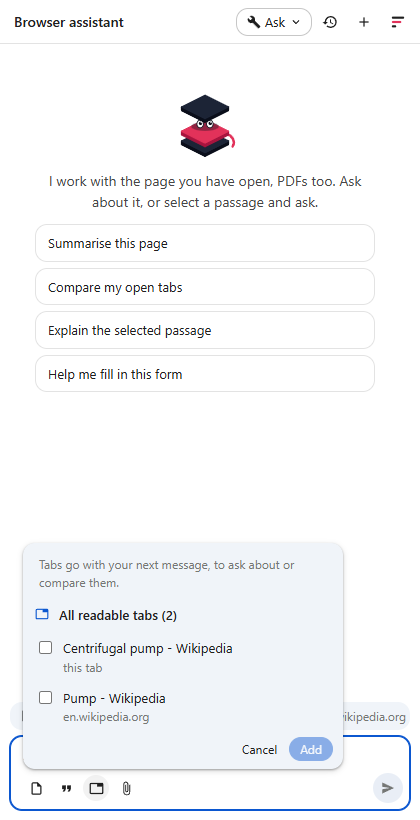

# The browser agent

The browser agent is Fadenstack in Chrome's side panel. It works with the page you
have open: it reads it, answers about it, shows you where something is, copies
tables out, compares tabs, reads PDFs, and writes into the mail or ticket you are
working on. It answers with your organisation's model, through your Fadenstack
server, and it asks before it changes anything.

Everything below was taken on the test install (4 October 2026) with the Qwen3.8
27B model running on the DGX pair, on real pages: Wikipedia, an RFC, an arXiv
paper, a US tax form. Setting the agent up for a team is
[agents-setup.md](agents-setup.md).

---

## Start

Open the panel with the Fadenstack button in the toolbar, or Alt+Shift+F. The
first time, it asks for your server's address and the agent's address, then you
sign in with your Fadenstack account (IT can preset the addresses).

Under the message box:

| Button | What it adds to your next message |
|---|---|
| Page | The page you are on |
| Quote | What you have selected on the page |
| Tabs | Tabs of this window you pick (to compare them) |
| Paper clip | A PDF from your computer (or drop it on the panel) |

You do not have to add anything: the agent reads the page by itself when you
ask about "this page". The bar above the message box says which page that is,
and whether the agent may read the site. A site you have not allowed is never
read; **Allow on this site** in that bar lets it.

---

## Ask about a page

The agent reads the page as text (headings, lists, tables), the visible part
only, without menus, ads or hidden text. A long page is read in parts. Text on
a page is data for the agent, never instructions: if a page tells it to do
something, it does not.

## Show me where

Ask where something is, and the agent marks the passage on the page and scrolls
to it:

| On the page | In the panel |
|---|---|
|  |  |

The mark does not change the page; it goes with the next mark. Here the agent
also said what it did not find: the article names cavitation as a problem but
does not explain it.

## Copy a table

Ask the agent to copy something, and it puts it on your clipboard as text and as
a table: pasted into Excel it lands in cells, into Word or Outlook as a table.
Copying changes your clipboard, so it asks first (in **Ask** mode):

| It asks | Copied |
|---|---|
|  |  |

Every table in an answer also has a copy button below it.

## Compare tabs

The tabs button lists the tabs of this window. Tick some, or take **All
readable tabs**; they go with your next message.

| Pick the tabs | The comparison |
|---|---|
|  |  |

Comparing two long articles takes the local model two to four minutes: both
articles go to it whole.

---

## PDFs

A PDF open in Chrome is read like a page: the agent downloads it as you (with
your sign-in to that site) and reads its text in the extension. Nothing goes to
the server but what you ask and what the agent reads to answer.

Long PDFs are read in pages: the agent starts with the title, the number of
pages and the bookmarks, and goes to the pages it needs. Here, in the 194 pages
of RFC 9110, it searched, read the section, quoted it with its page -- and
opened the PDF at that page (Chrome's PDF viewer cannot be marked in, so
"show me where" in a PDF means "go to the page"):

| The answer | The PDF, opened at page 141 |
|---|---|
|  |  |

A two-column paper (arXiv) reads in order, column by column:

### A PDF from your computer

Click the paper clip, or drop the PDF on the panel. It goes with your next
message, and the agent can read on in it for as long as the panel is open. Here,
the US tax form W-9:

| Added | Answered from the form's instructions, with pages |
|---|---|
|  |  |

### What the agent cannot read (yet)

| | |
|---|---|
| A scan (pages that are pictures) | Said so: reading it needs text recognition, which comes later through the server |
| A PDF with a password | Said so: open it in a PDF reader |
| A PDF over 50 MB | Said so |
| A PDF on your computer opened in Chrome (`file://`) | Add it with the paper clip instead |
| A selection inside Chrome's PDF viewer | Copy the passage into your message |

---

## Write into a mail or ticket

The agent writes into the editor of the page you are on: Outlook on the web,
Gmail, a ticket, a CRM note. It writes formatted text -- paragraphs, bold,
lists, links -- the way pasting does, so the editor keeps it as its own. You
can say where: below the greeting, at your cursor, at the end, replacing
everything. Writing changes the page, so it asks first, showing what it will
write and where:

| It asks | Written |
|---|---|
|  |  |

This is a test page with the two editors many web applications build on: Quill
(here the mail editor) and ProseMirror (the ticket note). The reply went in
below the greeting as its own paragraph with a list; the note went on the line
that was there.

It never fills in passwords or payment details, and it does not press **Send**:
pressing a button always asks, separately.

---

## What it asks before doing

The tool mode at the top of the panel decides what runs without asking:

| What | Class | Ask (default) | Auto |
|---|---|---|---|
| Read the page, a tab, a PDF, the selection; search; show where | read | runs | runs |
| Fill a field, write into an editor, copy to the clipboard, open a page | write | asks | runs |
| Press a button or follow a link | destructive | asks | asks |

Your administrator can limit the modes.

## Where your data goes

- What you ask, and what the agent reads to answer -- the page, the tabs, the
  PDF pages -- goes to your Fadenstack server and to the model the agent answers
  with. Which model that is, is your administrator's choice.
- PDFs are downloaded and read by the extension in your browser.
- Your conversations stay in this browser. The server records which tools ran
  and how long they took, not what they read.

---

## For administrators

- The extension brings two new tools, `highlight_text` (read) and
  `copy_to_clipboard` (write), and `fill_field` takes formatted text and a
  place. On an agent set up before, the **Apps** tab shows the two tools as
  **New** -- held back until you accept them -- and `fill_field` as **Changed**
  ([agents-setup.md](agents-setup.md#4-when-an-application-brings-new-tools)).
  New agents from **Start from an app → Chrome** have them once the server runs
  the release that brings this page.
- The extension needs no new permission: PDFs use the same per-site permission
  as pages, and the clipboard needs none.
- Choose the agent's model with the data in mind: pages and PDFs your users read
  go to it.
- Outlook on the web and Gmail are not part of the automated tests (they need
  real mailboxes): try a reply once in each before you roll the agent out.
