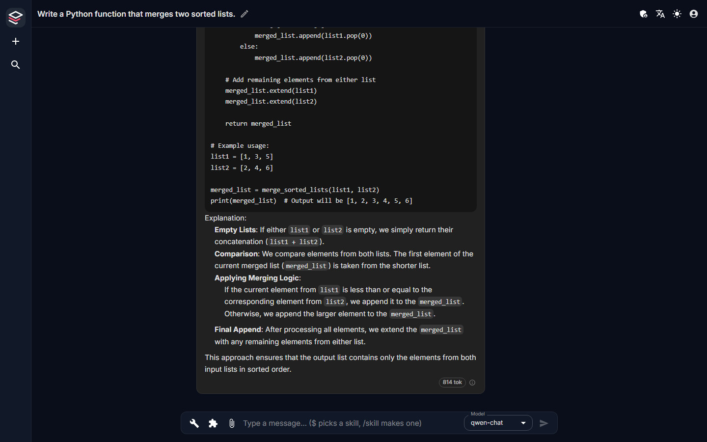

# The chat

The chat is where everyone in the organization talks to the models
Fadenstack serves: `http://<server>/chat`. Users land in it after signing in;
administrators reach it from the console too.

The screenshots were taken on the development install on 2026-09-26.

---

## A conversation

**New chat** starts a conversation. Type in the box at the bottom and press
Enter to send (Shift+Enter for a new line); the square button stops a reply
while it is being written.

| Control | What it does |
|---|---|
| Wrench | The chat's **Tools**: which MCP tools the model may use. They start off; see [MCP servers → In a chat](mcp-servers.md#in-a-chat) |
| Puzzle piece | The chat's **skills**; type `$` in the box for the same list. See [Skills](skills.md) |
| Paper clip | Attach a file to the message |
| Model | The model that answers |

Under a reply, the badge counts its tokens; hover it for the prompt,
completion and total. The ⓘ beside it names the model that answered.

---

## Leaving a reply that is being written

A reply keeps being written when you leave it: when you open another chat or
another page, reload, or close the tab. Come back to the chat and it shows
the reply from its start and follows it to the end. A chat whose reply is
still being written has a small spinner in the sidebar.

- **One reply per chat, three at once.** A chat takes a new message once its
  reply is done. You can have replies written in up to three chats at the
  same time; a fourth is refused until one finishes, and what you typed stays
  in the box. An administrator sets the number:
  `FADEN_GATEWAY_CHAT_TURNS_PER_USER` in the install's `.env`, applied when
  the gateway is next started (`faden upgrade` does).
- **Stop.** The square button stops the reply, whichever chat you started it
  in. What was written stays, marked **Stopped**.
- **Failed replies stay.** A reply that failed stays in the chat with the
  reason, for example a model refusing the request. **Retry** under the
  chat's last reply asks again with the model now selected, and the new reply
  takes its place. Sending the same message again does the same. A failed
  reply is not sent to the model with later messages; a stopped one is.
- **A server restart** ends the replies being written; they are marked as
  cut off and can be tried again.
- **Where it is kept meanwhile.** So that any of the gateway's workers can
  show it, a reply's parts also go to the stack's Redis while it is written,
  and stay there for a minute after it ends. With chat encryption on
  (`FADEN_GATEWAY_ENCRYPTION_KEY`), they are encrypted with the same key as
  the messages. The finished reply itself is in the database.

This is the chat's own behaviour. A request to the gateway's OpenAI-style API
still ends when its client disconnects.

---

## Titles

A chat is named from its first message: its first line, cut at a word, at
most 80 characters. Chats created through the API or a script without a
title are named the same way.

The title is in the bar above the conversation. The pencil beside it renames
the chat in place: Enter saves, Escape cancels.

Titles are stored encrypted, as the messages are: they are the start of what
you wrote. The admin console lists chats by their id and never shows a title.

The key they are encrypted with is `FADEN_GATEWAY_ENCRYPTION_KEY` in the
install's `.env`, which `faden deploy` generates. Until October 2026 it never
reached the gateway, so chats were stored in plain text on every install; an
upgrade passes it on, and from then on new messages and titles are
encrypted. Chats from before stay readable as they were. Losing the key makes
the encrypted chats unreadable: keep the `.env` with your backups.

---

## The sidebar

The sidebar has **New chat**, the search and two sections:

- **Projects**: a folder per project, with its chats; the folder button next
  to the heading makes a new one. A project's settings
  hold a description and a **system prompt** that goes before every message
  in its chats: the context, a persona or rules for that piece of work.
- **Chats**: the rest, grouped by when they were last used: Today, Yesterday,
  Previous 7 days, Previous 30 days, Older.

The sidebar shows the 50 most recent chats and loads more as you scroll to
the end (**Show more**). A project shows 20 at first.

**Moving a chat into a project.** Drag it onto the project, or use the
**Move to project** button that appears when you point at it. Drag it back
onto the chats, or choose **No project**, to take it out. On a touch screen,
and in search results, a chat's actions (Move to project, Delete) are behind
its ⋮ button.

**Search** matches chat titles as you type and lists the results ("Results:
2"). It searches the titles, not what was said in the chats.

**Collapsing.** The arrow at the bottom folds the sidebar into a narrow rail:
the logo opens it again, **+** starts a chat, and the magnifier opens it with
the search ready.

---

## Skills in a chat

Type `$` and part of a skill's name: the matching skills are listed as you
type. Enter or Tab picks one, and it is used for every message of this chat
until you take it off. `/skill` drafts a new skill from the conversation.

[Skills](skills.md) explains what a skill is, how it is picked on its own,
and how to share one.

---

## The top bar

From the right:

- **Your avatar**: your email, **Manage profile**, **Skills** (your own, the
  ones shared with you and the organization's, when the skills module is on)
  and **Log out**.
- **Sun or moon**: light or dark theme.
- **Language**: English, German, Spanish, French or Chinese.
- **Shield** (superusers only): the admin console.

---

## On a phone

Below 600 px the sidebar opens from the round **menu button** in a bottom
corner, or from the logo in the top bar. The button sits on the side you
choose in the panel (**Menu button: Left / Right**), the same choice as in
the admin console.

On a phone:

- Replies take the whole width.
- The text has its own row, with the controls and the model under it.
- Enter starts a new line; the send button sends.
- A chat's actions are behind its ⋮ button.
- The menu button moves aside while the keyboard is up.
