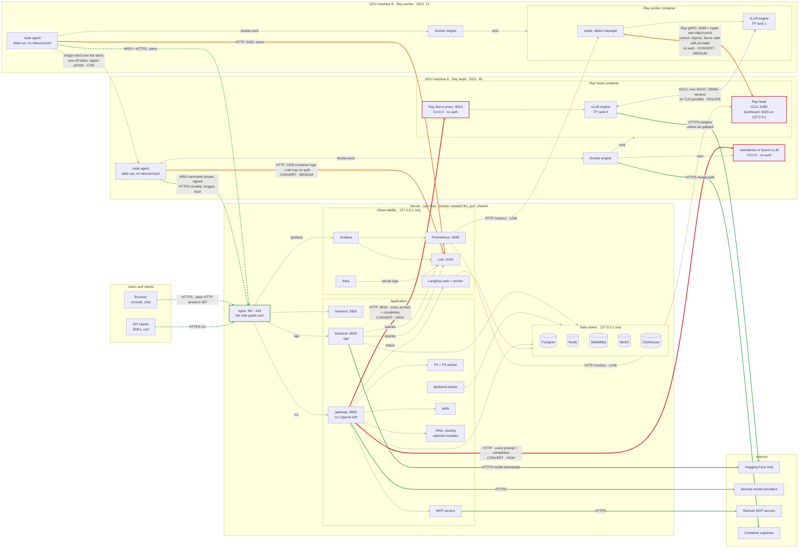

# Connections and TLS

Every connection between the parts of a Fadenstack install -- browsers, the
server's containers, the GPU machines, Ray, vLLM, the internet -- and whether it
is encrypted today. Drawn for the release VM and the DGX Spark pair: one server
host, one Ray head, one Ray worker. Read from the code on branch `ray` at
`246b581`, 27 September 2026.

How TLS works where it is used -- the install CA, the machines following the
server to HTTPS, renewal, signed commands -- is in
[HTTPS and trust](https-and-trust.md).

- [The map](#the-map)
- [What should move to TLS](#what-should-move-to-tls)
- [Encrypted today](#encrypted-today)
- [Plain, never leaves the host](#plain-never-leaves-the-host)

## The map

| Line | Meaning |
|---|---|
| Green, solid | TLS, always: calls out to the internet. |
| Green, dashed | TLS once HTTPS is on: into nginx. A new install starts on plain HTTP. |
| Red, thick | Plain across the network, **convert first**: prompts and completions, to unauthenticated endpoints. |
| Orange | Plain across the network, **convert next**: logs and Ray cluster traffic. |
| Amber, dashed | Plain across the network, low value: metrics, or content already checked by digest. |
| Purple, dotted | Cannot be TLS: keep the network isolated. GPU-to-GPU tensor traffic over RDMA. |
| Grey, thin | Plain, never leaves the host: the Docker network or a local socket. |

A red outline marks a listener on the machines' network with no authentication
of its own; the green outline, the one port the server publishes. The machines
open no port for control: their agents dial out to nginx.

## What should move to TLS

| Priority | Connection | What crosses it | Today | Recommended |
|---|---|---|---|---|
| High | Gateway → Ray Serve proxy `:8010` on the head, and → standalone or found vLLM | Every prompt and every completion | Plain HTTP over the machines' LAN. Both listen on `0.0.0.0` with no authentication: anyone on that network can use the models directly, past API keys, PII redaction, limits and usage attribution. | A TLS listener on each machine, run by the agent, with a certificate from the install CA and **mutual TLS**: the gateway presents a client certificate. That closes eavesdropping and the missing authentication in one step, the same way for Serve, standalone and found vLLM. Until then, bind to the management address and firewall the port to the server. |
| High | Browsers, API clients and agents → nginx | Sign-ins, API keys, prompts, machine credentials | TLS only after HTTPS is switched on; a new install runs plain HTTP. | Make `--tls generate` the default of `llmport deploy`. Everything else is already built. |
| Medium | Agents → Loki `:3100` | Container logs; vLLM can log request text | Plain HTTP, and Loki has no authentication. Only happens when `LOKI_BIND` publishes Loki. | Push through nginx on a path authenticated by the machine credential. It inherits HTTPS, and Loki stays on 127.0.0.1. |
| Medium | Ray between machines: GCS `:6390`, raylet, object manager, worker ports | Cluster control, objects, and Serve's calls into replicas on the other machine, prompts included | Plain gRPC. Ray has no authentication: anyone who reaches the GCS can run code on the cluster. | Keep it on the isolated fabric (today a direct RoCE link). Then `RAY_USE_TLS=1` with per-machine certificates from the install CA, delivered by the agent the way it already delivers the trust bundle. Measure the cost on object transfers first. |
| Low | Prometheus → Ray metrics on each machine | Numbers | Plain HTTP pull over the LAN. | Later: scrape through the agent, or TLS with the same machine certificate. |
| Low | Runtime image copy between machines (image seed) | A public runtime image | Plain HTTP on the fabric; one-off token; the copy is checked against the pinned digest. | Nothing needed: integrity is already covered and the content is not secret. |
| Isolate | NCCL / RDMA between GPUs, and the fabric check | Tensors, test traffic | Plain over RoCE. | TLS is not possible at this bandwidth. Keep the fabric physically separate: a direct cable or its own VLAN. |
| Fine | Containers on the server, containers on a machine | Everything | Plain on the Docker bridge or a local socket; never leaves the host. | Fine while they share the host. A Postgres, Redis or MinIO moved to another host needs TLS (`sslmode=verify-full`, `rediss://`, HTTPS). |

## Encrypted today

- Browser and API clients to nginx, once HTTPS is on (plain HTTP answers 307)
- Agents to the server: command stream (WSS), enrollment, credential rotation, model and image downloads, trust refresh
- Every command to a machine is HMAC-signed, TLS or not (agents 0.1.15+)
- Backend to Hugging Face; gateway to remote providers; MCP to remote MCP servers; Docker to registries

## Plain, never leaves the host

- nginx to frontend, backend, gateway, Grafana
- Services to Postgres, Redis, RabbitMQ, MinIO, ClickHouse
- Prometheus, Loki, Grafana, Alloy, Langfuse on the server
- Agent to Docker; Serve proxy to its local replica
- Ray dashboard `:8265`, bound to 127.0.0.1
