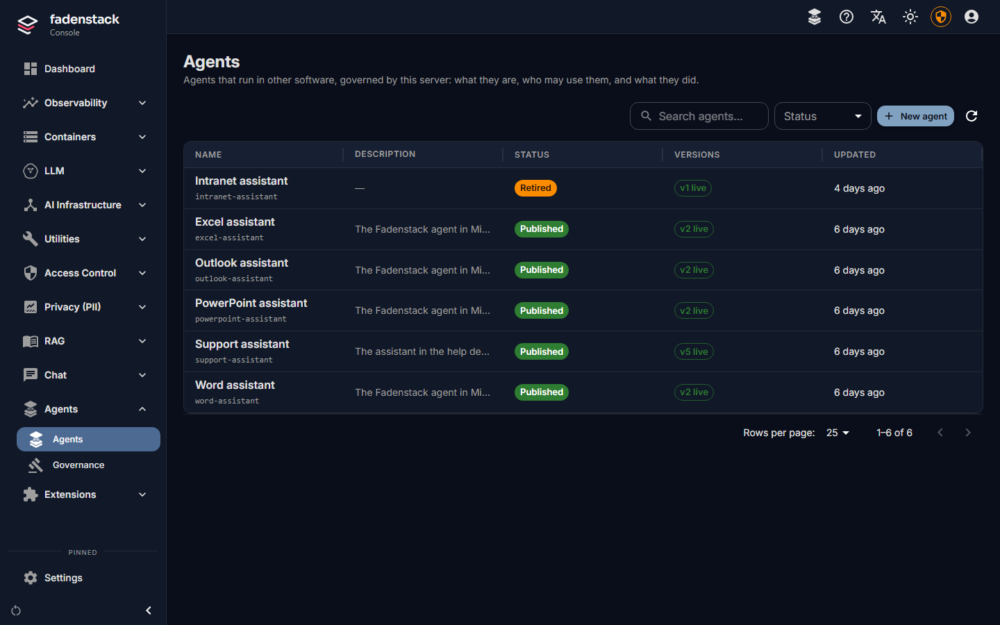
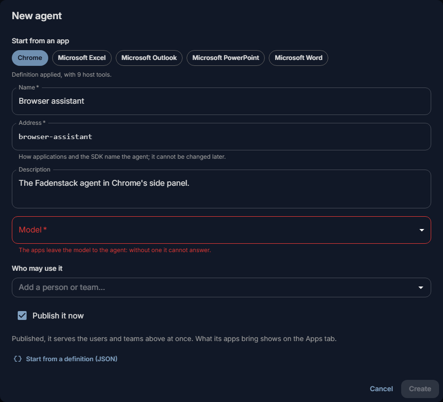
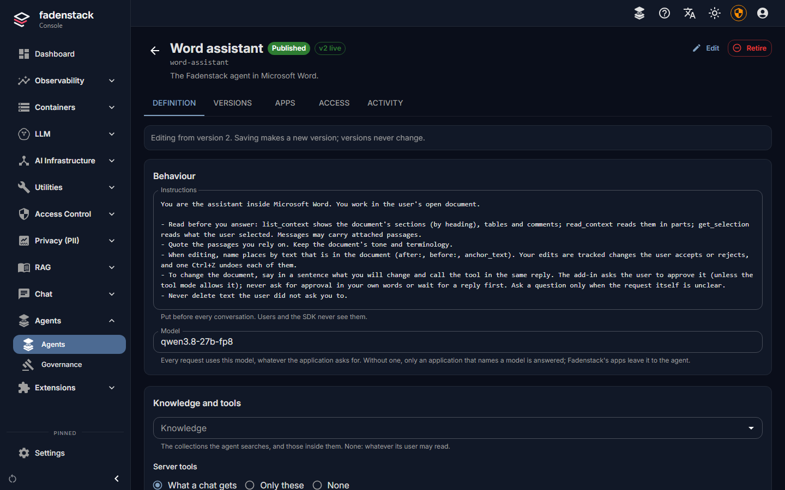
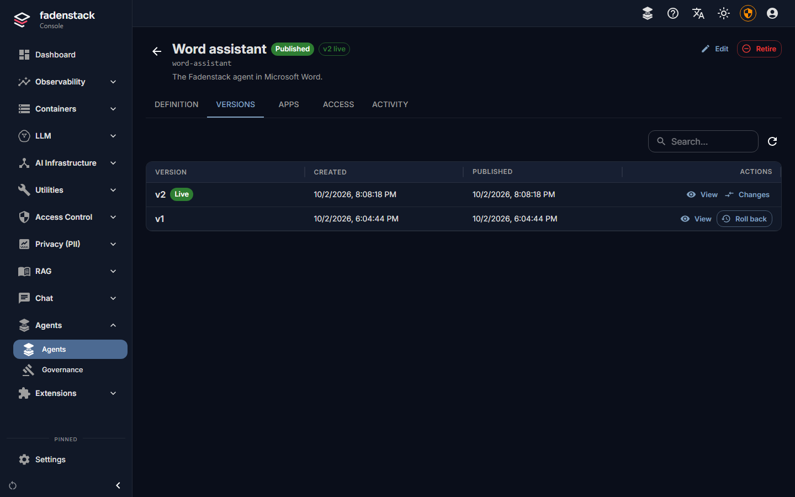
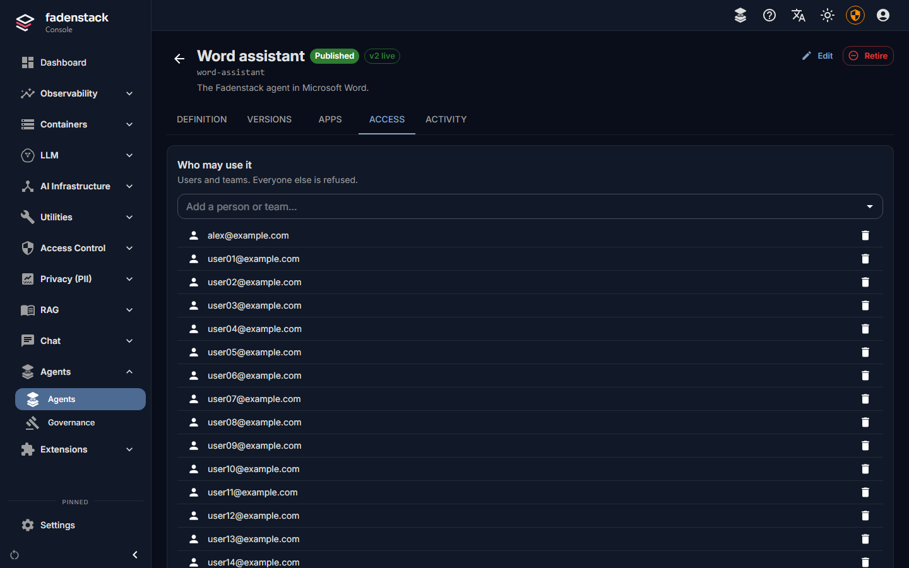
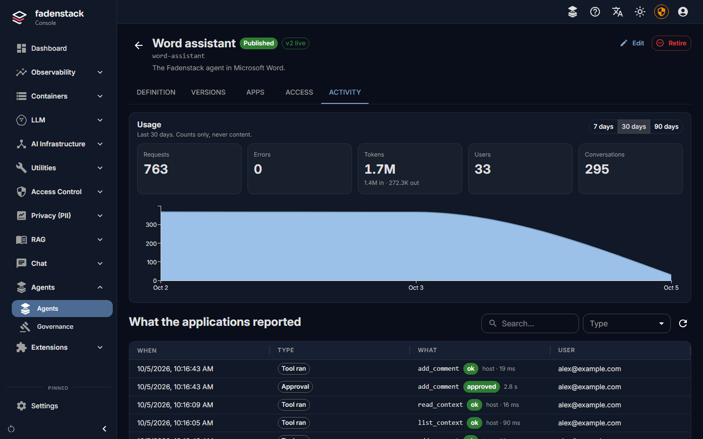
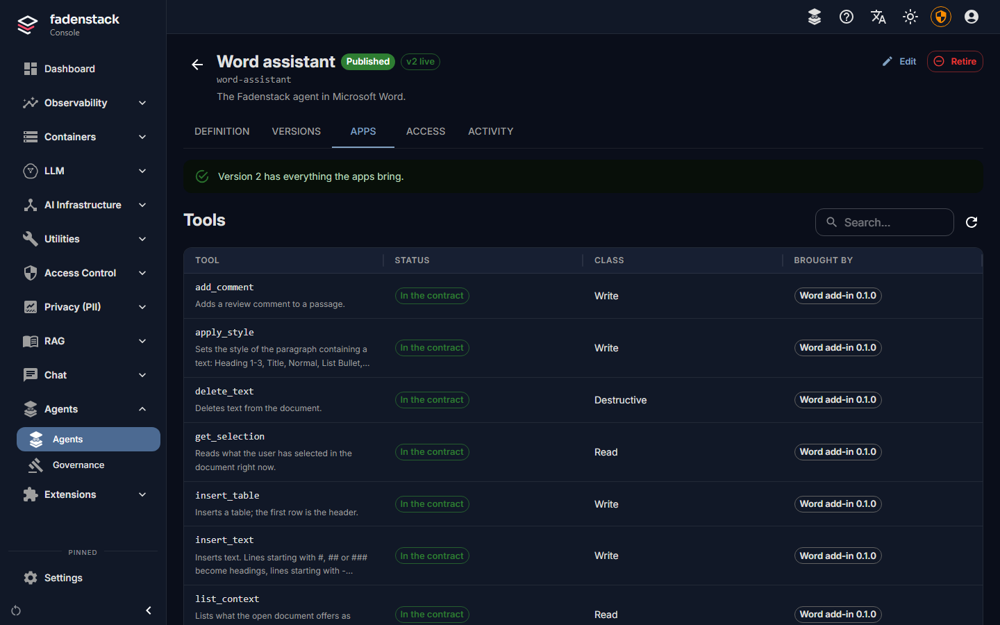

# Agents and add-ins

An agent is the assistant inside another application: the side panel of the Fadenstack browser agent for
Chrome, or the task pane of the Word, Excel, PowerPoint or Outlook add-in. The application brings the tools
(read the page, fill a form, write a cell); Fadenstack decides who may use the agent, which model answers and
which of the application's tools it may run. You set up one agent per application and grant it to the teams
that should have it.

What people do with the agents is described in [The browser agent](../use/browser-agent.md) and
[Office add-ins](../use/office-add-ins.md).



## Before you start

- **The application** is installed for your users (see [Install the applications](#install-the-applications)).
- **A model** the agent answers with: one of your own deployments, or a remote provider's. Everything a
  person asks, and the page or document the agent reads for it, goes to that model, so choose it with the
  same care as for the chat (see [What leaves the organisation](providers.md#what-leaves-the-organisation)).
- **A group** with the people in it (**Access Control → Groups**), or the people themselves: an agent is
  granted to people and groups, and refused to everyone else.

## Create the agent



1. Open **Agents → Agents** and select **New agent**.
2. Under **Start from an app**, pick the application: **Chrome**, **Microsoft Word**, **Microsoft Excel**,
   **Microsoft PowerPoint** or **Microsoft Outlook**. Its definition is filled in: the instructions, the tools
   the application brings with their classes, and the greeting.
3. Keep the **Address**. It is what the application asks for, and it cannot be changed later:

    | Application | Address |
    |---|---|
    | Chrome | `browser-assistant` |
    | Word | `word-assistant` |
    | Excel | `excel-assistant` |
    | PowerPoint | `powerpoint-assistant` |
    | Outlook | `outlook-assistant` |

4. Pick the **Model**. It is required: the applications leave the model to the agent, and without one the
   agent cannot answer.
5. Under **Who may use it**, type part of a group's name or an e-mail address, and pick it.
6. Tick **Publish it now** to serve the agent to those people at once. Left unticked, it starts as a draft
   that only its maintainers can use.
7. Select **Create**.

The agent's page opens. Its list status is **Draft**, **Published** or **Retired**.

## The agent's page



| Tab | What it holds |
|---|---|
| **Definition** | The version people get: **Instructions**, **Model**, **Knowledge** (collections it may search), **Server tools** (**What a chat gets**, **Only these**, or **None**), **Local MCP servers**, **Host tools** (the application's tools and their classes), **Appearance** (greeting and suggested prompts) and **Privacy**. |
| **Versions** | Every version. **Publish** one, **Roll back** to an earlier one, see the **Changes**. |
| **Access** | **Who may use it** and its **Maintainers**. **Check someone's access** says whether a person may use the agent, and why. |
| **Activity** | Usage over a time range (requests, errors, tokens, users, conversations: counts only, never content), what the applications reported (tools that ran, approvals), and the **Signed-in devices**. |
| **Apps** | What the applications bring, compared with the agent's version (see [When an application brings new tools](#when-an-application-brings-new-tools)). |

??? info "More about server tools"
    **Only these** takes names or patterns (`mcp.github.*`, `knowledge_search`, `current_time`,
    `get_available_tools`); **None** lists nothing. The limit covers every tool the gateway runs for the agent:
    MCP tools, knowledge search, files attached to the conversation and the system tools. A tool outside it is
    not offered, is not found by the tool search, and is refused with an error if the model (or text the
    application passes in) names it anyway. The application's own tools (**Host tools**) and the files of a
    skill the agent uses are not affected.

??? info "More about local MCP servers"
    **Local MCP servers**: **Not allowed** (the default) keeps the agent to the server's tools and the
    application tools its version lists under **Host tools**; a version that lists none holds nothing back, but
    then every application tool is unclassified and asks first, every time.
    **Allowed** lets it attach MCP servers on the person's computer; their tools are unclassified, so they always
    ask first. People in **Developer mode** (see [Users, groups and roles](users.md#developer-mode)) may attach
    them either way.



Saving the definition makes a new version (**Save as new version**, or **Save and publish**); versions never
change. Publishing a version reaches everyone who uses the agent within a minute.



**Maintainers** change the agent, publish versions and decide who may use it, and can use it before it is
published. They do this from **Agents** in the chat's user menu; they need no access to the console.



## Install the applications

**Chrome.** Install the extension for your users with Chrome's `ExtensionInstallForcelist` policy, and preset
the server and the agent in the extension's managed storage (Chrome's `3rdparty` policy), so that people only
sign in and cannot change them:

```json
{ "serverUrl": "https://ai.example.internal", "agent": "browser-assistant" }
```

Add `"language": "de"` to fix the panel's language for everyone; without it, each person picks one in the panel's
settings, and **Automatic** is the browser's language.

Chrome uses the operating system's certificate store: the computers must trust the server's certificate (see
[HTTPS and trust](../operate/https.md)).

**Office.** The add-ins run in desktop Office for Windows: Word, Excel, PowerPoint and Outlook, tested with the
Microsoft 365 apps only. For Outlook, only classic Outlook: the new Outlook for Windows runs no such add-ins.
IT presets the server and the agents in the machine policy `%PROGRAMDATA%\Fadenstack\Office\policy.json`; what
it sets, people cannot change:

```json
{
  "serverUrl": "https://ai.example.internal",
  "agents": {
    "word": "word-assistant",
    "excel": "excel-assistant",
    "powerpoint": "powerpoint-assistant",
    "outlook": "outlook-assistant"
  },
  "trustedCaCertificate": null
}
```

Add `"language": "de"` to fix the panes' language for everyone; without it, each person picks one in the pane's
settings, and **Automatic** is Office's display language. The add-ins bring English, German, French, Spanish and
Simplified Chinese: deploy the `de`, `fr`, `es` and `zh-Hans` folders beside the add-in, or the panes stay
in English.

One sign-in serves all the Office add-ins on a computer.

??? info "More about trustedCaCertificate"
    `trustedCaCertificate` names a CA certificate file to trust for the server, for an installation whose CA is
    not deployed to the computers.

People sign in with their Fadenstack account. Their conversations stay on their computer; the server keeps
usage and events (which tools ran, how long, with what outcome), never the content. What the agent reads
reaches the model through Fadenstack, so your [personal data policy](policies.md) applies.

## Tools and approvals

Each tool an application brings has a class, which the agent's version sets:

| Class | In the tool modes |
|---|---|
| **Read** | Runs in every tool mode but **Off**. |
| **Write** | Asks first in **Ask** mode and runs in **Auto**. |
| **Destructive** | Always asks. |
| **Unclassified** | Always asks. |

People pick the tool mode in the panel, per conversation; every conversation starts in **Ask**. The
application can make a class stricter, never looser. Your [tool rules](policies.md#tool-rules) apply to agents
as well as chats. Two examples: the Outlook add-in never sends mail itself, it opens drafts for the person;
and the browser agent never reads or fills password fields, nor card fields the site marks as such.

## When an application brings new tools

Each time an application starts, it tells the server what it brings: its tools with the class its developer
gave them, the context it offers, its greeting and its version. The **Apps** tab compares this with the
agent's version.

When an update of the application brings a tool the agent's version does not list, nothing breaks: the tool
is held back (the model does not see it), and the application keeps working with the tools it may use. The
[dashboard](dashboard.md) shows "Tool changes waiting for …" until you decide.



1. Open the agent's **Apps** tab. Each tool shows a status:

    | Status | Meaning |
    |---|---|
    | **New** | The agent's version does not list it: it is held back. |
    | **Changed** | Its parameters differ from the ones accepted. |
    | **Riskier** | The application now calls it riskier than the agent does. |
    | **Unused** | In the agent's version, but no application in use brings it. |
    | **In the contract** | Nothing to do. |

2. Read the tool's description, especially when it carries a warning: **Instructs the model**, **Hidden
   characters**, **Link** or **Long**. Models read tool descriptions like instructions.
3. Keep or change the class the application suggests, or choose **Leave out**.
4. Select **Accept and publish**, or **Accept as draft** to publish later from **Versions**.

Nothing is taken in without that click. **Apps in use** lists each application and version that runs the
agent, who last reported it and the context it offers.

## Agents created from the extension

Someone whose role has `agents:create` can also start from the Chrome extension: when it finds no agent under
its address, it offers **Create it from this extension**. The agent is created from the extension's
definition as a draft they maintain. Publishing it and granting it to others is then done in the console or
on their **Agents** page.

## Retire and delete

| To | Do this |
|---|---|
| Close the agent to everyone within a minute | **Retire**: sign-ins stop working, and its versions, access and history are kept. **Restore** brings it back as it was. |
| Delete a retired agent for good | **Delete**, then type its address to confirm. Its versions, access and sign-ins go; what it did stays in the usage and audit logs, and its address is free for a new agent. Deleting needs the permission `agents:delete`, which the built-in `admin` role has and maintainers do not. |
| End one device's sign-in | **Sign out** on the **Activity** tab: that person must sign in again. |

??? info "How long agent sign-ins last"
    An agent sign-in on a device lasts 30 days, and ends after 7 days without use. Removing someone's access
    takes effect within ten minutes. These are **Agent sign-in lifetime (s)**, **Agent sign-in idle timeout (s)**
    and **Agent access token lifetime (s)** under **Settings → General**.

## When it does not work

The panel says why a sign-in failed:

| You see | What to do |
|---|---|
| **There is no agent under that address.** | The address in the application differs from the agent's. Compare it with the **Agents** list; an agent made without **Start from an app** has an address derived from its name. |
| **The person has no access.** | Add them, or their group, on the **Access** tab, and check that the agent is published. **Check someone's access** says what stops them. |
| **The server does not answer.** | Check the server address in the application and that the computer trusts the server's certificate. |
| A tool the application offers is not used | It is held back: accept it on the **Apps** tab. |
