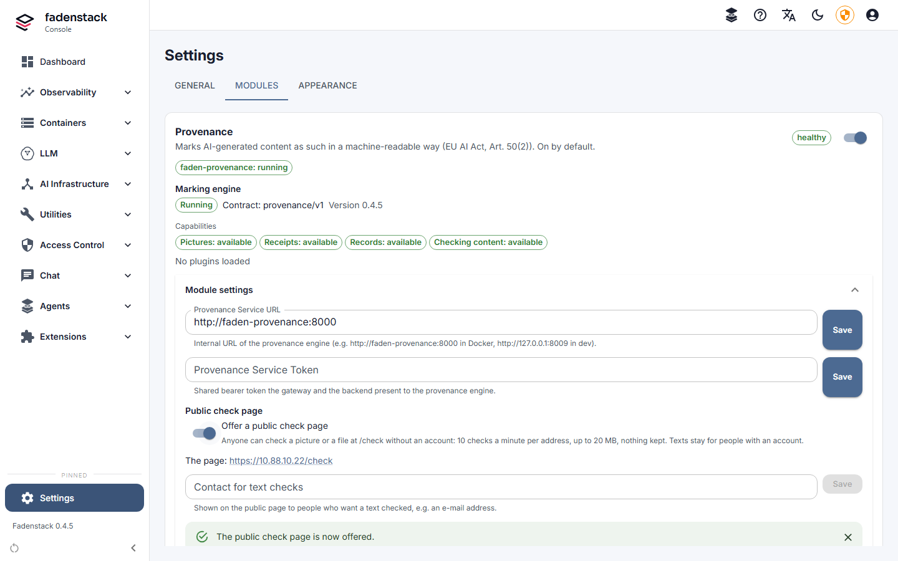

# Content marking

The EU AI Act (Art. 50(2)) asks providers of AI systems that generate text, pictures, audio or video to mark
what they generate in a machine-readable way, so that it can be detected as AI-generated. The **Provenance**
module does that for what your installation's models produce, and lets people check content for those marks.
It is on from the start and needs no setup.

How people check a text, a picture or a file is on [Checking content](../use/checking-content.md).

## What is marked

| Content | What it gets |
|---|---|
| Pictures that image models return | An invisible watermark, picture metadata and signed content credentials (see [Pictures](#pictures)) |
| Every complete text answer, of every model | A signed receipt (see [Text answers](#text-answers)) |
| Text answers of your own models | Also an invisible text watermark, on a runtime that has it |
| What the agents write into documents, mails, web forms and files | A mark there, and a signed record of each placement (see [What the agents write](#what-the-agents-write)) |

!!! tip "Ask people to keep the marks"
    The marks are only useful while they stay in place. Tell the people who use generated content not to remove
    them: not to strip a picture's metadata or content credentials, and not to edit a text just to get rid of its
    watermark. The EU's Code of Practice on marking asks providers to say this.

## Pictures

Every picture that an image model returns through Fadenstack is marked before it leaves:

- an **invisible watermark** (TrustMark) in the pixels, which survives re-encoding and screenshots in most cases;
- **picture metadata** (IPTC) that names it "trained algorithmic media";
- **content credentials** (a C2PA manifest), signed with a certificate from your installation's own certificate
  authority.

!!! note "No unmarked picture leaves"
    If the marking engine cannot mark a picture, the picture is not delivered: the request fails with 503
    `provenance_unavailable` and "The picture could not be marked as AI-generated, so it was not returned."
    Text answers are not held back: while the engine is down, they go out without a receipt.

## Text answers

**The receipt.** Every complete answer gets a signed receipt: a record that a model of this installation
produced a text with this hash. The marking engine never stores the text, only a keyed hash of it. Checking a
text later finds its receipt, even when line breaks and spacing were changed, but not once it is reworded.

**The text watermark.** Answers of your own models also carry an invisible watermark: a pattern in the model's
choice of words, keyed with your installation's secret watermark key. It can be found in texts of roughly 200
words or more, and it weakens when the text is heavily edited, translated or paraphrased. A text that mostly
restates what the model was given (a summary of a mail, a rewrite of a paragraph, names and figures taken from a
document) carries little of it, as the model has few words of its own to choose: such a text is found by its
receipt, and what the agents write also by the record they keep with it.

These answers carry no text watermark, and their receipt records which of these applies:

- short answers, under 200 tokens;
- answers asked for with temperature 0 (greedy decoding: the model always takes its most likely word);
- answers of a model on a runtime without the watermark (see [The runtime decides](#the-runtime-decides));
- answers of remote providers. Anthropic marks its own models' answers; the receipt says so;
- answers of a deployment for which a superuser switched the watermark off.

!!! note "The same question, a new answer"
    With the text watermark, the model's choice of words is keyed, so exactly the same request would get exactly
    the same answer. Fadenstack therefore varies each request to a watermarking model invisibly: trying again
    gives a new answer, as it does without the watermark, and a request with a `seed` gets the same answer
    for the same seed. Several answers to one request (`n`) come only without streaming.

## The runtime decides

Whether a chat model watermarks its answers depends on its cluster's runtime. On a cluster's **Runtime** card, a
runtime with vLLM 0.30 or later has the watermark; for GB10 machines that is the runtime with vLLM 0.31, while
the one with vLLM 0.29 has none.

- A model picks up the watermark the next time it starts. Switching a cluster's runtime restarts the cluster and
  its models (see [Clusters](../operate/clusters.md#runtime)).
- Models with speculative decoding (MTP, EAGLE) carry it too; Fadenstack sets that up by itself. We recommend MTP
  for models that have it: answers come about 70 % faster. The watermark is found in fewer of their answers (about
  half of the long ones in our measurement), as the drafts the model accepts carry little of it; receipts and the
  agents' records are the same as without MTP.
- A superuser can switch the watermark off for one deployment with the engine setting `watermark_config: false`
  (see [Engine settings](deployments.md#engine-settings)). The receipts of its answers then say that they carry
  none.

## What the agents write

The Office add-ins, the Chrome extension and the Nextcloud app mark what they write into documents, mails, web
forms and files, each in the way its host allows: in document properties or custom XML, in mail headers, in
HTML attributes, in file metadata, or in the front matter of a Markdown file. The installation keeps the signed
record of each placement.

## Who can check content

Everyone signed in can check content, from the chat's avatar menu (**Check content**); you also find it in the
console under **Utilities → Check content**. It needs the permission `provenance:check`, which every built-in
role has. Give it to [roles of your own](users.md#roles-of-your-own) whose people should check too.

## The public check page

People without an account can check pictures and files too, once you offer the public check page. It is off
until you switch it on.

1. Open **Settings → Modules** and, on the **Provenance** card, open **Module settings**.
2. Under **Public check page**, switch on **Offer a public check page**. The card shows the page's address, for
   example `https://ai.example.internal/check`.
3. Enter the **Contact for text checks**, for example `alex@example.com`, and select **Save**.

The page checks pictures and files up to 20 MB, 10 checks a minute per address, and keeps nothing. Texts are
refused there, and the page names your contact instead: texts are checked only for people with an account (the
AI Act's code of practice allows limiting who can check for text watermarks). With the page on, the
certificates needed to check a signed result offline are published too.

## Switch it off, or on again

1. Open **Settings → Modules**.
2. On the **Provenance** card, select **Stop**.
3. Read what stops being marked, tick **I understand that generated content will no longer be marked as
   AI-generated.** and select **Switch off**.

It is recorded in the audit log with your name and the time. **Start** on the same card switches it on again.

On the server, `faden module disable provenance` does the same: it explains what stops being marked, asks to
confirm and records who switched it off and when; `faden up` then applies it, and
`faden module enable provenance` switches it on again. Upgrades keep the module as it was, on or off.

??? info "What stops while it is off"
    Pictures leave unmarked, answers get no receipt, models that start from then on start without the text
    watermark, and **Check content** disappears from the chat and the console. What was recorded before is kept.

## Records

Receipts, the records of placements and the agents' reports about them hold hashes and ids, never the content.
They are kept as long as they are needed. Every backup includes them, with the provenance database and
its keys, and a restore or an upgrade keeps them (see [Backups](../operate/backups.md)).

## Keys

The keys live on the server, in `.env`, and the `faden` command manages them:

| Key | What it is for | How it changes |
|---|---|---|
| The signing key and its certificate | Sign the content credentials, the receipts, the records and the signed results of checks | `faden up` and `faden upgrade` issue a new one when fewer than 30 days are left; `faden secrets rotate` gives a new one at any time |
| The hash keys | Key the hashes that receipts and records hold | Kept in versions |
| The text watermark keys | Key the text watermark | Kept in versions |

Rotating a versioned key adds a version, and every older one stays, so content marked earlier can still be
checked. A running model keeps its watermark key until it next starts. `faden secrets rotate --only provenance`
rotates these keys alone; how a rotation runs is on [Rotating the keys](../operate/rotating-keys.md).

## When it does not work

| You see | What to do |
|---|---|
| A picture request fails with 503 `provenance_unavailable` | The marking engine could not mark the picture. Look at **Marking engine** on the **Provenance** card under **Settings → Modules**. Whoever runs the server checks `faden status` and `faden logs faden-provenance`. |
| **Marking engine** says **Not running** | Content cannot be marked while the engine is not running. Whoever runs the server starts it again (`faden up`). |
| **The engine refused the service token** | The backend and the engine must use the same service token. Tell whoever runs the server. |
| **Content cannot be checked yet: the marking engine has no keys set up.** | The keys are missing in `.env`. `faden up` makes what is missing. |
| A model's answers carry no text watermark | Go through the list under [Text answers](#text-answers): the runtime, whether the model has restarted since, the length of the answers, the temperature, and whether they restate a given text. |
