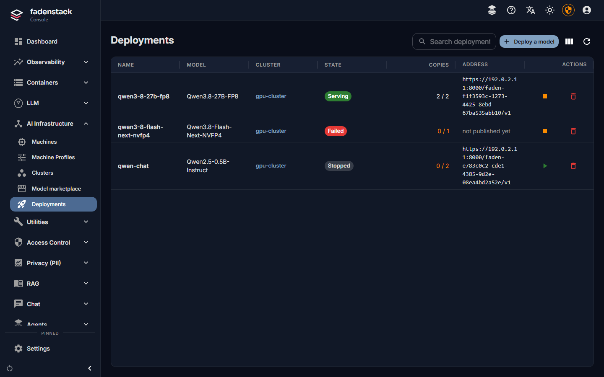
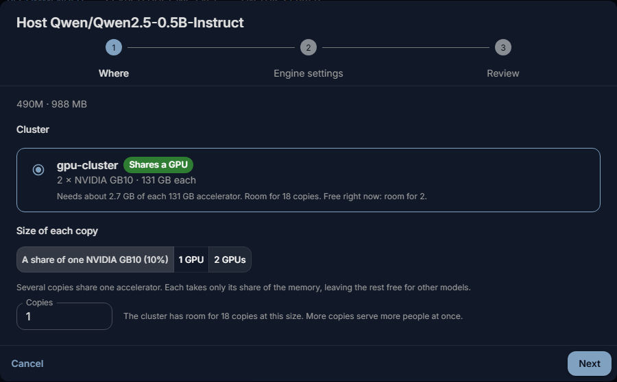
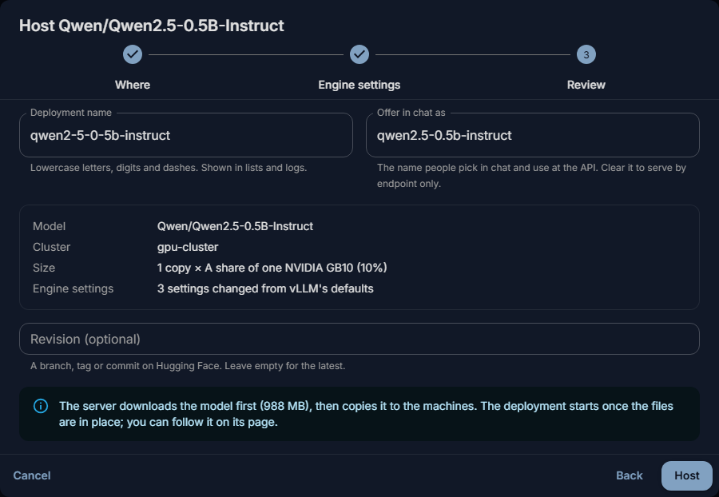
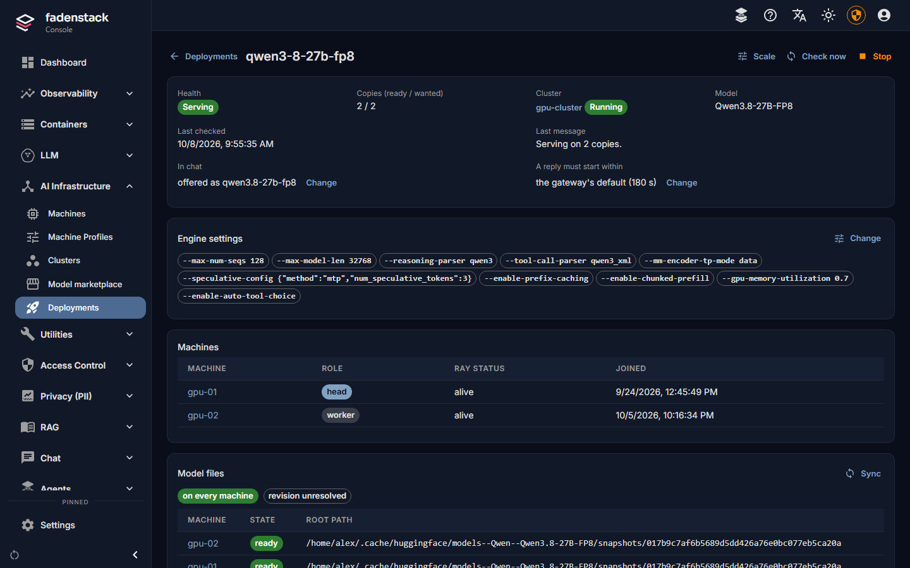
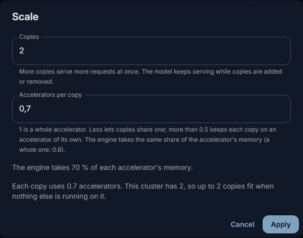
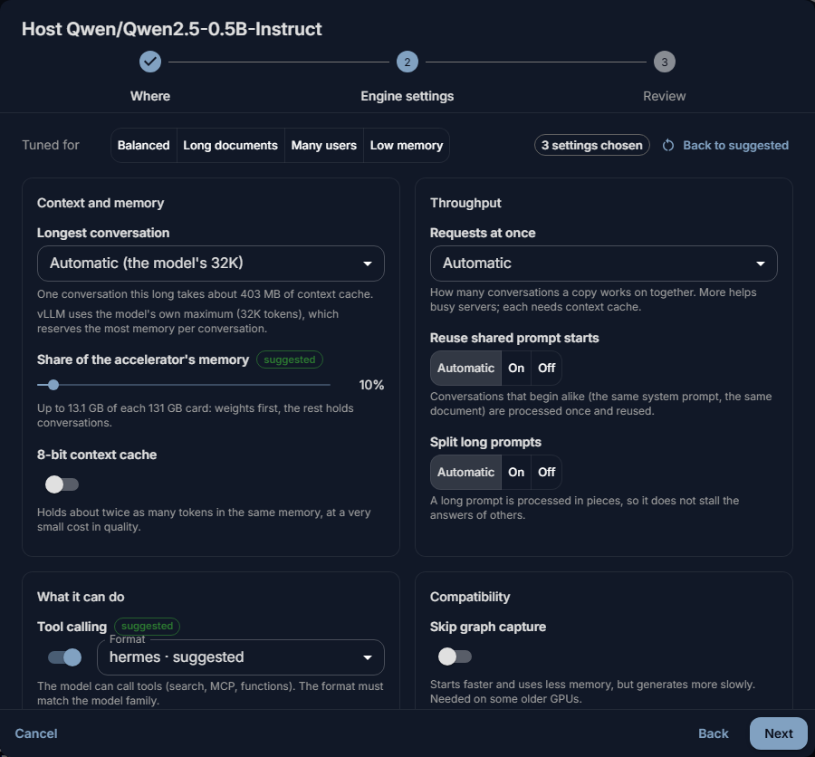

# Deployments

A deployment is one model running on one of your clusters, in one or more copies. This page covers hosting a
model, reading its page, changing how many copies run and how the engine runs them, and what its states and
messages mean.

## Before you start

- A cluster that is running (see [Clusters](../operate/clusters.md)).
- A model: from the [model marketplace](models.md), or one this server already keeps.

## Host a model

Start from any of these; they open the same dialog:

- **Host** on a model's card in **AI Infrastructure → Model marketplace**;
- **Deploy a model** on a cluster's page;
- **Deploy a model** under **AI Infrastructure → Deployments** (the dialog then starts with a **Model** step:
  pick one of the models this server keeps).

Then:

1. **Where.** Pick the **Cluster**, the **Size of each copy** and how many **Copies** run. Select **Next**.

    ??? info "More about the size of a copy"
        The size is a share of one accelerator, one accelerator, or several (the copy is then split across
        them). The fit check picks a size and says how many copies the cluster has room for.

2. **Engine settings.** The suggested settings suit most uses (see [Engine settings](#engine-settings)).
   Change the longest conversation here if people need longer ones. Select **Next**.

    

3. **Review.** Check the **Deployment name** and **Offer in chat as**. Select **Host**.

    ??? info "More about the names and the revision"
        The **Deployment name** takes lowercase letters, digits and dashes, and is shown in lists and logs.
        **Offer in chat as** is the name people pick in the chat and use at the API. **Revision (optional)**
        pins a branch, tag or commit on Hugging Face.

The server downloads the model if it does not have it yet, copies it to the machines and starts the copies.
Nothing waits in the dialog: **Deployments** and the deployment's page show how far it got. If not every copy
fits in the memory free right now, the dialog says so; the rest start when other models make room.

## The deployment's page

Open **AI Infrastructure → Deployments** and select a deployment. The page shows:

| Part | What it shows |
|---|---|
| **Health** | The deployment's state (see [States](#states)), and **Copies (ready / wanted)**. |
| **Cluster**, **Model** | The cluster it runs on, and the model. |
| **Last checked**, **Last message** | What the deployment last reported, in words. **Check now** looks at it at once instead of at the next regular check. |
| **In chat** | The name it is offered under, or "not offered: endpoint only". |
| **A reply must start within** | The reply wait (see [Reply wait](#reply-wait)). |
| **Engine settings** | What was changed from the engine's defaults. |
| **Machines** | The cluster's machines and their state. Which machine runs which copy is not reported. |
| **Model files** | Whether the model is on every machine, or on how many, and a **Sync** button. |
| **Endpoints** | The address the model answers on, once the first copy serves. |
| **Requests**, **Generation speed**, **Time to first token**, **Request latency**, **Failed** | Figures measured at the gateway over the last minutes; further down, the figures **Reported by the engine**. |
| **Logs** | One log from every machine of the cluster, with two streams: **Model serving** (copies starting, getting ready, stopping) and **Engine (vLLM)** (what the engine printed, including why a start failed). Filter by level, stream and machine, or search; copy or download the lines the filters show. |

## Offer it in the chat

A deployment is offered in the chat only under a name someone chose. The hosting dialog proposes one. To set
or change it:

1. On the deployment's page, select **Offer in chat** (or **Change** beside **In chat**).
2. Enter the name under **Offer in chat as**, or clear it to serve the model only at its endpoint.
3. Select **Save**.

The model keeps running; only its name changes. It appears in the chat within a minute or two. Deployments
that share a name share the traffic: each request goes to one of them that is healthy.

## Reply wait

The reply wait is how long a request waits for its reply to start. After it, the request fails and the person
can try it again. It is 180 seconds unless you change it:

1. Select **Change** beside **A reply must start within**.
2. Enter 10 to 1800 seconds, or leave it empty for the gateway's default.
3. Select **Save**.

The model keeps running while this changes.

??? info "Why replies time out"
    A busy model keeps new requests in its queue until it has room, and sends nothing meanwhile. If replies
    time out often, the model needs more room rather than more patience: more copies, or more memory per copy.

## Scale it

1. Select **Scale** on the deployment's page.
2. Set **Copies**: how many copies run. More copies serve more requests at once.
3. Set **Accelerators per copy**, for a model that runs on one accelerator.
4. Select **Apply**.

??? info "More about accelerators per copy"
    1 is a whole accelerator. Less lets copies share one; more than 0.5 keeps each copy on an accelerator of
    its own. The engine takes the same share of the accelerator's memory (a whole one: 80 %), and the dialog
    shows how much that is.

| You change | What happens |
|---|---|
| The number of copies | The copies that run keep serving. New copies start beside them; surplus copies finish their requests and stop. The deployment stays **Serving**, and **Last message** says what is left, for example "Serving on 1 of 2 copies; 1 more starting." |
| **Accelerators per copy** | Every copy restarts with its new share. The model is unavailable until they are back. |

??? info "When you ask for more copies than fit"
    The dialog counts the cluster's accelerators: "Each copy uses 1 accelerator. This cluster has 2, so up to
    2 copies fit when nothing else is running on it." Asked for more, the copies that fit start and serve, and
    the page says why the rest cannot ("… 1 cannot start: each copy needs 1 accelerator, and this cluster has
    2, so 2 fit. Scale to 2, or add a machine to the cluster.").

??? info "A copy also needs memory"
    A copy needs both its share of an accelerator and the accelerator memory its engine asks for. When a
    machine has the share free but another model or program holds the memory, the new copy keeps trying to
    start: **Last message** stays at "Serving on 1 of 2 copies; 1 more starting.", and the **Engine (vLLM)**
    log shows the engine's error about memory. The copies already running keep serving. Scale back down,
    lower the accelerator share or the engine's memory share (both restart every copy), stop another
    deployment on that machine, or add a machine to the cluster.

??? info "When changing the number of copies restarts every copy"
    A deployment set up through the API to scale itself between a lowest and a highest number of copies
    restarts every copy when those bounds change. **Scale** in the console always sets a fixed number.

    A deployment that was started by an earlier Fadenstack release restarts every copy once, the first time
    its number of copies changes after the upgrade. From then on, changing the number keeps the running copies
    serving. This needs recent agents on the cluster's machines and a recent runtime; without them, every
    change restarts every copy.

## Engine settings

The engine (vLLM) runs the model. **Engine settings → Change** on the deployment's page opens the same editor
as the hosting dialog. Values marked *suggested* come from the vLLM project's recipe for the model when there
is one, otherwise from rules for the model's family. Each says why it was suggested.

| Part | Settings |
|---|---|
| **Tuned for** | **Balanced**, **Long documents**, **Many users** or **Low memory**. A preset changes only the settings it is about. |
| **Context and memory** | **Longest conversation** (prompt and answer together), **Share of the accelerator's memory**, **8-bit context cache**. |
| **Throughput** | **Requests at once**, **Reuse shared prompt starts**, **Split long prompts**. |
| **What it can do** | **Tool calling** and its **Format**, **Show its thinking separately**, **Serve embeddings**. Without tool calling the model answers in text only, and the tools offered in the chat (MCP tools, the knowledge base) are not used. |
| **Compatibility** | **Skip graph capture**, **Run the model's own code**. Turn the latter on only for publishers you trust: it runs Python from the model's repository on your machines. |
| **All vLLM settings** | Every setting of the engine version the cluster runs, searchable, and **Other flags, as text** for anything else. Anything that could escape the command is refused. |
| A preview | The settings, shown as vLLM flags. |

??? info "Warnings and the memory share"
    Warnings appear before a setting that will not start: a conversation longer than the model supports or
    than fits in memory, a memory share above 95 %, a tool format with tool calling off, or the model's own
    code.

    The memory share can be lowered below the share of the accelerator set under **Scale**, never raised
    above it; a higher value is capped, and the dialog says so.

!!! warning
    **Save and restart** restarts every copy with the new settings. The model is unavailable until they are
    back up. If a copy does not start, the page says why, and you can change the settings back.

## Stop, start and delete

- **Stop** on the deployment's page takes the copies off the machines and frees their accelerators; a large
  model can take a few minutes. The deployment keeps its settings. **Start** loads it again.
- **Delete** in the row's actions under **Deployments** stops it and removes it from its cluster. The model
  stays on this server under **Model marketplace → On this server**, so it can be hosted again without a
  download.

## States

| State | Meaning |
|---|---|
| **Queued** | Waiting to be applied, for example until its cluster is running. |
| **Copying the model** | The server downloads the model if needed, then copies it to the machines. |
| **Starting** | The copies are starting and loading the model. |
| **Serving** | At least one copy serves requests. |
| **Degraded** | Some copies serve, others failed to start or are unhealthy. The model is still in use. |
| **Stopping**, **Stopped** | Being stopped, or stopped. |
| **Failed** | It did not start. **Last message** and the log say why. |
| **Removed** | Deleted. |

## When it does not work

| You see | What to do |
|---|---|
| **"Start failed: … Not tried again: this error comes back on every attempt."** | The engine stopped with an error that would return on every try, such as weights it cannot load or a setting it rejects. Select **Show the errors** to see the lines in the log. Most often the model does not fit in the accelerator's memory, or it needs a number format the card does not support. Fix the cause (for memory: a shorter **Longest conversation**, or the **8-bit context cache**), then save the change or select **Check now**: it starts over. |
| **"A start failed: … Ray is trying again."** | An error that can pass, such as memory that is not free yet, or a timeout. The cluster keeps trying by itself. |
| **"1 of 2 copies serve; the others failed to start: …"** (**Degraded**) | The model serves on fewer copies than asked for. Read the reason, then scale down, free memory, or fix the setting it names. |
| **"… Ray has not found room for it yet -- another deployment may be using the accelerators it needs."** | Stop or scale down another deployment on the cluster, or add a machine. |
| The deployment waits while the server downloads the model, then shows a download error | For example a gated model without a Hugging Face token, or a misspelt repository. Fix it (see [Models](models.md#gated-models-and-the-hugging-face-token)) and select **Try again** under **Model marketplace → On this server**. The deployment picks the model up once it is there. |
| It serves, but it is not in the chat | It has no chat name: **In chat** says "not offered: endpoint only". Select **Offer in chat**. |
| Replies fail with **"The model did not start its reply within … s; it may be busy."** | The model was busy for longer than the reply wait. Add copies, give each copy more memory, or raise the wait. |

More on failures and logs: [Failures and logs](../operate/failures.md).
