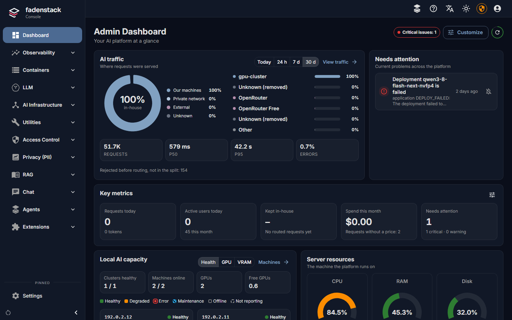

# Administering Fadenstack

As the administrator, you set Fadenstack up for your organisation in the console: you choose which models
people can use and where they run, add the people, connect tools, and set the rules for personal data. This
section walks through each of those tasks.

## Before you start

- Fadenstack is installed, and you can sign in to the console, for example at
  `https://ai.example.internal/admin`. Installing is described in [Installing](../operate/installing.md).
- Your account is a **Superuser**. The console is for superusers only: anyone else who signs in lands in the
  chat. See [Users, groups and roles](users.md).

## Find your way around

The **Help** menu (the question mark in the top bar) has:

| Entry | What it does |
|---|---|
| **Getting started** | A list on the [dashboard](dashboard.md) that takes you from a fresh install to people using it. |
| **Tour of the console** | A minute's look at where things are. |
| **About this page** (or ++f1++) | Explains the page you are on and what you can do there. |
| **How-to guides** | Walk you through a task on the real pages: you do the clicks, the guide shows the way. |
| **About Fadenstack** | The edition, the release this server runs and its licence, with links to the release notes, Help, third-party notices, security and the developers' docs, and **Copy details** for a support request. The release also shows at the bottom of the menu on the left; a click on it opens the same. |

Each step of **Getting started** ticks itself when the server has what it needs, so you can do the steps in
any order. **Show me** starts a guide for the step; **Hide** removes the list from the dashboard. It stays
under **Help**.

??? info "Which how-to guides there are"
    There are guides for adding a machine, creating a cluster, hosting a model, connecting a cloud model,
    adding people and creating an API token.

## First steps, in order

1. **Connect your GPU machines and group them into a cluster.** A machine joins by running one command on it
   and being approved under **AI Infrastructure → Machines**. Then create a cluster under **Clusters**.
   Whoever runs the machines does the command-line part: see [GPU machines](../operate/machines.md) and
   [Clusters](../operate/clusters.md). If you use no machines of your own, skip to step 3.
2. **Offer a model.** Pick one in the [model marketplace](models.md), see whether it fits your cluster, and
   host it. The [deployment](deployments.md) page shows how far it got. Then open the chat and try it, the
   way your colleagues will.
3. **Connect a cloud model**, if you want one next to your own: see [Remote providers](providers.md). Check
   [what leaves the organisation](providers.md#what-leaves-the-organisation) first.
4. **Add the people.** Create their accounts, and give roles and groups where they need more than the chat.
   See [Users, groups and roles](users.md).
5. **Add tools, skills and agents** as you need them: [MCP servers](mcp-servers.md) give chats tools,
   [skills](skills.md) are instructions people reuse, and [agents](agents.md) bring the assistant into
   Chrome and Microsoft Office.
6. **Set the rules.** Decide what personal data is masked before it reaches a model and which tools may run
   without asking: see [Policies and personal data](policies.md).

After that, the [dashboard](dashboard.md) tells you what needs attention, and [Usage and costs](usage.md)
shows how much is used and by whom. [What happens to a request](requests.md) explains, in plain terms, what
Fadenstack does with each message people send.

## Modules

Some parts of Fadenstack are optional modules: **PII / Privacy**, **MCP** and **Skills**. Whoever runs the
server adds them to the installation (see [Installing](../operate/installing.md#optional-modules)). Once
added, they can be switched on and off under **Settings → Modules**; switching one off stops it, and requests
running through it are interrupted. Their pages, and their steps in **Getting started**, appear only while
the module is on.

**Provenance** is on from the start: it marks generated content as AI-generated, as the EU AI Act requires
(Art. 50(2)). Switching it off explains what stops being marked, asks you to confirm, and is recorded in the
audit log with your name and the time. What it marks, and the public check page, are on
[Content marking](content-marking.md).
