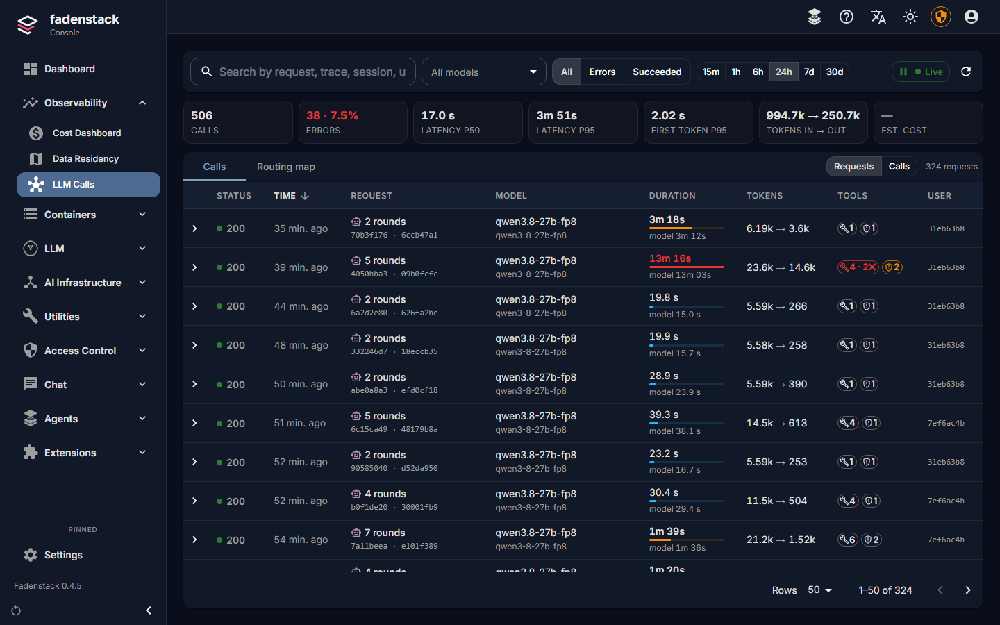
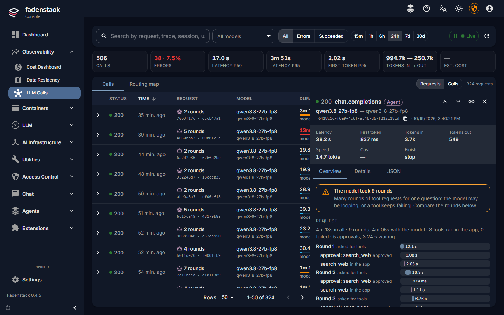
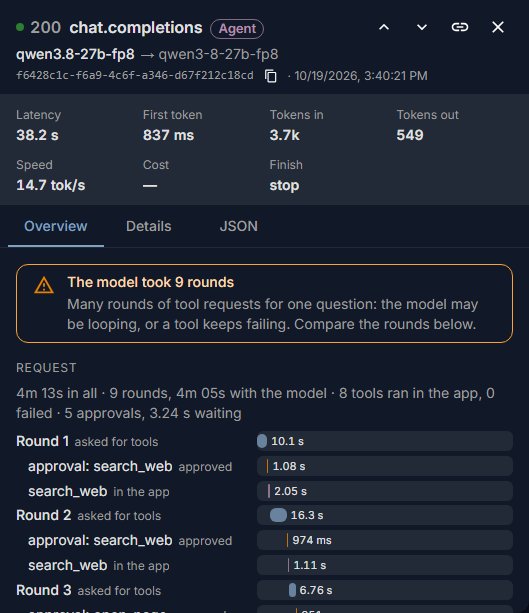
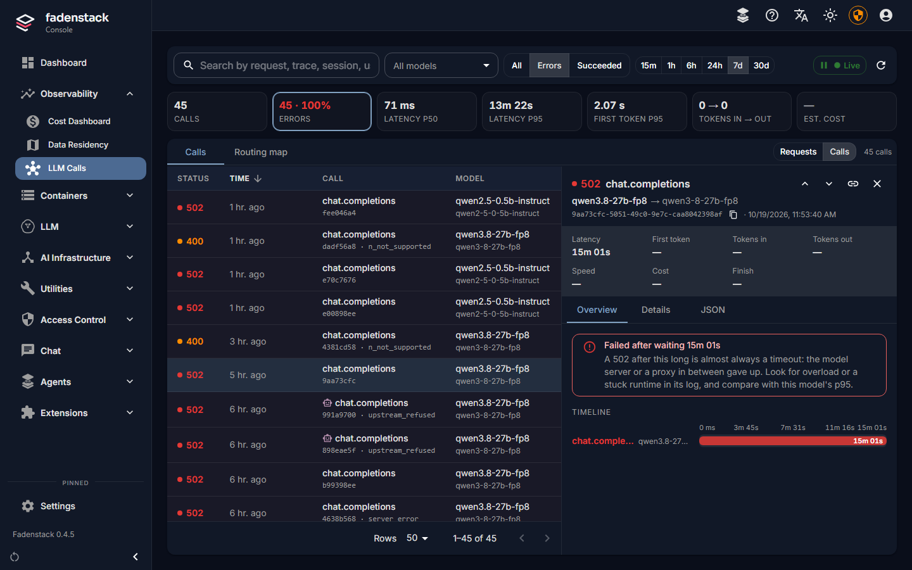
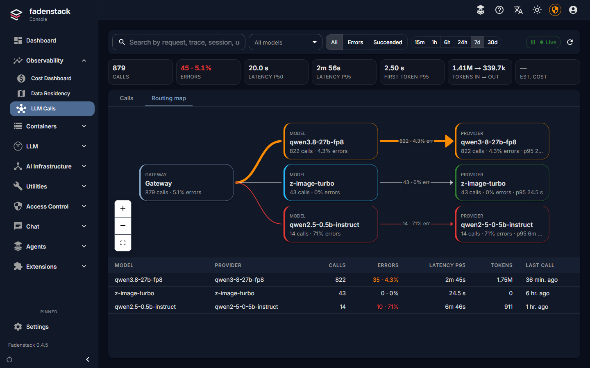

# LLM calls

Every call that goes through the gateway, from the chat, an agent or an application using the API, with what it
cost in time and tokens and how it ended. Use this page to find the call that went wrong and see why, and to
follow what an agent did for one question: each round with the model, and the tools its app ran in between.

## Before you start

Open **Observability → LLM Calls**. People with the `admin`, `operator` or `viewer` role can see the page (see
[Users, groups and roles](users.md)).

## What the page shows

At the top, the figures of everything the filters select: **Calls**, **Errors** (select it to see only the
failures), **Latency p50** and **Latency p95**, **First token p95**, **Tokens in → out** and **Est. cost**.

Below them, the list. **Show** switches between two views of the same calls:

| View | One row per |
|---|---|
| **Requests** | Question someone asked. An agent's app often needs several **rounds** with the model for one question: the model asks for tools, the app runs them, the model answers. A request groups those rounds. A call that belongs to no agent's request is a request of its own. |
| **Calls** | Call to a model, each round on its own row. |

| Column | What it shows |
|---|---|
| **Status** | The outcome: green when it succeeded; the code of the failure otherwise. |
| **Request** / **Call** | How many rounds the request took, or what kind of call it was. The robot marks a call of an agent. |
| **Duration** | From the start of the first round to the end of the last, with the model's own share below. |
| **Tokens** | Tokens sent to the model, and tokens it wrote. |
| **Tools** | The tools that ran for the request, and how many failed; beside it, the approvals a person gave or refused. |

Select the arrow in front of a request to see its rounds.

## Find a call

1. Pick a time range at the top: **15m** to **30d**.
2. Narrow the list: **All models** for one model, **Errors** or **Succeeded** for the outcome, or type in the
   search box. The search finds a call by its request, trace, session, conversation or agent id, and by part of
   a model name or error code.
3. Sort by **Time**, **Duration** or **Tokens** with the column headers.

**Live** brings in new calls every few seconds while you look at the first page; select it again to pause.

Every filter is in the page's address. Copy the address, or select the link icon in an open call, to show a
colleague exactly what you see.

## Open a request or a call

Select a row. The call opens beside the list; on a small screen it opens over it. Use the arrows at its top, or
the `j` and `k` keys, to go to the next or the previous one, and `Esc` to close it.

**Overview** starts with what the call's record says went wrong, if anything (see below). Then:

- **Request**: for a request with several rounds, a timeline of the whole request. Each round with the model,
  and between them the tools the app ran and the approvals it waited for. Select a round to open it.
- **Timeline** (**This round** in a request): where this call's time went, the wait for the first token and the
  writing, and the tools the gateway ran for it.
- **Governance**: what a policy decided about the call, if one did.
- **Conversation**: the other calls of the same conversation, in order.

**Details** lists every recorded field but the person, with a button to filter the list by the call's model
or conversation. **JSON** shows the record as it is, to copy into a bug report.

??? info "Where the app's tools come from"
    An agent's tools run in its app, on the person's computer, not on the server. The app reports which tools
    it ran, how long they took and how they ended, and which approvals it asked for. It never reports what
    the tools read or wrote.

    Some apps send these reports together at the end of a request, without their own times. The timeline then
    places them in the gaps between the rounds, in the order the app reported them, and says so below it.

## Why a call failed

Each finding names what happened and what to check next. The most common ones:

| You see | What to do |
|---|---|
| **Failed after waiting …** | The model server or something between it and the gateway gave up. Look at the model's deployment and its logs for overload or a stuck copy. |
| **The model server sent an error inside its answer** | The client got a reply that broke off with an error. Usually the prompt is longer than the model's context, or a parameter is not supported. The deployment's logs have the model server's reason. |
| **The provider could not be reached** | Check the provider's address, that it is running, and the HTTPS settings (see [Remote providers](providers.md)). |
| **No provider had free capacity** | Every copy of the model was busy. Raise its limit or add copies (see [Deployments](deployments.md)). |
| **The caller was not allowed** | The sign-in or API token is missing, expired or revoked, or the person lacks the permission. |
| **Blocked by a governance policy** | A policy refused the call (see [Policies and personal data](policies.md)). |
| **The answer was cut off at … tokens** | The call's token limit or the model's context ran out. Raise the limit or shorten the prompt. |
| **… tool run(s) in the app failed** | The app ran a tool the model asked for, and it failed. The app's own log has why. |
| **Denied by the user** | A person refused a tool the model wanted to run. Not an error: the model went on without it. |
| **Waited … for approvals** | Much of the request's time was a person deciding. |
| **The model took … rounds** | Many rounds for one question: the model may be going in circles, or a tool keeps failing. Compare the rounds. |

## Where calls went

**Routing map** draws the calls of the time range from the gateway to each model asked for and on to the
provider that answered, with the number of calls and the share of errors on each line. Red and orange lines
show where failures pile up. The table below has the same figures, with the slowest calls (**Latency p95**)
and the last call of each. Select a model to see its calls. With a call open in the list, the map highlights
the way it went.

## What is recorded

For each call the gateway keeps who sent it, which model answered and where, the timings, the tokens, the
outcome and the estimated cost; for an agent, also its conversation and request. The text of the request and
of the answer is not kept, and neither is what a tool read or wrote. The figures here are the same as on
[Usage and limits](usage.md).

This page never shows who sent a call, and does not find calls by person. One person's usage is shown only in
the person-level view on **Usage**, to a usage auditor, with a reason, and recorded (see
[Usage and privacy](usage-privacy.md#looking-at-one-persons-figures)).

## When it does not work

| You see | What to do |
|---|---|
| **No calls match** | Nothing in the time range matches the filters. Pick a longer range or select **Clear filters**. |
| An agent's request shows rounds, but no tools | The model asked for tools, but the app did not report running any: an app without tool reports, or reports still on their way. The rounds still show. |
| The provider shows as **Instance …** | The provider that served the call was removed since. |
| **Est. cost** shows "—" | The models used have no price. Set one (see [Usage and limits](usage.md#set-prices)). |
