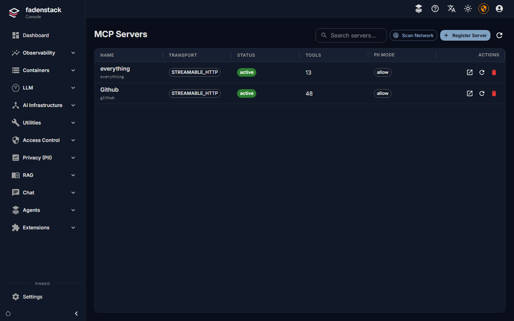
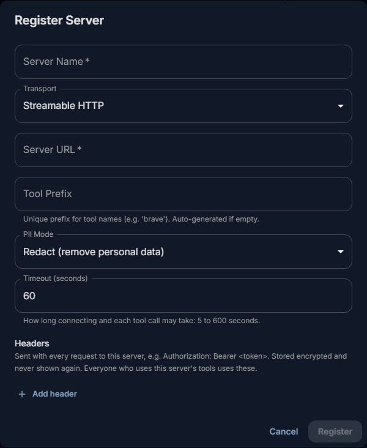
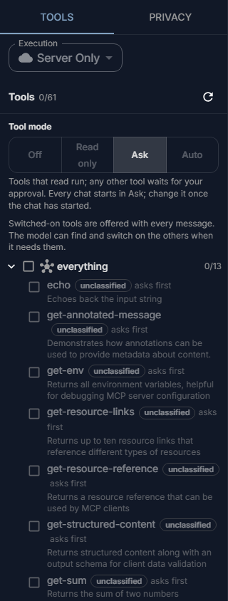

# MCP servers

An MCP server gives chats and agents tools: search a repository, open a ticket, read a file. You register the
server once; Fadenstack connects to it, lists its tools, and runs a tool when a model asks for it, under the
rules you set.

## Before you start

- The **MCP** module is on (**Settings → Modules**; see [Modules](index.md#modules)). Its pages are under
  **Extensions → MCP Hub**.
- The server's address, or the command that starts it, and the credentials it needs. A server that speaks
  MCP over HTTP can also run as a container on the Fadenstack server itself (see
  [Containers](../operate/containers.md)).
- The models people use with tools can call them: for your own models, **Tool calling** is on in the
  deployment's [engine settings](deployments.md#engine-settings); for a remote provider, **Offer the gateway's
  tools** is on (see [Remote providers](providers.md)).

## Register a server

1. Open **Extensions → MCP Hub** and select **Register Server**.
2. Enter the **Server Name** and choose the **Transport**.
3. Enter the **Server URL** (HTTP) or the **Command** (stdio).
4. Choose the **PII Mode** (see [Personal data](#personal-data-pii-mode)).
5. Under **Headers** (HTTP) or **Environment variables** (stdio), add what the server needs to let you in,
   such as `Authorization: Bearer <token>`.
6. Select **Register**.

Fadenstack connects to the server and lists its tools. The server then shows as active, with its number of
tools.

??? info "More about the fields"
    | Field | What to enter |
    |---|---|
    | **Server Name** | The name shown in the console. |
    | **Transport** | **Streamable HTTP** for current servers, **SSE (legacy HTTP)** for older ones, or **Stdio (command)** for a server the MCP service starts itself. |
    | **Server URL** | For HTTP: the server's MCP address, usually ending in `/mcp` (or `/sse`), for example `https://tools.example.internal/mcp`. |
    | **Command** | For stdio: the command and its arguments, for example `uvx mcp-server-time`. |
    | **Tool Prefix** | A short, unique name. The server's tools are named `mcp.<prefix>.<tool>`, for example `mcp.github.search_repositories`. Made up if left empty. |
    | **PII Mode** | What the server may see of personal data (see [Personal data](#personal-data-pii-mode)). |
    | **Timeout (seconds)** | How long connecting and each tool call may take: 5 to 600 seconds. |

!!! warning "Everyone uses these credentials"
    Headers and variables are stored encrypted and never shown again; the console lists their names only.
    Every person whose chat uses the server's tools acts with these credentials. Give the server a token with
    only the rights the tools need, read-only where you can.

**Scan Network** looks for MCP servers on a host and a range of ports, and offers the ones it finds for
registration.

## A server's page

Select a server in the list to open its page. It shows its status, transport, prefix, PII mode, timeout and
which headers are set, and, if its last connection failed, **The last connection attempt failed** with the
reason.

| To | Do this |
|---|---|
| See every tool the server offers | **Discovered Tools** lists them. |
| Turn one tool off (or on) for everyone | The **Enabled** switch beside the tool, under **Discovered Tools**. |
| Turn the whole server off or on | **Enabled** at the top. |
| List the tools again | **Refresh**. |
| Check the connection and count the tools | **Test**. |
| Change the URL or command, the timeout, the PII mode, and the headers or variables | **Edit** (below). |
| Remove the server and all its tools | **Delete Server**. |

In **Edit**, a stored header is replaced or removed on its own, without entering the others again. Saving
reconnects the server and lists its tools again.

## Who can use the tools

A registered, enabled server's tools are available to every chat in the organisation and to agents. There is
no per-person list of MCP servers. You decide what runs with:

- **Turning tools off** under **Discovered Tools**, for tools nobody should use.
- **Tool rules** under **Agents → Governance**: deny a tool, have the person approve it before it runs, or
  allow it, by name or pattern, such as `mcp.github.*` (see [Policies and personal data](policies.md)).
- **Tool classes** under **Agents → Governance**: say whether a tool only reads, writes or deletes. The
  tool mode people pick in the chat acts on that class. A tool nobody classified always asks before it runs.
- **An agent's server tools**: each agent gets what a chat gets, only the tools you list (such as
  `mcp.github.*`), or none (see [Agents and add-ins](agents.md)). The limit holds when a tool runs, not only
  in what the model is offered: a call to a tool outside it is refused and never reaches the server.

## How people get the tools in a chat

{ width="280" }

- **Every MCP tool starts switched off in a new chat.** Each tool offered to the model takes room in every
  message, so only the tools a chat needs are sent.
- A tool is switched on when the person turns it on in the chat's **Tools** panel (the wrench), when their
  message names it, or when the model finds it with its tool search. Once on, it stays on for that chat.
- **The tool mode** decides what may run without asking: **Off**, **Read only**, **Ask** (every chat starts
  here: tools that read run, any other tool waits for the person's approval) or **Auto** (tools that read or
  write run; destructive and unclassified ones ask).

[Tools in the chat](../use/tools.md) explains this for the people who use it.

??? info "Narrow a hosted server's tools"
    Hosted servers with many tools often let you narrow them with a header. GitHub's server, for example, takes
    `X-MCP-Toolsets: repos` or `X-MCP-Readonly: true`.

## Personal data (PII mode)

With the **Privacy (PII)** module on, the chat's PII policy may replace personal data with placeholders
before a model sees it. What a tool then receives depends on its server's **PII Mode**:

| Mode | The tool receives |
|---|---|
| **Allow (no filtering)** | The real values. |
| **Redact (remove personal data)** | The placeholders; personal data found in the call's arguments is removed as well. |
| **Block (reject if personal data is found)** | Nothing: the call is refused when its arguments contain personal data. |

Choose **Redact** or **Block** for a server outside your organisation. These two modes need the PII module: if it
is off or cannot be reached, the call is refused, nothing is sent, and the chat shows that the personal-data check
could not run. Start the PII module, or, if the check is not needed for this server, set its PII mode to **Allow**.
The server's page and the Register and Edit dialogs show a warning while the module is off.

A server you register while the PII module is off starts on **Allow**, and on **Redact** while it runs. Servers
that already exist keep their mode.

## When it does not work

| You see | What to do |
|---|---|
| **"… is registered but could not be connected: … Open it to correct the URL or credentials."** | The server is saved in error. Open it, read the reason, and select **Edit**. The common reasons are in the next three rows. |
| The reason says `401 Unauthorized` | The server needs credentials: add them as a header, for example `Authorization: Bearer <token>`. |
| The reason says `404` | The server has no MCP endpoint at that address: Streamable HTTP addresses usually end in `/mcp`, SSE ones in `/sse`. |
| The reason says `Connection refused` | Nothing listens at that address, or the Fadenstack server cannot reach it. |
| **"MCP server … is …"** on the dashboard | The server is in error or disconnected, and its tools are not available to chats. Open it and select **Test**. |
| People see no tools in the chat | Check that the server is enabled, its tools are enabled, and the model they chat with can call tools. |
