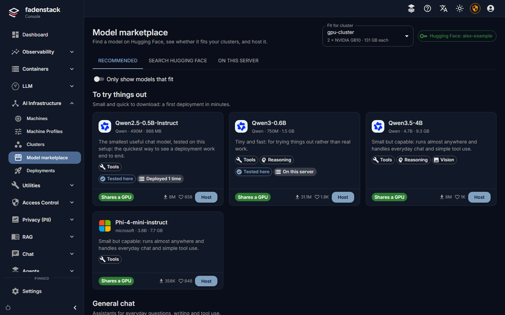
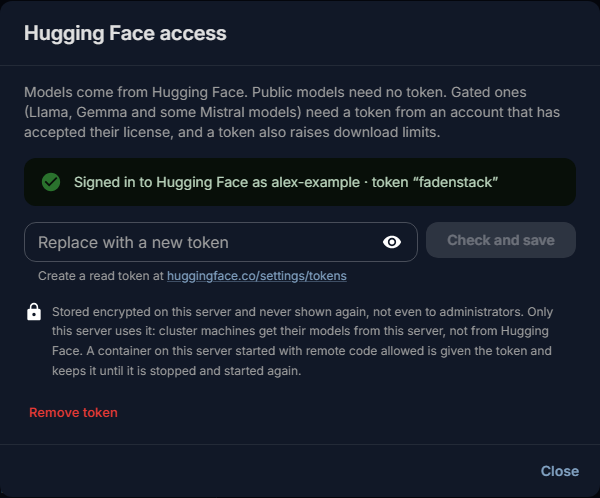
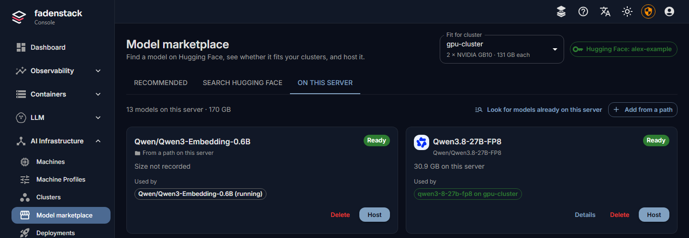

# Models

The **Model marketplace** is where you choose the models your organisation runs on its own machines. It shows
models from Hugging Face, says whether each one fits your cluster, keeps the models this server has
downloaded, and hosts a model on a cluster in one dialog. Models that run at a cloud provider are connected
under [Remote providers](providers.md) instead.

## Before you start

- At least one cluster, for the fit check and for hosting (see [Clusters](../operate/clusters.md)). Without
  one you can still browse.
- For gated models, a Hugging Face token (see [Gated models](#gated-models-and-the-hugging-face-token)).

## Find a model

Open **AI Infrastructure → Model marketplace**. It has three tabs:

- **Recommended**: models known to work well, grouped by what they are for: **To try things out**, **General
  chat**, **Coding**, **Reasoning**, **Vision** and **Embeddings**. A model marked **Tested here** has been
  served on the hardware its tooltip names.
- **Search Hugging Face**: any model on the Hugging Face Hub. Filter by task (**Chat**, **Embeddings**,
  **Vision**) and **Author** (an organisation or user, such as `Qwen`), and sort by **Trending**, **Most
  downloaded**, **Most liked** or **Newest**. In the search box, `*` matches any text and `?` one character:
  `qwen3.8*fp8` finds every FP8 build of Qwen3.8.
- **On this server**: the models this server already keeps, and their downloads (see
  [On this server](#on-this-server)).

Each card says what the model is for (**Tools**, **Reasoning**, **Vision**, **Code**, **Embeddings**) and how
it fits. Select a card for the details: parameters, context length, precision, licence, its files, and how it
fits each of your clusters. **Open on Hugging Face** shows the full model card.

Models the engine cannot serve are hidden, with a button to show them and the reason: GGUF files (for
llama.cpp and Ollama), MLX weights (Apple silicon only), repositories with no weights, and models that are
neither chat, vision nor embedding models.

## Which models fit

Pick a cluster under **Fit for cluster**. Each card then says how the model fits it:

| Badge | Meaning |
|---|---|
| **Shares a GPU** | Small enough that several copies, or other models, share one accelerator. Each copy takes only its share of the memory. |
| **Fits on N GPUs** | One copy needs N accelerators, split between them. |
| **Fits, but not right now** | It fits the cluster, but other models are using the memory it needs. |
| **Too large** | Even every accelerator in the cluster together cannot hold it. |
| **Size unknown** | Hugging Face does not say how large it is. |

**Only show models that fit** hides the rest. Fit is an estimate from the model's size, the memory its
conversations need and each accelerator's memory. The hosting dialog shows the figures before anything
starts.

Before anything is downloaded, the hosting dialog also checks that the cluster's runtime can load the model:

- **Cannot run here**: the runtime does not know this kind of model. The cluster cannot be chosen, and
  nothing is downloaded. The model needs a newer runtime on the cluster (see
  [Move a cluster to another runtime](../operate/upgrading.md#move-a-cluster-to-another-runtime)).
- **May not run**: the runtime can read the model but has no implementation of its architecture. It may
  still work through a generic fallback, which not every model supports.

## Host a model

Select **Host** on the card. The dialog has three steps: **Where** (the cluster, the size of each copy and
how many copies), **Engine settings**, and **Review** (the deployment's name and the name people pick in the
chat). [Deployments](deployments.md) describes each step and the deployment's page.

The server downloads the model, copies it to the cluster's machines and starts it. Nothing waits in the
dialog: the deployment page shows each step.

## Gated models and the Hugging Face token

Public models need no token. Gated models (Llama, Gemma and some Mistral models among them) need a token from
a Hugging Face account that has accepted the model's licence. A token also raises download limits.

1. Select the **Hugging Face** chip at the top of the marketplace (or open **Settings → General**).
2. Create a read token on Hugging Face and paste it under **Access token**.
3. Select **Check and save**.

The chip then shows the account, for example **Hugging Face: alex-example**.

- The server checks the token with Hugging Face before saving it, and refuses one Hugging Face rejects. If
  Hugging Face cannot be reached, the token is saved and marked as unchecked.
- The token is stored encrypted on the server and never shown again, not even to administrators. If it can
  also write to Hugging Face, the dialog suggests replacing it with a read-only one.
- Only the server uses it, to search and to download. Cluster machines get their models from the server and
  never see the token, unless their cluster lets them download models themselves (below).
- **Remove token** takes it away. Gated models can then no longer be downloaded.

## Where the machines get models

By default the server downloads a model once, and each machine of the cluster copies it from the server, so
the machines need no internet access. Over a slow link between server and machines, a large model then takes
that long twice. A cluster can instead let each machine download models from Hugging Face itself, with the
server's token for a gated model: the switch **Machines download models themselves** on the cluster's page
(see [Clusters](../operate/clusters.md#where-the-machines-get-models)). It needs every machine to reach
Hugging Face, and applies to the next model placed on the cluster.

## Recipes and suggested settings

When the vLLM project publishes a recipe for a model, its recommended settings are part of the suggestions
in the **Engine settings** step, and the model's details say so (**Open the recipe**). Settings from the
recipe that cannot be used here are listed; optional features from the recipe appear as choices. For other
models, the settings are suggested for the model's family. Each suggestion says why it was made. A server
without internet access has no recipes and suggests settings by model family.

The engine settings themselves are described under [Deployments](deployments.md#engine-settings).

## On this server

The **On this server** tab lists the models this server keeps.

- **Downloads** run on the server, not in the page: leave the page or close the browser and they carry on.
  Each shows its progress and can be cancelled (**Cancel**) or tried again (**Try again**). While anything
  downloads, a chip in the header says so on every tab.
- **Download to this server**, in a model's details, downloads it without hosting it, so it is ready when
  someone deploys it.
- **Add from a path** registers a folder on the Fadenstack server that already holds a model's files (its
  `config.json` and weights). Fadenstack never deletes those files.
- **Look for models already on this server** picks up models copied into the server's model store by other
  means.
- **Used by** lists the deployments that use each model.
- **Delete** removes a model from the list. A model a deployment still uses cannot be deleted: the dialog
  names the deployments to remove first. **Also delete its files from this server** frees the disk space; a
  model added from a path keeps its files.

## Without internet access

A server that cannot reach Hugging Face still shows the recommended list and the models it keeps, with sizes
estimated. Search is not available. You can host models already on the server, including models added from
a path.

## When it does not work

**"Hugging Face: token rejected".** Hugging Face no longer accepts the stored token: it may have expired or
been revoked. Save a new one.

**A gated model does not download.** The token is missing, or its account has not accepted the model's
licence on Hugging Face. Accept it there, then try the download again under **On this server**.

**"This server still uses the default settings master key".** The server will not store a token until it
has a key of its own. Whoever runs the server sets one (see [Installing](../operate/installing.md)).

**Model downloads failed.** The [dashboard](dashboard.md) lists failed downloads of the last day. Open **On
this server**, read the reason, and select **Try again**. A deployment waiting for the model picks it up
once the download finishes.
