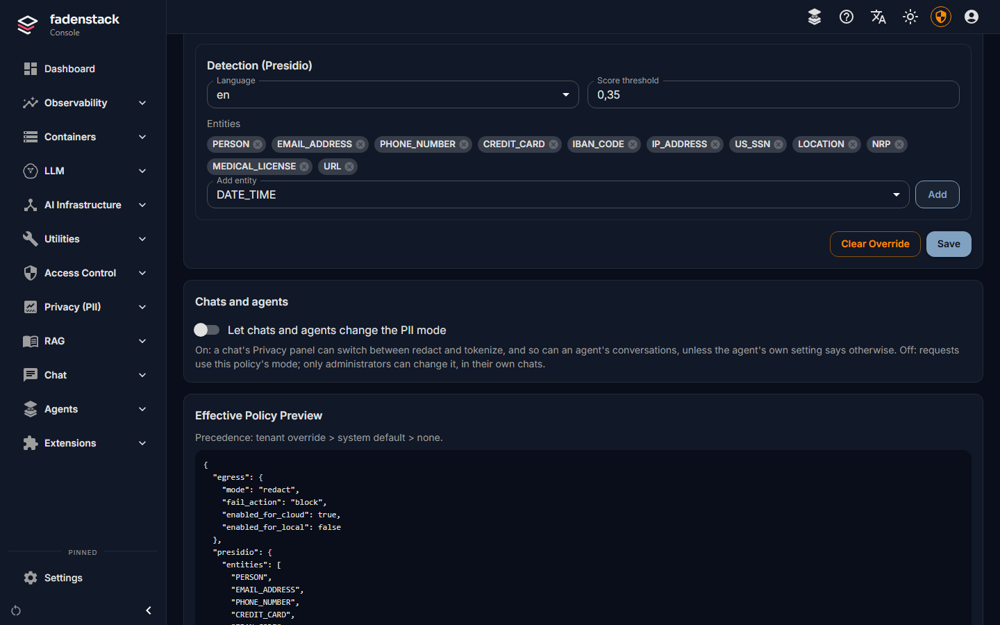
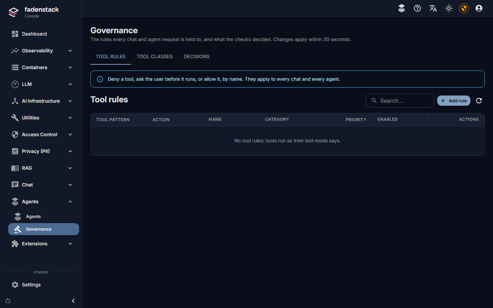
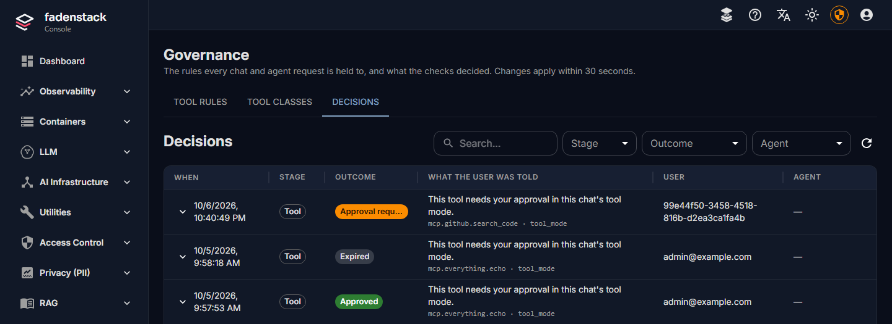

# Policies and personal data

You decide which personal data is masked before it reaches a model, and which tools may run without asking.
Both apply to every chat and every agent. This page covers the personal data policy, the tool rules, and
what people see when a rule stops something.

## Before you start

- For personal data: the **PII / Privacy** module is on (**Settings → Modules**; see
  [Modules](index.md#modules)). Its pages are under **Privacy (PII)**. Without it, nothing is masked.
- For tool rules: **Agents → Governance**. It needs no module.

## Personal data

The personal data filter finds names, e-mail addresses, phone numbers, account and card numbers, places and
similar data in what people send, and masks it before the request reaches a model. It runs only as your
policy says: you choose which data, for which models, and what happens when the filter cannot run.

### The policy Fadenstack starts with

With the module on, the default policy:

- protects requests to **cloud providers**; requests to your own machines' models are not scanned;
- **redacts**: personal data is replaced, and the model never sees it;
- **blocks** a request to a cloud provider when the filter cannot run;
- reads English text, and looks for these types: `PERSON`, `EMAIL_ADDRESS`, `PHONE_NUMBER`, `CREDIT_CARD`,
  `IBAN_CODE`, `IP_ADDRESS`, `US_SSN`, `LOCATION`, `NRP`, `MEDICAL_LICENSE`, `URL`. Dates (`DATE_TIME`) are
  not on the list. Add them if you need dates of birth covered; plain numbers in a message may then be masked
  as dates too.

The filter has an English language model only. In German or other languages it still finds what has a fixed form
(e-mail addresses, phone, card and account numbers, IP addresses, links), but often misses names and places.

### Change the policy

The **default policy** applies to the whole installation:

1. Open **Settings → Modules**, find **PII / Privacy**, and open its **Module settings**.
2. Change the **Default PII Policy** (fields below).
3. Select **Save**.

!!! warning
    Saving the default policy restarts the gateway to apply it. Replies being written at that moment stop and
    can be tried again. Save outside busy hours.

A **tenant policy** replaces the default for one tenant (your organisation is the tenant `default` unless
your installation uses others):

1. Open **Privacy (PII) → Tenant Policies**, enter the **Tenant ID** and select **Load Tenant**.
2. Change the fields under **Tenant Override**. **Effective Policy Preview** shows what requests will get.
3. Select **Save**. **Clear Override** goes back to the default policy.

The fields are the same in both places:

| Field | What it does |
|---|---|
| **Outgoing requests**: **Protect requests to cloud providers**, **Protect requests to local models** | Which requests are scanned. |
| **Mode** | `redact`: personal data is replaced with a placeholder such as `<PERSON>`, and the answer keeps it. `tokenize_reversible`: each value is replaced with a token such as `[PERSON_1]`, and put back in the answer the person sees. The model sees neither. |
| **If detection fails** | `block`: the request is refused. `allow`: it is sent unscanned. `fallback_to_local`: it is sent unscanned to one of your own models under the same name, if there is one, and refused otherwise. |
| **Detection (Presidio)**: **Language**, **Score threshold**, **Entities** | Which language the filter reads, how sure it must be, and which kinds of data it looks for. A higher threshold masks less. Only English is installed: keep **Language** at `en`. With another language every check fails, and **If detection fails** decides. |
| **Telemetry**: **Remove personal data from telemetry**, **Mode** | For request traces, which are off by default: whether a trace keeps the request with personal data removed (`sanitized`) or figures only (`metrics_only`). Without Enterprise, traces keep figures only anyway. |

### Chats and agents

- A person can make the policy **stricter** for one chat in the chat's **Privacy** panel: more types, a
  higher threshold, local models scanned too.
- Switching between `redact` and `tokenize_reversible` is not a stricter setting but a different one, so a
  chat may do it only when **Let chats and agents change the PII mode** is on (**Privacy (PII) → Tenant
  Policies**, off by default).
  Otherwise the chat shows "Your admin hasn't allowed changing the PII mode for this chat."
- An agent's **Privacy** setting (**Changing the PII mode** on its **Definition** tab) overrides that switch
  for the agent's conversations: **As the tenant's PII policy says**, **Allowed** or **Not allowed**.
- What an MCP tool receives is set per server: see
  [MCP servers](mcp-servers.md#personal-data-pii-mode).

### What the filter found

**Privacy (PII) → Dashboard** shows counts only: scans, how many found personal data, the kinds found, and
the daily volume. **Privacy (PII) → Activity Log** lists every scan with its mode, kinds and counts, without
the text itself.

## Tool rules

**Agents → Governance → Tool rules** decides, by name, what happens when a model wants to run a tool:

1. Select **Add rule**.
2. Give it a **Name** (for you) and a **Tool pattern**: a tool name, or a pattern with `*`, such as
   `mcp.github.*`, `knowledge_search` or `*`.
3. Choose the **Action**: **Deny**, **Ask first** (the person approves each call) or **Allow**.
4. Write the **Message to the user**: what people are told when the rule applies.
5. Set the **Priority**. Lower is tried first, and the first rule that matches decides, so a rule with a
   lower number can make an exception to a broader one.
6. Save it. Rules apply within 30 seconds.

Without rules, tools run as the tool mode says.

### Tool classes and tool modes

**Agents → Governance → Tool classes** says what tools do, by pattern: **read**, **write**, **destructive**,
or **As its MCP server says** (trust what the tool's MCP server declares about itself). **Reaches outside**
records whether a tool reaches outside the organisation. A tool nobody classifies is unclassified.

People pick a tool mode per chat, and the class decides what runs:

| Mode | read | write | destructive | unclassified |
|---|---|---|---|---|
| **Off** | not offered | not offered | not offered | not offered |
| **Read only** | runs | not offered | not offered | not offered |
| **Ask** (every chat starts here) | runs | asks | asks | asks |
| **Auto** | runs | runs | asks | asks |

No mode runs a destructive or unclassified tool without asking. To let a tool run in **Auto**, classify it
as **read** or **write**.
Fadenstack's own tools (the knowledge base search, the time, the tool search) are read tools.

### Decisions

**Agents → Governance → Decisions** lists what the checks decided: when, at which stage (**Prompt**,
**Answer**, **Tool**), the outcome (**Blocked**, **Approval required**, **Approved**, **Rejected**,
**Expired**), what the person was told, the user, the agent and the request. The refused text itself is never
stored: only a keyed fingerprint, so the same text refused twice shows the same value, and nobody can read it
back.

## What people see when something is stopped

| What happened | In the chat |
|---|---|
| A tool rule denied a tool | The tool line says **Not run**. The model is told, with the rule's message, and carries on without it. |
| A tool needs approval | "… wants to run", with **Approve** and **Decline**. Without an answer within five minutes, the call is not run (**Expired**). |
| The personal data filter could not run, and the policy blocks | The reply fails with "PII service unavailable and fail_action=block." Nothing was sent to the model. |
| A prompt was refused (content policies, Planned) | The message is marked **Not sent**, with the policy's message or "This was stopped by your organisation's policy." Nothing is sent to a model or stored. |
| An answer was refused (content policies, Planned) | The answer stops and is marked **Answer withheld**. |

Applications using the API get the same outcomes as errors they can handle; the details are on the
[Developers](https://developers.fadenstack.com/) site.

## What Core includes, and what is planned

| Check | Core | Enterprise |
|---|---|---|
| Who may sign in and use an agent | Accounts, roles, agent access | Single sign-on Planned |
| Personal data | PII policies, per-chat and per-agent settings | |
| The prompt | | Content policies on the prompt Planned |
| The answer | | Content policies on the answer Planned |
| Tools | Tool rules, tool classes, tool modes | Content policies on tool arguments, and limits on the tool mode people may pick, per team, agent or person Planned |
| The record | Decisions, without the text | An auditor's view with policy names, and exports Planned |

Content policies will refuse a prompt, an answer or a tool call by what it says.
