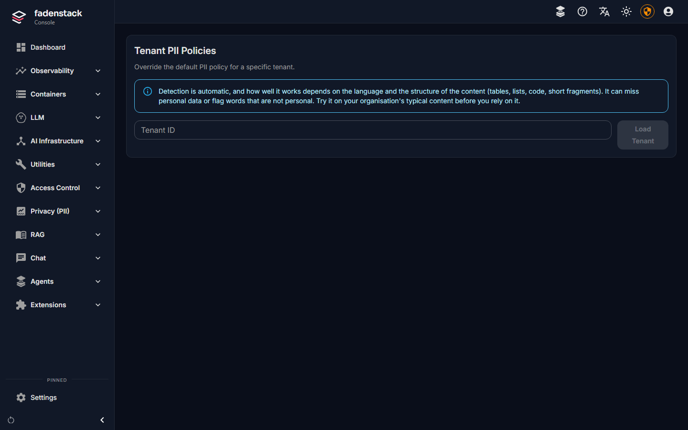
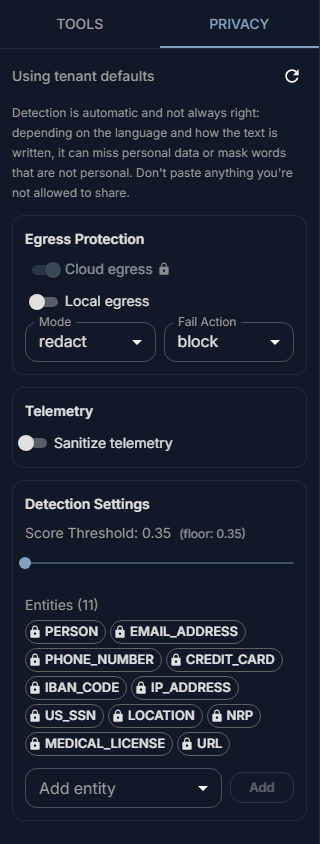
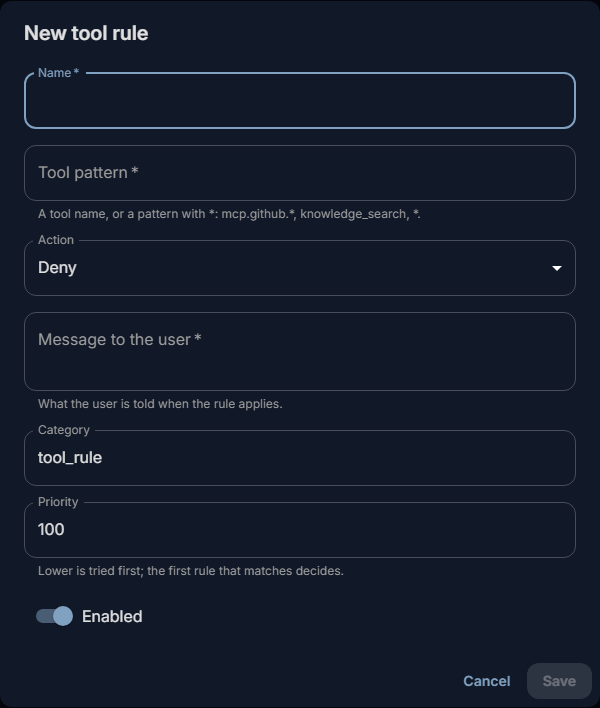
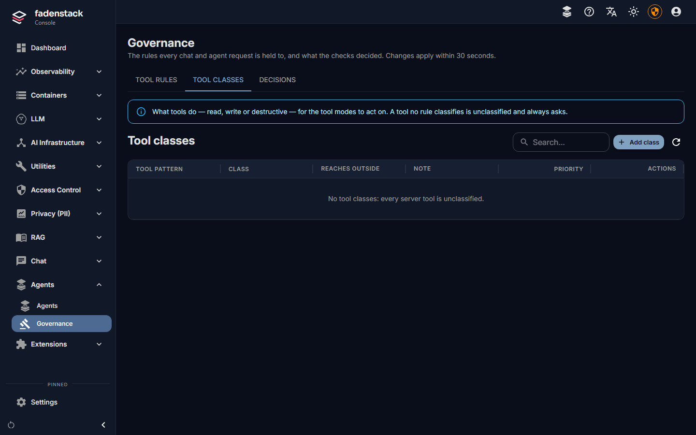

# Policies and personal data

You decide which personal data is masked before it reaches a model, and which tools may run without asking.
Both apply to every chat and every agent. This page covers the personal data policy, the tool rules, and
what people see when a rule stops something.

## Before you start

- For personal data: the **PII / Privacy** module is on (**Settings → Modules**; see
  [Modules](index.md#modules)). Its pages are under **Privacy (PII)**. Without it, nothing is masked, with one
  exception: see [When the module is off](#when-the-module-is-off).
- For tool rules: **Agents → Governance**. It needs no module.

## Personal data

The personal data filter finds names, e-mail addresses, phone numbers, account and card numbers, places and
similar data in what people send, and masks it before the request reaches a model. It runs only as your
policy says: you choose which data, for which models, and what happens when the filter cannot run.

!!! note "Detection is not always right"
    How well the filter works depends on the language and on the structure of the content: it does best on plain
    English sentences, and less well on other languages and on tables, lists, code and short fragments. It can miss
    personal data, and it can mask words that are not personal data. Try it on your organisation's typical content
    before you rely on it, and tell people not to paste what they may not share.

### The policy Fadenstack starts with

With the module on, the default policy:

- protects requests to **cloud providers**; requests to your own machines' models are not scanned;
- **redacts**: personal data is replaced, and the model never sees it;
- **blocks** a request to a cloud provider when the filter cannot run;
- reads English text, and looks for these types: `PERSON`, `EMAIL_ADDRESS`, `PHONE_NUMBER`, `CREDIT_CARD`,
  `IBAN_CODE`, `IP_ADDRESS`, `US_SSN`, `LOCATION`, `NRP`, `MEDICAL_LICENSE`, `URL`.

### When the module is off {#when-the-module-is-off}

A policy needs the module to run. What happens without it depends on where the policy comes from:

- **A policy saved for your organisation** (**Settings → Modules → PII / Privacy**, tenant policy): a missing
  module counts as a filter that cannot run, and **If detection fails** decides. With `block`, the default,
  chats to the models the policy covers fail with "A PII policy is set for this workspace, but the PII module is
  not running" and nothing is sent. Start the module, or switch the policy off if you do not need it. With
  `allow` the request goes out unscanned, and the log says so.
- **The default policy only** (nobody saved a policy): not applied. Every install has it, including those that
  never switched the module on, and their chats keep working unmasked.

Switching the module off therefore does not silently remove a policy you saved. Be aware that if you rely on the
default policy and later switch the module off, requests to cloud providers are no longer masked: save a policy
for your organisation if that must not happen.

??? info "More about dates"
    Dates (`DATE_TIME`) are not on the list. Add them if you need dates of birth covered; plain numbers in a
    message may then be masked as dates too.

The filter has an English language model only. In German or other languages it still finds what has a fixed form
(e-mail addresses, phone, card and account numbers, IP addresses, links), but often misses names and places.

### Change the policy

The **default policy** applies to the whole installation:

1. Open **Settings → Modules**, find **PII / Privacy**, and open its **Module settings**.
2. Change the **Default PII Policy** (fields below).
3. Select **Save**.

!!! warning
    Saving the default policy restarts the gateway to apply it. Replies being written at that moment stop and
    can be tried again. Save outside busy hours.

A **tenant policy** replaces the default for one tenant (your organisation is the tenant `default` unless
your installation uses others):

1. Open **Privacy (PII) → Tenant Policies**, enter the **Tenant ID** and select **Load Tenant**.

    

2. Change the fields under **Tenant Override**. **Effective Policy Preview** shows what requests will get.
3. Select **Save**. **Clear Override** goes back to the default policy.

??? info "More about the fields (the same in both places)"
    The fields are the same in both places:

    | Field | What it does |
    |---|---|
    | **Outgoing requests**: **Protect requests to cloud providers**, **Protect requests to local models** | Which requests are scanned. |
    | **Mode** | `redact`: personal data is replaced with a placeholder such as `<PERSON>`, and the answer keeps it. `tokenize_reversible`: each value is replaced with a token such as `[PERSON_1]`, and put back in the answer the person sees. The model sees neither. |
    | **If detection fails** | `block`: the request is refused. `allow`: it is sent unscanned. `fallback_to_local`: it is sent unscanned to one of your own models under the same name, if there is one, and refused otherwise. |
    | **Detection (Presidio)**: **Language**, **Score threshold**, **Entities** | Which language the filter reads, how sure it must be, and which kinds of data it looks for. A higher threshold masks less. Only English is installed: keep **Language** at `en`. With another language every check fails, and **If detection fails** decides. |
    | **Telemetry**: **Remove personal data from telemetry**, **Mode** | For request traces, which are off by default: whether a trace keeps the request with personal data removed (`sanitized`) or figures only (`metrics_only`). Without Enterprise, traces keep figures only anyway. |

### Chats and agents

{ width="280" }

- A person can make the policy **stricter** for one chat in the chat's **Privacy** panel: more types, a
  lower threshold (it then masks more), local models scanned too.
- Switching between `redact` and `tokenize_reversible` is not a stricter setting but a different one, so a
  chat may do it only when **Let chats and agents change the PII mode** is on (**Privacy (PII) → Tenant
  Policies**, off by default).
  Otherwise the chat shows "Your admin hasn't allowed changing the PII mode for this chat."
- An agent's **Privacy** setting (**Changing the PII mode** on its **Definition** tab) overrides that switch
  for the agent's conversations: **As the tenant's PII policy says**, **Allowed** or **Not allowed**.
- What an MCP tool receives is set per server: see
  [MCP servers](mcp-servers.md#personal-data-pii-mode).

### What the filter found

**Privacy (PII) → Dashboard** shows counts only: scans, how many found personal data, the kinds found, and
the daily volume. **Privacy (PII) → Activity Log** lists every scan with its mode, kinds and counts, without
the text itself.

## Tool rules

**Agents → Governance → Tool rules** decides, by name, what happens when a model wants to run a tool:

1. Select **Add rule**.

    

2. Give it a **Name** (for you) and a **Tool pattern**: a tool name, or a pattern with `*`, such as
   `mcp.github.*`, `knowledge_search` or `*`.
3. Choose the **Action**: **Deny**, **Ask first** (the person approves each call) or **Allow**. A rule also
   covers the tools an agent's app runs itself, such as the browser and Office agents' tools: the app asks every
   time, whatever the person allowed before, and an app that cannot ask is not offered the tool.
4. Write the **Message to the user**: what people are told when the rule applies.
5. Set the **Priority**. Lower is tried first, and the first rule that matches decides, so a rule with a
   lower number can make an exception to a broader one.
6. Save it. Rules apply within 30 seconds.

Without rules, tools run as the tool mode says.

### Tool classes and tool modes

**Agents → Governance → Tool classes** says what tools do, by pattern: **read**, **write**, **destructive**,
or **As its MCP server says** (trust what the tool's MCP server declares about itself). **Reaches outside**
records whether a tool reaches outside the organisation. A tool nobody classifies is unclassified. An agent's own
tools take their class from its **Host tools**; an agent whose version lists none has every tool unclassified.

People pick a tool mode per chat, and the class decides what runs:

| Mode | read | write | destructive | unclassified |
|---|---|---|---|---|
| **Off** | not offered | not offered | not offered | not offered |
| **Read only** | runs | not offered | not offered | not offered |
| **Ask** (every chat starts here) | runs | asks | asks | asks |
| **Auto** | runs | runs | asks | asks |

No mode runs a destructive or unclassified tool without asking. To let a tool run in **Auto**, classify it
as **read** or **write**.
Fadenstack's own tools (the knowledge base search, the time, the tool search) are read tools.

### Decisions

**Agents → Governance → Decisions** lists what the checks decided: when, at which stage (**Prompt**,
**Answer**, **Tool**), the outcome (**Blocked**, **Approval required**, **Approved**, **Rejected**,
**Expired**), what the person was told, the user, the agent and the request. The refused text itself is never
stored: only a keyed fingerprint, so the same text refused twice shows the same value, and nobody can read it
back.

## What people see when something is stopped

| What happened | In the chat |
|---|---|
| A tool rule denied a tool | The tool line says **Not run**. The model is told, with the rule's message, and carries on without it. |
| A tool needs approval | "… wants to run", with **Approve** and **Decline**. Without an answer within five minutes, the call is not run (**Expired**). |
| The personal data filter could not run, and the policy blocks | The reply fails with "PII service unavailable and fail_action=block." Nothing was sent to the model. |
| A policy you saved applies, but the PII module is not running, and the policy blocks | The reply fails with "A PII policy is set for this workspace, but the PII module is not running, so nothing was sent." |
| A prompt was refused (content policies, Planned) | The message is marked **Not sent**, with the policy's message or "This was stopped by your organisation's policy." Nothing is sent to a model or stored. |
| An answer was refused (content policies, Planned) | The answer stops and is marked **Answer withheld**. |

Applications using the API get the same outcomes as errors they can handle; the details are on the
[Developers](https://developers.fadenstack.com/) site.

## What Core includes, and what is planned

| Check | Core | Enterprise |
|---|---|---|
| Who may sign in and use an agent | Accounts, roles, agent access | Single sign-on Planned |
| Personal data | PII policies, per-chat and per-agent settings | |
| The prompt | | Content policies on the prompt Planned |
| The answer | | Content policies on the answer Planned |
| Tools | Tool rules, tool classes, tool modes | Content policies on tool arguments, and limits on the tool mode people may pick, per team, agent or person Planned |
| The record | Decisions, without the text | An auditor's view with policy names, and exports Planned |

Content policies will refuse a prompt, an answer or a tool call by what it says.
