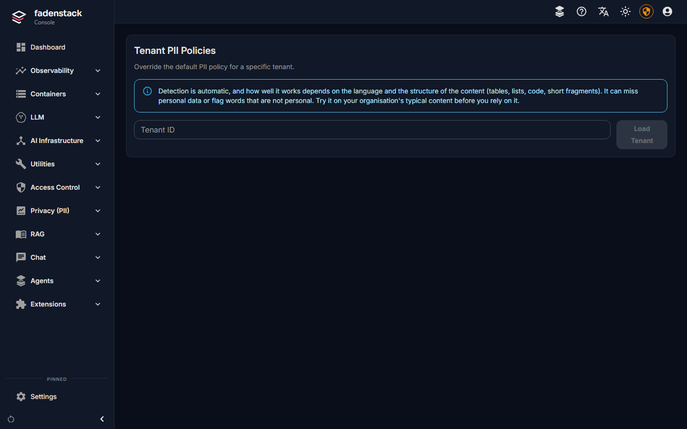
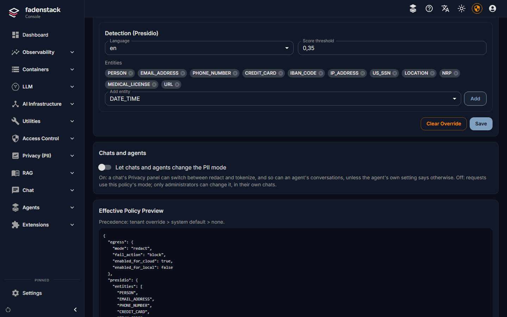
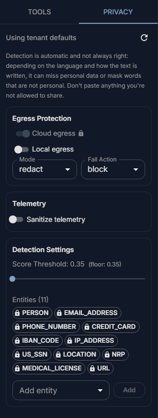
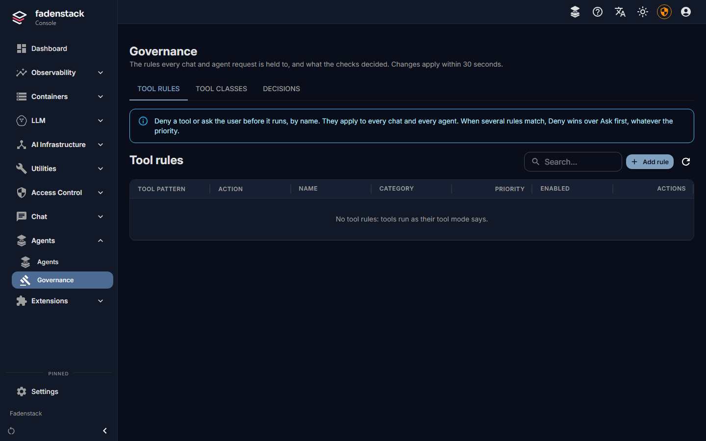
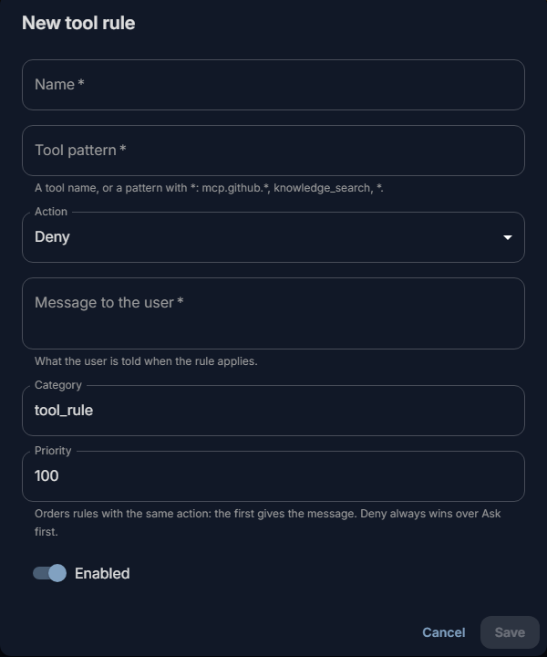
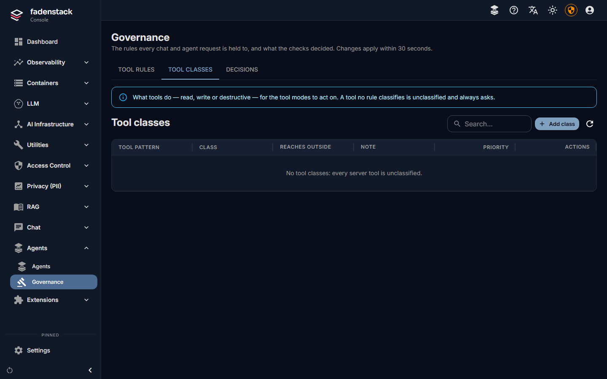
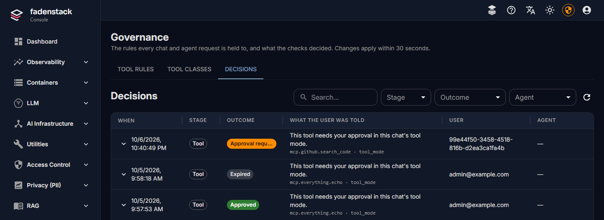

# Policies and personal data

You decide which personal data is masked before it reaches a model, and which tools may run without asking.
Both apply to every chat and every agent. This page covers the personal data policy, the tool rules, and
what people see when a rule stops something.

## Before you start

- For personal data: the **PII / Privacy** module is on (**Settings → Modules**; see
  [Modules](index.md#modules)). Its pages are under **Privacy (PII)**. Without it, nothing is masked, with one
  exception: see [When the module is off](#when-the-module-is-off).
- For tool rules: **Agents → Governance**. It needs no module.

## Personal data

The personal data filter finds names, e-mail addresses, phone numbers, account and card numbers, places and
similar data in what people send, and masks it before the request reaches a model. It runs only as your
policy says: you choose which data, for which models, and what happens when the filter cannot run.

!!! note "Detection is not always right"
    How well the filter works depends on the installed profile, the language and the structure of the content.
    Tables, lists, code and short fragments need particular care. It can miss
    personal data, and it can mask words that are not personal data. Try it on your organisation's typical content
    before you rely on it, and tell people not to paste what they may not share.

### The policy Fadenstack starts with

With the module on, the default policy:

- protects requests to **cloud providers**; requests to your own machines' models are not scanned;
- **redacts**: personal data is replaced, and the model never sees it;
- **blocks** a request to a cloud provider when the filter cannot run;
- reads English text and names no types of its own: it looks for the standard types the installed detector finds,
  with that detector's thresholds. These are `PERSON`, `EMAIL_ADDRESS`, `PHONE_NUMBER`, `CREDIT_CARD`, `IBAN_CODE`,
  `IP_ADDRESS`, `US_SSN`, `LOCATION`, `MEDICAL_LICENSE` and `URL`, and with the older `presidio-legacy` profile also
  `NRP` (nationality, religion, political group), which the local detectors do not find. The policy form lists them
  under **Entities** when none are picked.

Before 0.6.0 the default named eleven types itself, `NRP` among them, with a threshold for the older profile. The
local detectors refuse both, so with one installed every request to a cloud provider was refused. An install that
still has that default as it was set up gets the new one when it starts; a default you changed stays as you saved
it (see [Adopt an installed detector profile](#adopt-an-installed-detector-profile)).

### When the module is off {#when-the-module-is-off}

A policy needs the module to run. What happens without it depends on where the policy comes from:

- **A policy saved for your organisation** (**Settings → Modules → PII / Privacy**, tenant policy): a missing
  module counts as a filter that cannot run, and **If detection fails** decides. With `block`, the default,
  chats to the models the policy covers fail with "A PII policy is set for this workspace, but the PII module is
  not running" and nothing is sent. Start the module, or switch the policy off if you do not need it. With
  `allow` the request goes out unscanned, and the log says so.
- **The default policy only** (nobody saved a policy): not applied. Every install has it, including those that
  never switched the module on, and their chats keep working unmasked.

Switching the module off therefore does not silently remove a policy you saved. Be aware that if you rely on the
default policy and later switch the module off, requests to cloud providers are no longer masked: save a policy
for your organisation if that must not happen.

While that is the case, administrators see it at the top of every admin page, as an error that cannot be hidden:
*"PII is off: requests to cloud models go out with personal data unmasked."* It appears once the module, on
before, is off, a cloud model is enabled and no policy is saved for your organisation; and it goes when the module
is on again (`faden module enable pii`), when no cloud model is enabled any more, or when the default policy no
longer scans cloud models (then sending them unmasked is what you chose).

??? info "More about dates"
    Dates (`DATE_TIME`) are not on the list. Add them if you need dates of birth covered; plain numbers in a
    message may then be masked as dates too.

The older `presidio-legacy` profile supports English. The local multilingual profiles support English (`en`),
German (`de`), French (`fr`) and Spanish (`es`). The form lists the languages and categories available from the
running service. A successful check does not confirm protection for an unlisted language.

### Change the policy

The **default policy** applies to the whole installation:

1. Open **Settings → Modules**, find **PII / Privacy**, and open its **Module settings**.
2. Change the **Default PII Policy** (fields below).
3. Select **Save**.

!!! warning
    Saving the default policy restarts the gateway to apply it. Replies being written at that moment stop and
    can be tried again. Save outside busy hours.

A **tenant policy** replaces the default for one tenant (your organisation is the tenant `default` unless
your installation uses others):

1. Open **Privacy (PII) → Tenant Policies**, enter the **Tenant ID** and select **Load Tenant**.

    

2. Change the fields under **Tenant Override**. **Effective Policy Preview** shows what requests will get.
3. Select **Save**. **Clear Override** goes back to the default policy.

### Adopt an installed detector profile

**Installed detector** shows the model, content locale pack and execution mode. Only the pack’s
installed languages are offered. A locale change requires review of each affected saved policy.

After your operator changes the detector or its entity filter set, review the default policy and each tenant
override that should use it:

1. Check that the installed profile is available. An unavailable-service notice does not confirm active protection.
2. Select **Use installed profile defaults** under **Detection (Presidio)**. This selects the installed profile and
   **Use profile thresholds**, and removes the categories the installed detector does not find; it keeps your other
   categories and outgoing-request choices. The form warns when a policy's threshold or a category does not fit the
   installed detector: until it is adopted, requests the policy covers are refused.
3. Choose **Language**. Remove categories shown as unavailable for that language, then add the categories you need
   under **Entities**. Adopting a profile does not automatically select every available category.
4. Choose whether to protect cloud requests, local-model requests or both. Keep **If detection fails** at `block`
   when a protected request must not be sent without a successful check. Save the policy.

Changing the language can make a previously selected category unavailable. Remove or replace it explicitly;
the service refuses unsupported coverage instead of silently ignoring that category.

??? info "Extended categories and their limits"
    When your operator enables the [extended filter set](../operate/installing.md#extended-pii-fields), the available
    categories include dates, age, gender, postcodes, identity documents, tax and social-security numbers and
    declared sensitive fields. Select the categories your policy needs; availability alone does not enable them.

    Health, ethnic origin, political opinions, religion or philosophical beliefs, union membership, genetic and
    biometric data, sex life, sexual orientation and criminal records are recognized in supported explicit fields.
    This does not provide general detection of every sensitive statement in ordinary conversation, nor a guarantee
    of GDPR compliance. Test your organisation's content and field formats.

    Numeric or container values under a protected sensitive tool-argument key may be refused because replacing them
    would change the tool's data type. Non-sensitive values keep their types. Images and audio are not text checks;
    unsupported protected content follows **If detection fails**.

??? info "More about the fields (the same in both places)"
    The fields are the same in both places:

    | Field | What it does |
    |---|---|
    | **Outgoing requests**: **Protect requests to cloud providers**, **Protect requests to local models** | Which requests are scanned. |
    | **Mode** | `redact`: personal data is replaced with a placeholder such as `<PERSON>`, and the answer keeps it. `tokenize_reversible`: each value is replaced with a token such as `[PERSON_1]`, and put back in the answer the person sees. The model sees neither. |
    | **If detection fails** | `block`: the request is refused. `allow`: it is sent unscanned. `fallback_to_local`: it is sent unscanned to one of your own models under the same name, if there is one, and refused otherwise. |
    | **Detection (Presidio)**: **Language**, **Score threshold**, **Entities** | The installed profile, language and categories to use. **Use profile thresholds** uses the installed profile's defaults. A manual higher threshold masks less. **Entities** left empty: the standard types the installed detector finds. Choose only an advertised language and supported categories; otherwise the check fails and **If detection fails** decides. |
    | **Telemetry**: **Remove personal data from telemetry**, **Mode** | For request traces, which are off by default: whether a trace keeps the request with personal data removed (`sanitized`) or figures only (`metrics_only`). Without Enterprise, traces keep figures only anyway. |

### Chats and agents

{ width="280" }

- A person can make the policy **stricter** for one chat in the chat's **Privacy** panel: more types, a
  lower threshold (it then masks more), local models scanned too.
- Switching between `redact` and `tokenize_reversible` is not a stricter setting but a different one, so a
  chat may do it only when **Let chats and agents change the PII mode** is on (**Privacy (PII) → Tenant
  Policies**, off by default).
  Otherwise the chat shows "Your admin hasn't allowed changing the PII mode for this chat."
- An agent's **Privacy** setting (**Changing the PII mode** on its **Definition** tab) overrides that switch
  for the agent's conversations: **As the tenant's PII policy says**, **Allowed** or **Not allowed**.
- What an MCP tool receives is set per server: see
  [MCP servers](mcp-servers.md#personal-data-pii-mode).

### What the filter found

**Privacy (PII) → Dashboard** shows counts only: scans, how many found personal data, the kinds found, and
the daily volume. **Privacy (PII) → Activity Log** lists every scan with its mode, kinds and counts, without
the text itself.

The dashboard also shows **Avg Processing Time** and **p95 Processing Time**; the activity log shows **Duration**.
These describe the PII service's reported processing time, including waiting for detection. They exclude the
model's reply time. Older events can have no duration. A detection-rate percentage is the share of checks that
found something, not a measurement of how much personal data was successfully removed.

## Tool rules

**Agents → Governance → Tool rules** decides, by name, what happens when a model wants to run a tool:

1. Select **Add rule**.

    

2. Give it a **Name** (for you) and a **Tool pattern**: a tool name, or a pattern with `*`, such as
   `mcp.github.*`, `knowledge_search` or `*`.
3. Choose the **Action**: **Deny** or **Ask first** (the person approves each call). A rule also covers the
   tools an agent's app runs itself, such as the browser and Office agents' tools: the app asks every time,
   whatever the person allowed before, and an app that cannot ask is not offered the tool.
4. Write the **Message to the user**: what people are told when the rule applies.
5. Set the **Priority**. It orders rules with the same action: when several of them match, the one with the
   lowest number gives the message.
6. Save it. Rules apply at once.

Without rules, tools run as the tool mode says.

### When several rules match {#when-several-rules-match}

**Deny** wins over **Ask first**, whatever their priority. To leave some tools out of a **Deny** rule, make its
pattern narrower: deny `mcp.github.delete_*` rather than `mcp.github.*`. To let a tool run without asking, give
it a tool class (see [Tool classes and tool modes](#tool-classes-and-tool-modes)).

### Allow rules from earlier versions {#allow-rules}

In earlier versions an **Allow** placed before a **Deny** or **Ask first** rule (a lower priority number) let the
tool through. From this release a Deny or Ask first always wins, and Allow changes nothing. Rules made with it are
listed as **No effect**: change them to **Deny** or **Ask first**, or delete them.

### Tool classes and tool modes

**Agents → Governance → Tool classes** says what tools do, by pattern: **read**, **write**, **destructive**,
or **As its MCP server says** (trust what the tool's MCP server declares about itself). **Reaches outside**
marks a tool that reaches outside the organisation: below **Auto** a call to it asks, a read tool's too, and the person
can allow it for that chat only, not always, since what it is given leaves the organisation. **Auto** runs it as its
class says. A tool nobody classifies is unclassified. An agent's own
tools take their class from its **Host tools**; an agent whose version lists none has every tool unclassified.

People pick a tool mode per chat, and the class decides what runs:

| Mode | read | write | destructive | unclassified |
|---|---|---|---|---|
| **Off** | not offered | not offered | not offered | not offered |
| **Read only** | runs | not offered | not offered | not offered |
| **Ask** (every chat starts here) | runs | asks | asks | asks |
| **Auto** | runs | runs | asks | asks |

No mode up to **Auto** runs a destructive or unclassified tool without asking. To let a tool run in **Auto**, classify it
as **read** or **write**. A fifth mode, [Bypass](#bypass), is off unless you allow it.
Fadenstack's own tools (the knowledge base search, the time, the tool search) are read tools.
So is `find_tool`, the search the agent SDKs bring when an agent allows **Local MCP servers** (see
[Agents](agents.md)): it only finds the tools of the MCP servers on the person's computer and switches them on for the
chat. Each tool it finds is unclassified and asks first, every time.

### Tool mode limits {#tool-mode-limits}

Enterprise

With Enterprise, **Agents → Governance → Tool mode limits** sets the most a chat's tool mode may be, for
**Everyone**, **A team**, **An agent** or **A person**: choose who it is **For**, pick the team, agent or person,
choose **At most** and select **Set limit**. Change a limit in its row, or remove it. Several limits can apply
to one chat (everyone's, the person's teams', the agent's, the person's own): the narrowest wins. People see
that their chat is capped, and an agent's applications get its limit too. Changes apply at once and
are recorded in the audit log.

Without a valid Enterprise licence the limits cannot be applied, so tools in every chat are read-only until the
licence is back; a notice for administrators says so. **Lift** on that notice gives every chat the mode each
person picks again; the limits are kept, and apply again once the licence is valid.

### Approval limits {#approval-limits}

Enterprise

With Enterprise, **Agents → Governance → Approval limits** sets, for **Everyone**, **A team**, **An agent** or
**A person**, how long a [grant](#running-grants) may last and what the server keeps of the calls it covers. Choose
who it is **For**, pick the team, agent or person, give a **Longest grant (minutes)** (15 to 720), an **Evidence
level**, or both, and select **Set limit**. Several limits can apply to one grant: the shortest longest grant and
the most recorded level win. The agent's own longest grant and **Longest grant (minutes)** in **Settings →
Approvals** still apply; the shortest of all of them counts.

| Evidence level | What the server keeps of each covered call |
|---|---|
| **Decisions** | The tool, the time, which side ran it, and which grant covered it |
| **Calls** | That, and its place and arguments after personal data is masked |
| **Results** | That, and whether it worked: the error, or the first 500 characters of its result after personal data is masked |

Without a limit, grants for a time keep **Decisions**, and working alongside and Bypass keep **Calls**. A level you
set replaces that, also for Bypass. Places, arguments and results are kept encrypted on the server.

A grant takes its longest time and its level when it is made. A **shorter** limit takes effect at once: running
grants it covers that would last longer end at their start plus the new limit, and each such change is recorded
beside the grant. A longer limit, a removed limit or a changed level leaves running grants as they are.

**Bypass for.** Below the limits, **Bypass for** names whom Bypass is for, on two sides, each on its own: people
(persons and teams) and agents. Once a side names anyone, only those on it may use Bypass: a person must be named or
be in a named team, and when agents are named too, the chat's agent must be one of them. Everyone it does not name
gets **Auto** at most. The list only narrows: the installation must still allow [Bypass](#bypass), and the agent's
highest level must be **Bypass**.

- **A side stays restricted when its entries go**, removed here or deleted with their team, person or agent. A
  side with nobody left names nobody, so Bypass is for nobody on it, until you select **Bypass for any person** (or
  **Bypass for any agent**), which lifts the side and takes its entries off the list.
- **A narrower list ends the running Bypass sessions** of the chats it no longer names, at once, and says how many:
  the first entry of a side, an entry removed, a side restricted. A wider list ends nothing.

Every change is recorded in the audit log. Without a valid Enterprise licence the limits and the list cannot be
applied, so no grant is made while any exist: each call asks. A notice for administrators says so, and **Lift**
on it lets people make grants within the core limits again.

**Alerts by mail.** With [mail](mail.md) set up, administrators and the addresses under its **Alerts** get a mail:

- once a day, as one digest, for every switch-on since the last digest: who, which agent and version, on which
  device, from when until when, how and when they signed in again, and the reason they gave, if any. It goes out
  at 07:00 in the installation's time zone (the one set under the usage settings; UTC unless set). A day without
  switch-ons sends none;
- when the report of a Bypass session's device differs from what the server recorded: at once, once per session.

### Agent actions {#agent-actions}

Enterprise

**Agents → Governance → Agent actions** shows what agents did and how each call was allowed, newest first:

| State | Meaning |
|---|---|
| **Asked** | The server asked the person and has no answer recorded |
| **Once**, **For this chat**, **Always** | The person allowed it, for this call, for the chat, or always (**Approved** from an app that does not say which) |
| **Declined**, **Expired** | The person said no, or did not answer in time |
| **Blocked** | A rule refused the call |
| **Grant**, **Bypass** | A grant or a Bypass session covered it, without a question |
| **Without asking** | The server ran it without a question: the chat's tool mode allowed it |
| **Ran** | The device reported running it; a question it asked first is its own row |

Each row shows the time, the person, the agent and the version in effect then, the tool, the device, the turn, the
model, and whether the row is the server's record or the device's report. Search by person, agent, device,
workspace and time (at most 31 days; the last day by default). A workspace is a document, a folder or a site: the
search finds the calls a grant covered there. **Calls** opens a grant's calls with their places, arguments and
results, as far as the grant kept them. **Export (CloudEvents)** downloads the same rows as
[CloudEvents](https://cloudevents.io/) in JSON Lines, one event per line, for a SIEM to read in; nothing is sent
anywhere by itself.

Only people with the role `approvals_auditor` can open the actions and the export. Every search, export and refused
attempt is recorded in the audit log.

!!! note "Works council (Germany)"
    The actions are records per person, so using them needs an agreement with the works council (BetrVG §87(1)
    no. 6). They are kept for analysing incidents, not for judging performance.

### Decisions

**Agents → Governance → Decisions** lists what the checks decided: when, at which stage (**Prompt**,
**Answer**, **Tool**), the outcome (**Blocked**, **Approval required**, **Approved**, **Rejected**,
**Expired**), what the person was told, the user, the agent and the request. The refused text itself is never
stored: only a keyed fingerprint, so the same text refused twice shows the same value, and nobody can read it
back.

### Running grants {#running-grants}

**Agents → Governance → Active grants** lists the grants that are running. A grant is what a person gives one agent on one of their devices, for a while: either one tool (**For a time**), or reading and writing in named places (**Working alongside**), so that what would otherwise ask runs without asking. It never covers destructive or unclassified tools, and never what an **Ask first** rule or a tool marked **Always ask** covers. Each row shows the person, the agent, what it covers, the time left and the number of calls used. **Revoke** ends one from the agent's next call; a call already running finishes. People can end their own in the agent's **Settings → Approvals**. A grant also ends at its time, and when the agent gets a new version.

### Bypass {#bypass}

**Bypass** is a fifth tool mode above **Auto**, for long repetitive work a person trusts: in one conversation, destructive and unclassified tools run without asking, for a chosen time. It is off by default. People switch it on in the agent's app, see [Tools in the chat](../use/tools.md#bypass).

**Allow it**

1. Start **Root Mode**, which changing these settings needs.
2. Open **Settings → Approvals** and turn on **Allow Bypass** (`approvals.bypass_allowed`). Turning it on needs Root Mode; turning it off does not. Each change is in the audit trail with its old and new value and whether Root Mode was on.
3. In the agent's version, set **Approval levels → At most** to **Bypass** (see [Tools and approvals](agents.md#tools-and-approvals)). Such a version can be published only while Bypass is allowed.

The **Starts in** level can never be Bypass, so no conversation starts in it. A [tool mode limit](#tool-mode-limits) below Bypass (Enterprise) removes the choice.

**Settings → Approvals** also holds:

| Setting | Default | What it does |
|---|---|---|
| **Longest grant (minutes)** (`approvals.longest_grant_minutes`) | 120 (15 to 720) | The longest any grant may last: for a time, for a stretch of work, or Bypass. An agent's own longest grant may only be shorter. |
| **Keep Bypass records (days)** (`approvals.bypass_retention_days`) | 365 (90 to 1095) | Bypass sessions and their calls are deleted this long after they ended. |
| **Result summary (characters)** (`approvals.result_summary_chars`) | 500 (0 to 2000) | Where a grant records results, how much of each covered call's result is kept after personal data is masked. 0 keeps only whether it worked and an error's text. An error always keeps its first 500 characters. |

**The second sign-in.** To switch Bypass on, a person signs in again in the browser. This cannot be switched off. **Active grants** (and, for holders of `approvals_auditor`, a session's calls) show how and when the person signed in again: password, OpenID Connect, SAML or directory, with the provider's name. Check this with your sign-in provider before you allow Bypass:

- An OpenID Connect provider is asked with `prompt=login` and `max_age=0` and must answer with `auth_time`.
- A SAML provider is asked with `ForceAuthn`, and its assertion's `AuthnInstant` must be later than the request.
- A provider that answers from an older session is refused: "The sign-in provider did not confirm a fresh sign-in".
- A directory (LDAP) asks for the password again.

Apps that cannot do the second sign-in (older SDK versions) are not offered Bypass.

**What Bypass does not skip.** Hidden and refused tools stay so. **Deny** rules, **Ask first** rules and tools the agent's author marked **Always ask** still apply. Tools that act on machines or the physical world are not recognised on their own yet: mark them **Always ask** or give them an **Ask first** rule.

**What is recorded.** Every call that runs under Bypass is recorded on the server: the tool, the time and its arguments after personal data is masked, reads and writes alike. At the end of each turn the person's device reports the calls it ran, and the server compares; any difference is flagged. Bypass itself is recorded before it takes effect, and without the server's confirmation there is no Bypass.

**Watch and stop it.** **Agents → Governance → Active grants** lists running Bypass sessions, with any differences, and **Revoke** ends one (see [Running grants](#running-grants)).

**Switch it off.** Turning **Allow Bypass** off makes Bypass act as **Auto** at once (within half a minute on every server worker) and ends running Bypass sessions, recorded as ended by the switch.

**Who may read what ran.** Only people with the role `approvals_auditor`. Nobody has it at install, and being an administrator is not enough. Every read and every refused attempt is in the audit trail. The console's list shows the tool, the time, which side ran it (device or server), whether the device reported it, differences, and, as far as the grant kept them, the place, the arguments and the result. They stay encrypted on the server and are decrypted only for the read. With Enterprise, [Agent actions](#agent-actions) searches them across sessions.

!!! note "Works council (Germany)"
    Records per person need an agreement with the works council (BetrVG §87(1) no. 6). The records are for analysing incidents, not for judging performance.

## What people see when something is stopped

| What happened | In the chat |
|---|---|
| A tool rule denied a tool | The tool line says **Not run**. The model is told, with the rule's message, and carries on without it. |
| A tool needs approval | "… wants to run", with **Approve** and **Decline**. Without an answer within five minutes, the call is not run (**Expired**). |
| The personal data filter could not run, and the policy blocks | The reply fails with "PII service unavailable and fail_action=block." Nothing was sent to the model. |
| The policy does not fit the installed detector (a threshold for the older profile, or a category it does not find), and the policy blocks | The reply fails with "The PII policy does not fit the installed PII detector (…), so nothing was sent." Adopt the installed profile in the policy (see [above](#adopt-an-installed-detector-profile)). |
| A policy you saved applies, but the PII module is not running, and the policy blocks | The reply fails with "A PII policy is set for this workspace, but the PII module is not running, so nothing was sent." |
| A prompt was refused (content policies, Planned) | The message is marked **Not sent**, with the policy's message or "This was stopped by your organisation's policy." Nothing is sent to a model or stored. |
| An answer was refused (content policies, Planned) | The answer stops and is marked **Answer withheld**. |

Applications using the API get the same outcomes as errors they can handle; the details are on the
[Developers](https://developers.fadenstack.com/) site.

## What Core includes, and what is planned

| Check | Core | Enterprise |
|---|---|---|
| Who may sign in and use an agent | Accounts, roles, agent access | Single sign-on Planned |
| Personal data | PII policies, per-chat and per-agent settings | |
| The prompt | | Content policies on the prompt Planned |
| The answer | | Content policies on the answer Planned |
| Tools | Tool rules, tool classes, tool modes | Tool mode limits for everyone, a team, an agent or a person; content policies on tool arguments Planned |
| Grants | Grants for a time, working alongside, Bypass; the installation's longest grant | Approval limits for everyone, a team, an agent or a person; whom Bypass is for; alerts by mail |
| The record | Decisions, without the text; the calls of a grant for auditors | Agent actions for auditors, with an export as CloudEvents; policy names Planned |

Content policies will refuse a prompt, an answer or a tool call by what it says.
