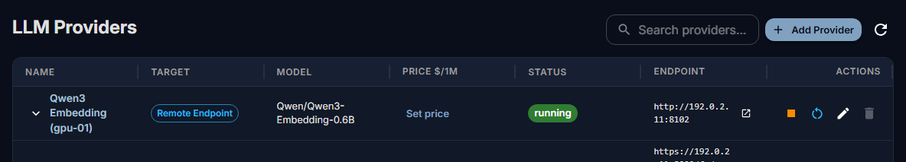
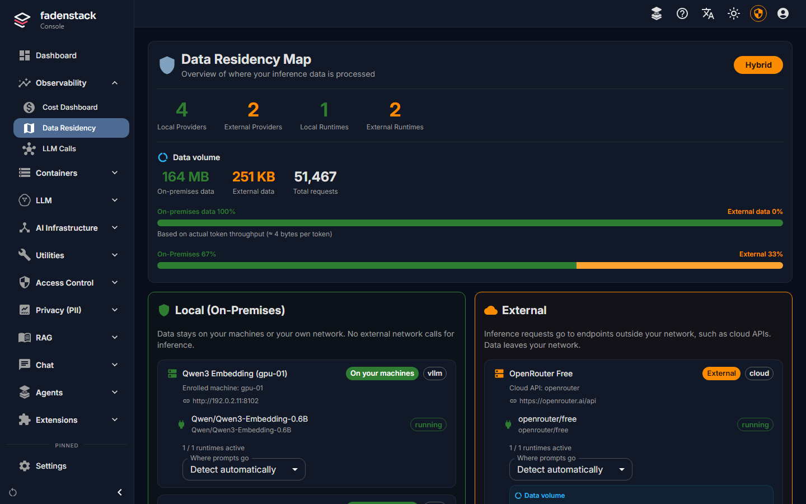

# Remote providers

A remote provider is a model that runs elsewhere: at a cloud provider such as OpenAI, Azure OpenAI,
Anthropic, Google, Mistral or OpenRouter, or on any server that speaks the OpenAI API. Once connected, it is
offered in the chat and at the API next to your own models, under the same rules.

## Before you start

- An account at the provider and an API key from its console.
- A decision about what may leave the organisation: read
  [What leaves the organisation](#what-leaves-the-organisation) first.

## Connect a provider

1. Open **LLM → Providers** and select **Add Provider**.

    

2. Enter a **Name** people will recognise, such as `OpenRouter`.
3. Under **Target**, choose **Remote Endpoint**.
4. Under **Provider**, pick the provider. For OpenAI, Mistral, Groq, DeepSeek and OpenRouter the
   **Endpoint URL** is filled in; change it only for a proxy. For hosted providers such as Anthropic or Google
   Gemini, leave it empty. For any other OpenAI-compatible service, choose **Other (OpenAI-compatible)** and
   enter its address, for example `https://api.example.com/v1`.
5. Paste the **API Key**.
6. Select **Test Connection**. It sends a small request to check the address and the key, and lists the
   provider's models: "Connection successful — 214 model(s) available."
7. Under **Model**, pick the model to offer, or type its name as the provider spells it.
8. Select **Next**. Under **Pricing (Optional)**, enter what a million input and output tokens cost, so that
   the console can estimate what usage costs (see [Usage and costs](usage.md)). Leave both empty to skip.
9. Select **Create**.

The model is available in the chat and through the API at once, under the model's name as you entered it.

One provider entry offers one model. To offer several models of the same provider, add one entry for each,
with the same key.

## The provider's key

- The key stays on the server. People using the chat or the API never see it, and the console does not show
  it again.
- To change it, select **Edit** in the provider's row and enter the new one under **API Key**. Left empty,
  the key stays as it is.
- Everyone who uses the model uses this key: the provider bills the organisation's account, not the person.

## Change or remove a provider

**Edit** in the provider's row changes the **Name**, the **Endpoint URL**, the **API Key** and the **Model**,
and the switch **Offer the gateway's tools**. That switch decides whether the model is offered the time, the
tool search and the chat's MCP tools. Switch it off for a model or a router that does not call tools; with
OpenRouter's free router, for example, requests are then shorter and the router can choose among all free
models.

**Stop** in the provider's row stops sending requests to it without removing it; **Start** sends them
again. **Delete** removes a stopped provider. It cannot be undone.

**Set price** (in the **Price $/1M** column) sets or changes the price later.

The **Providers** list also shows the models your clusters serve (**Target**: **Cluster**). Those are
managed on their deployment's page, not here (see [Deployments](deployments.md)).

## What leaves the organisation

A request answered by a remote provider is sent to that provider, over the internet unless the provider is
on your own network. It carries what the model needs to answer:

- the person's new message and the chat's earlier messages;
- the instructions that go with it: the chat project's instructions and the [skills](skills.md) in use;
- the text of files attached to the chat, and what tools returned, such as passages from the knowledge base
  or an MCP tool's answer;
- when **Offer the gateway's tools** is on, the names and descriptions of the tools offered;
- for an [agent](agents.md), the page or document the agent reads to answer.

The answer comes back the same way. What the provider keeps, and for how long, is set by its own terms.

**Personal data.** With the **Privacy (PII)** module on, the policy decides whether personal data is
replaced before a request leaves. The policy Fadenstack starts with protects requests to cloud providers:
names, e-mail addresses, phone numbers, card and account numbers and similar data are removed from them.
Check and adjust it under [Policies and personal data](policies.md).

**Choose with care which model an agent uses.** Everything an agent reads for a person goes to the agent's
model.

## Data residency

**Observability → Data Residency** shows where prompts are processed, for every provider:

| Class | Meaning |
|---|---|
| **On your machines** | Served by Fadenstack on your GPU machines, or on this server. |
| **Your network** | An address in a private range, or in a network you declared internal. |
| **External** | A known cloud API, or a public address: data leaves your network. |
| **Unknown** | The address does not resolve from this server, or none is set. |

Each provider says why it was placed where it is, for example "Cloud API: openrouter" or "Enrolled machine:
gpu-01". The page also shows how much data went each way, estimated from the tokens, and a badge for the
whole setup: **Air-Gapped ✓**, **Hybrid** or **Cloud Only**. Until every unknown provider is placed, the
setup is not counted as air-gapped.

When Fadenstack cannot tell, or tells wrongly, set **Where prompts go** on the provider: **On your
machines**, **Your network** or **External**. **Detect automatically** goes back to detection. Networks of
your own outside the private ranges, such as your data centre's public range, are declared under **Settings
→ General**: **Internal networks**.

The [dashboard](dashboard.md) shows the same classes as **Kept in-house** and in **AI traffic**.

## When it does not work

**"Not OpenAI API compatible".** The address or the key is wrong, or the service does not speak the OpenAI
API at that address. Check the address ends where the provider's documentation says, usually `/v1`.

**The model is not in the chat.** Check that the provider is not stopped, and its name under **Model** in
the provider's **Edit** dialog.

**"… is not answering"** on the dashboard. The provider did not answer its last checks, and requests are
not sent to it until it answers again. Check the provider's status page and your server's internet access.
