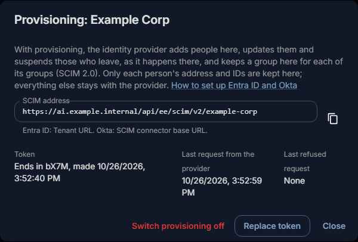

# Provisioning (SCIM)

With provisioning, your identity provider adds people here, updates them and suspends those who leave as soon as
it happens there, without waiting for them to sign in. Each of its groups becomes a group here, with the same
members. It works with Entra ID, Okta and other providers that speak SCIM 2.0, for OpenID Connect and SAML
providers, and needs Fadenstack Enterprise.

## Before you start

- You are signed in to the console as a **Superuser**.
- The provider is set up under **Access Control → Sign-in providers** (see [Sign-in providers](sign-in.md)).
- The server is reached over HTTPS, with a certificate the identity provider trusts. Fadenstack takes
  provisioning only over HTTPS.
- The identity provider can reach the server. Entra ID and Okta send from their cloud services: from the
  internet, or through the provider's agent inside your network (Entra ID: the provisioning agent with the
  **On-premises SCIM app**).

## Switch provisioning on

1. Open **Access Control → Sign-in providers** and select the **Provisioning** icon (two arrows) in the
   provider's row.
2. Select **Switch provisioning on**.
3. Copy the **SCIM address** and the **Token**. The token is shown only now; later the dialog shows only its
   last four characters.
4. Enter both at the identity provider (below) and start provisioning there.

The dialog then shows the **Last request from the provider** and the **Last refused request**. The
**Provisioning** column of the providers list says **On** for the provider.

??? info "What Fadenstack keeps of the people it is sent"
    Only what it needs. Everything else stays with the identity provider, and is accepted and dropped here:
    never stored, never written to a log.

    | The provider sends | Kept here |
    |---|---|
    | The person's ID at the provider (`externalId`) | Yes, to find the person again. Not shown. |
    | The login name (`userName`) | Yes |
    | One e-mail address (the work or primary one) | Yes: the account's address |
    | Active or not (`active`) | Yes: the account is suspended or not |
    | A group's name and members | Yes: a group here and its members |
    | Names, phone numbers, postal addresses, job title, department, manager, employee number, photos, other attributes | No |

    Map only the attributes in the first five rows at the provider (below), and delete the other mappings.

## What changes here

| At the identity provider | Here |
|---|---|
| A person is assigned to the application | They get an account with the provider's **Roles of new accounts** (see [Sign-in providers](sign-in.md#who-may-sign-in-and-what-they-get)). If an account with their address exists, it is linked, unless it is a superuser's or another sign-in provider keeps it. |
| A person's address or login name changes | The account's address changes. |
| A person is unassigned, disabled or deleted | The account is suspended: no sign-in, and none of their agents active. Nothing is deleted. |
| The same person is assigned again | The same account is let back in. |
| A group is assigned | A group with its name, **Kept by** the provider on **Access Control → Groups**. Give it roles and agents there. |
| A group's members change | Its members change. Members an administrator added stay. |
| A group is unassigned or deleted | The group stays, with the members an administrator added; it is no longer kept by the provider. |

Superusers are never changed or suspended by provisioning. A suspension made by an administrator, or after days
without sign-in, is not lifted by the provider: **Let back in** on **Access Control → Users** does that.

## The first sign-in

People provisioning added sign in with the provider as anyone else does. At their first sign-in, their account
is linked to the sign-in without the proof asked of other people who already have an account here:

- by the ID the provider sends at sign-in, when it is the one provisioning sent (Entra ID: set
  **Claim that names the person** to `oid`, see [OpenID Connect](sign-in-oidc.md));
- else by their e-mail address, when the provider vouches for it.

From then on provisioning keeps their address and groups: the sign-in changes neither, and the provider's group
rules do not apply to them. To let only these people sign in with the provider, tick **Only people the
provider's provisioning added may sign in with it** in the provider's settings.

## Entra ID

An application you registered under **App registrations** for OpenID Connect cannot provision. Add a second
application for provisioning, and assign it the same people and groups.

Each person needs an e-mail address in Entra ID: their **Email** under **Properties → Contact information**.
People without a mailbox have none until it is set, and Fadenstack takes nobody without an address.

1. In the Microsoft Entra admin center, open **Entra ID → Enterprise apps → New application → Create your own
   application**, name it, choose **Integrate any other application you don't find in the gallery
   (Non-gallery)** and select **Create**. (For a SAML provider you can use the application people sign in with.)
2. Open its **Provisioning** page and select **New configuration** (or **Get started**, and set
   **Provisioning Mode** to **Automatic**).
3. Choose bearer authentication, paste the **SCIM address** into **Tenant URL** and the **Token** into
   **Secret Token**, and select **Test Connection**. Then save.
4. Under **Mappings**, open **Provision Microsoft Entra ID Users**. Keep `userName`, `active`,
   `emails[type eq "work"].value` and `externalId`; delete the other mappings. Set the source of `externalId`
   to `objectId`, the person's ID in Entra ID.
5. Under **Provision Microsoft Entra ID Groups**, keep `displayName`, `members` and `externalId`.
6. Under **Settings**, choose **Sync only assigned users and groups**. Assign people and groups on the
   application's **Users and groups** page.
7. Back on **Provisioning**, set **Provisioning Status** to **On** and save.

Entra ID sends changes in cycles, about every 40 minutes. To try one person at once, use **Provision on demand**.
Entra ID's **Provisioning logs** show what it sent and what this server answered.

## Okta

1. In the Okta Admin Console, open the application people sign in with (**Applications → Applications**).
2. On **General**, under **App Settings**, select **Edit**, choose **SCIM** under **Provisioning**, and save. A
   **Provisioning** tab appears.
3. On **Provisioning → Integration**, select **Edit**:
    - **SCIM connector base URL**: the **SCIM address**.
    - **Unique identifier field for users**: `userName`.
    - **Supported provisioning actions**: **Push New Users**, **Push Profile Updates** and **Push Groups**.
    - **Authentication Mode**: **HTTP Header**, and the **Token** as the bearer token, without `Bearer` in
      front of it.
4. Select **Test Connector Configuration**, then save.
5. On **Provisioning → To App**, select **Edit**, switch on **Create Users**, **Update User Attributes** and
   **Deactivate Users**, and save.
6. Under the attribute mappings, remove what Fadenstack does not keep, where Okta lets you. What it still sends
   is dropped here.
7. Assign people and groups on **Assignments**; push groups on **Push Groups**.

For sign-ins with SAML, have Okta send its ID for each person as `subject-id` (see
[SAML](sign-in-saml.md)): a person's first sign-in then finds the account provisioning made by that ID.

## Replace the token or switch off

- **Replace token**: makes a new token at once. The old one stops working, so the provider's changes are
  refused until you enter the new one there.
- **Switch provisioning off**: the token stops working. The people and groups provisioning made stay as they
  are, and people keep signing in with the provider.
- **Deleting the provider** under **Sign-in providers** ends its provisioning too.

## When it does not work

| You see | What to do |
|---|---|
| The provider's test fails with **401** or "unauthorized" | The token is wrong or was replaced. Select **Replace token** and enter the new one at the provider. |
| The provider's test fails with **403**, "Provisioning answers only over HTTPS." | The provider used `http://`. Use the **SCIM address** as the dialog shows it, opened over HTTPS. |
| The provider's test fails with **403**, "Provisioning needs an active Fadenstack Enterprise licence.", or **Last refused request** shows `403 licence` | The licence is missing or has expired; the admin pages say which. Accounts keep their last state meanwhile. |
| The provider cannot connect at all | It cannot reach the server, or does not trust its certificate. See [Before you start](#before-you-start). |
| Okta's test says no users were returned | Nobody is provisioned yet. Save, then assign people. |
| A group pushed from Okta does not appear under **Groups** | Okta could not reach the server when it pushed. On **Push Groups**, select the group's **Push Status → Push Now**, or **Retry** under **Dashboard → Tasks**. |
| **Last refused request** shows `409 UniquenessException` | Two people at the provider have the same login name or address, or another sign-in provider keeps the account with this address. Fix it at the provider. |
| **Last refused request** shows `403 ForbiddenException` | The address is a superuser's here, and superusers are never provisioned. Leave that person unassigned at the provider. |
| **Last refused request** shows `400 InvalidFilterException` | The provider asked in a way this server does not answer. Map `userName` as the unique identifier. |
| **Last refused request** shows **429** | The provider sent too much at once; it tries again by itself. |
