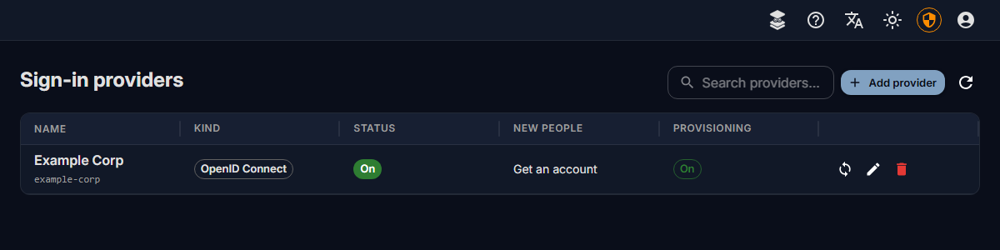

# Sign-in providers

People sign in with the account they already have at your organisation: through an identity provider that
speaks OpenID Connect or SAML, or with their name and password from your directory (LDAP, Active Directory).
They get a Fadenstack account the first time they do, with the roles and groups you choose.

## Before you start

- You are signed in to the console as a **Superuser**.
- The **Sign-in** module is switched on (**Settings → Modules**). Then the page **Access Control → Sign-in
  providers** appears.
- The server is reached over HTTPS, at the address people use (for example `https://ai.example.internal`).
  Each provider has a **Server address**: identity providers send people back there, and the addresses the
  provider is registered with are made from it. It starts as the address the console is open at.

## Add a provider

1. Open **Access Control → Sign-in providers** and select **Add provider**.
2. Under **Kind**, pick what your organisation has:
    - **OpenID Connect**: Entra ID, Google, Okta, Keycloak and others. See [OpenID Connect](sign-in-oidc.md).
    - **SAML 2.0**: AD FS, Shibboleth and others. See [SAML](sign-in-saml.md).
    - **Directory (LDAP, Active Directory)**: people type their directory name and password on the sign-in
      page. See [Directories](sign-in-ldap.md).
3. Give it a **Name**: people see it on the sign-in page, for example "Example Corp".
4. Check the **Key** the console made from the name. It is part of the addresses the provider is registered
   with, and cannot be changed later.
5. Check the **Server address**, fill in the provider's fields, and register the addresses shown at the
   provider (see the page for your kind). Then decide who may sign in (below).
6. Select **Add provider**.

The dialog lists what is **Still needed** before it can be sent. When the sign-in module refuses a setting, it
says which one and why, in the dialog.

## Who may sign in, and what they get

| Field | What it does |
|---|---|
| **Create an account at the first sign-in** | Off: only people who already have an account here can sign in with the provider. |
| **Roles of new accounts** | The roles a new account gets, at its first sign-in or from [provisioning](sign-in-provisioning.md). A new provider starts with `default_user`, which people need to chat (see [Users, groups and roles](users.md)). Empty: none until someone gives them. Nobody becomes a superuser this way. |
| **Only people the provider's provisioning added may sign in with it** | Shown with [provisioning](sign-in-provisioning.md). Everyone else is refused, and nobody gets an account by signing in. Superusers are not held to it. |
| **Allowed e-mail domains** | Only people with an address in these domains may sign in, for example `example.com`. An address in one of them counts as verified. Empty: any. |
| **People with an address in these domains may only sign in with this provider** | They can no longer sign in with a password here, so leaving your organisation ends their access here too. Superusers keep their password; a superuser who mistypes it sees the same message as everyone in the domain, so the page never tells whether a password was right. |
| **Group rules** | People in a group at the provider join a group here when they sign in. Name the group as the provider sends it: its name, its ID (Entra ID sends IDs), or its DN (directories). |
| **Take memberships away that the provider no longer gives** | At each sign-in, people leave the groups here that a rule gave them before and no longer gives. Memberships set by hand stay as they are. |
| **Sign-in lasts at most (hours)** | Then people sign in again. 12 unless you change it; the server's own **Sign-in lifetime** applies when it is shorter. |
| **Suspend after days without sign-in** | Accounts that signed in with the provider and were not used for this long are suspended: no sign-in, and none of their agents active. 45 unless you change it; empty: never. Superusers are never suspended this way. |

!!! note
    A suspended account keeps everything it had. **Let back in** on **Access Control → Users** gives the
    access back.

## How people sign in

- **OpenID Connect and SAML**: the sign-in page shows **Sign in with** and the provider's name. People are
  sent to the provider and come back signed in.
- **Directories**: the sign-in page shows a choice between **Fadenstack account** and the directory's name.
  With the directory picked, people type their **Account name** and password. **Forgot password?** is not
  offered: the password is the directory's.

### Someone who already has an account here

When someone signs in with a provider for the first time and an account with their address exists already,
the two are not joined by themselves: someone else could hold that address at the provider. Instead, the
sign-in page asks them to prove the account is theirs, in the same browser, within 10 minutes:

- with the account's **password**, or
- with a **code** sent to the account's address: **Don't know the password? Get a code by e-mail**. This is
  offered while the server can send mail (Enterprise, with the mail service switched on).

Then the sign-in is linked to the account and they are signed in; afterwards they sign in with the provider.
Five wrong passwords or codes end the attempt: they sign in with the provider again to start over.

An account made by a provider's sign-in has no password anyone knows. Without mail, give the person a
[password reset link](users.md#a-forgotten-password) for it; they set a password, then link with it.

## Change or remove a provider

- **Change**: the pencil icon in the provider's row. Secrets are never shown again: leave the field empty to
  keep the one that is set.
- **The server's address changed**: change the **Server address**, save, and register the new addresses at
  the provider. Until the provider knows them, sign-ins with it fail.
- **Switch off** for a while: turn off **People can sign in with it**. It disappears from the sign-in page.
- **Delete**: the bin icon. People who signed in with it keep their accounts, but can no longer sign in with
  it.

## When it does not work

What people see on the sign-in page, and what to do:

| You see | What to do |
|---|---|
| **"There is no account for you here yet, and this provider does not create one."** | Turn on **Create an account at the first sign-in**, or create their account under **Access Control → Users**. |
| **"You may not sign in with this provider."** | Their address is not in the **Allowed e-mail domains**. |
| **"You have not been given access here yet …"** | Only people the provider's provisioning added may sign in, and this person was not added. Assign them to the application at the identity provider (see [Provisioning](sign-in-provisioning.md)). |
| **"The provider did not confirm your e-mail address …"** | The provider does not say the address is verified. Add the domain to **Allowed e-mail domains**, or, for SAML and directories, tick **Its e-mail addresses are verified** if the provider is your organisation's own. |
| **"The provider did not give your e-mail address …"** | Have the provider send the e-mail address (the `email` scope, or the `mail` attribute). |
| **"The sign-in took too long or was already used."** | Start again from the sign-in page. A sign-in not finished within 10 minutes expires. |
| **"This sign-in only works over HTTPS."** | Open the console at its HTTPS address. |
| **"This sign-in is not available with this server's licence."** | The Enterprise licence is missing or has expired, past its grace period; the admin pages say which. Renew it, then sign in with the provider again. Passwords keep working meanwhile. |
| **"This sign-in is not offered here any more."** | The provider was removed or switched off, or no provider is offered (see the licence above), after the person opened the sign-in page. They sign in another way from a fresh sign-in page. |
| **"The sign-in service cannot be reached right now."** | The sign-in module is not running, or cannot reach the provider. Check the **Sign-in** card under **Settings → Modules**. |
| **"The sign-in did not work."** | The provider refused or answered something the module does not accept. Check the provider's settings on both sides; the sign-in module's log says more. |
