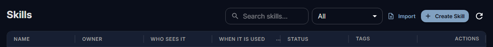

# Skills for the organisation

A skill teaches the assistant how to do one kind of task the way your organisation does it: a review
checklist, a report format, the steps of an incident write-up. People create their own skills in the chat and
share them; as administrator you see every skill, publish skills for everyone, and decide who may do what.

How people use and create skills in the chat is in [Skills](../use/skills.md). The skill format itself (the
`SKILL.md` file and its folder) is on the Developers site: [Skills](https://developers.fadenstack.com/skills/).

## Before you start

- The **Skills** module is on (**Settings → Modules**; see [Modules](index.md#modules)).
- **Extensions → Skills Hub** lists every skill. People reach their own skills from the chat's user menu
  (**Skills**).

## Owners and who sees a skill

Every skill has an owner: the person who created it, or the organisation (shown as **Owned by the
organization**). Only the owner, or an administrator, shares a skill, changes who sees it, archives it or
deletes it.

| **Who sees it** | Who can find and use it |
|---|---|
| **Private** | The owner, the people and groups it is shared with, and administrators. Every new skill starts here. |
| **Organization** | Everyone in the organisation. |
| **Everyone (all tenants)** | Every tenant on this installation. Administrators only. |

A private skill can be shared with people and groups on its **Sharing** tab, at one of two levels:

| Level | Allows |
|---|---|
| **Can use** | Seeing the published version and using it in chats. |
| **Can edit** | Also saving new versions and publishing them. |

The same rules decide what reaches a chat: a private skill never reaches the chat of anyone it is not
shared with. When someone leaves a group, the skills shared with that group stop reaching their chats within
a minute.

## Create a skill for everyone

1. Open **Extensions → Skills Hub** and select **Create Skill** (or **Import** a `SKILL.md` or a zipped skill
   folder).

    

2. Enter the **Skill Name** and the **Short name**, which people type after `$` in the chat to pick it.
3. Write the **Description** (what the skill does and when to use it: the model reads it) and the
   instructions.
4. Choose **When it is used**:
    - **When picked**: only when someone picks it in a chat, or asks for it with `$name`;
    - **When it matches**: when a message contains one of its trigger keywords or the chat has a file of one
      of its file types, and whenever it is picked;
    - **Always**: in every chat of everyone who sees it.
5. Under **Who sees it**, choose **Organization**.
6. Save it, and publish it (see [Versions](#versions)).

!!! note "Always for the whole organisation"
    A skill everyone sees goes into every chat when it is set to **Always**, so only an administrator can set
    that, on the skill's **Settings** tab. Use it for few, short skills.

The **Settings** tab also holds the skill's tags, triggers, and tool lists: tools the skill may use, prefers
or must not use, and the knowledge sources it draws on.

## Versions

Every save is a new version; no version is ever changed or deleted. A skill points at two of them:

- the latest version, which the editor shows;
- the **published** (live) version, which chats get.

**Save** adds a version without changing what chats get. **Save & publish**, or **Publish** on a version,
changes what chats get. On the **Versions** tab, **Changes** compares two versions and **Roll back to this**
publishes an older one, with its triggers and tool lists. The skill's status says what is live, for example
"Live v3 · v4 draft".

Each version has a fingerprint of its content. The audit log records the skill, the version and that
fingerprint for every request that used it, so what the model was told can always be looked up.

If two people save the same skill at once, the second save is refused with "This skill changed since you
opened it", instead of replacing the first.

## Manage the organisation's skills

In **Extensions → Skills Hub**:

- **All**, **Organization**, **Mine** and **Shared with me** narrow the list. Each skill shows its owner,
  status and how often it was used in the last 30 days.
- **Publish v…** publishes a skill's latest version; **Archive** takes it out of use and keeps it
  (**Restore** brings it back); **Delete** removes it for good.
- **Export** gives the **Skill folder (.zip)** or the **SKILL.md only**, to keep or to use in other tools.
- The **Assignments** tab brings a skill into the chats of a tenant, workspace, project or assistant, for
  the people who can see it.

Fadenstack never runs the scripts a skill folder may contain. They are kept so the skill can be exported to
tools that do.

## Who may do what

| Permission | Allows | Built-in roles that have it |
|---|---|---|
| `skills:read` | Seeing and using the skills visible to them | `default_user`, `viewer`, `operator`, `admin` |
| `skills:create` | Creating and importing skills of their own | `default_user`, `operator`, `admin` |
| `skills:share` | Sharing their skills with people and groups | `default_user`, `operator`, `admin` |
| `skills:publish` | Making a skill visible to the whole organisation | `admin` |
| `skills:manage` | Administering every skill | `admin` |

Superusers have all of them. To let someone who is not an administrator publish skills for everyone, give
them a role with `skills:publish` (see [Users, groups and roles](users.md#roles-of-your-own)).

## Limits

Unless whoever runs the server changed them:

| Limit | Default |
|---|---|
| Published skills the whole organisation sees | 25 |
| Skills one person owns | 200 |
| Skills picked for one message | 5 |
| Instructions of one version | 100,000 characters |
| Files in a skill's folder | 64, at most 512 KiB each and 4 MiB in all |

Private skills do not count against the 25.

## When it does not work

**A skill does not come into a chat.** Check that it is published (not only saved), that the person can see
it, and how it is used: a skill set to **When picked** comes in only when picked.

**"You do not have the permission to share skills."** The person's roles lack `skills:share`.

**People cannot see the Skills page.** The **Skills** module is off, or their roles lack `skills:read`.
