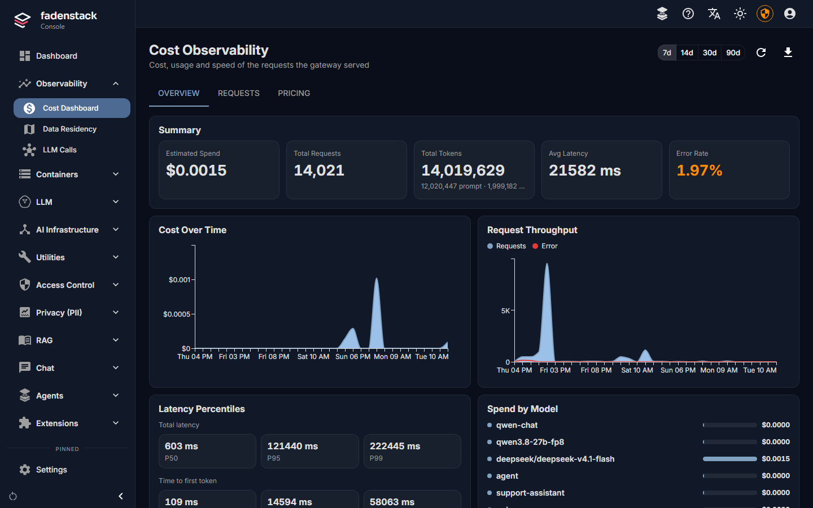
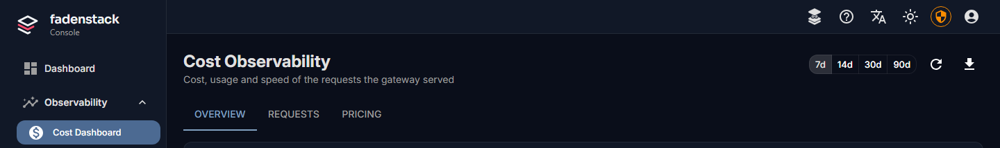
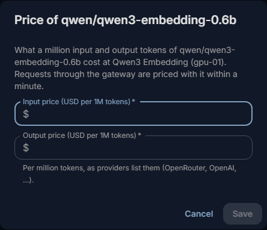
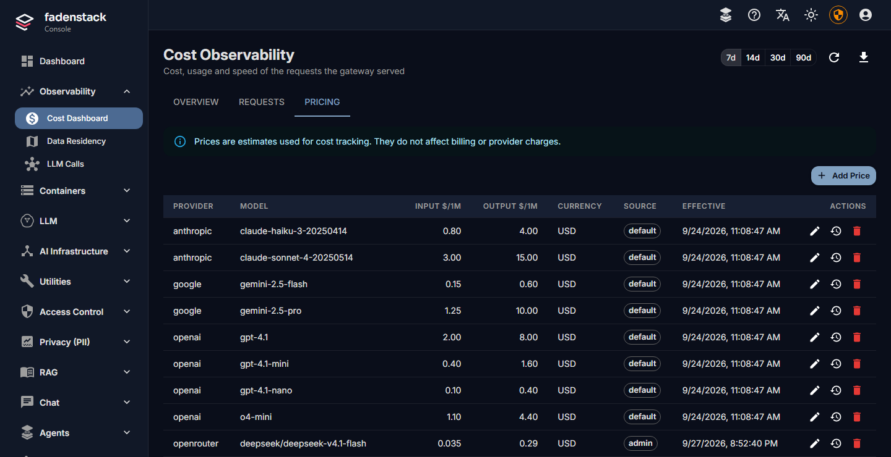

# Usage and limits

Fadenstack counts every request that goes through its gateway: how many tokens it took, which model answered,
and what it would cost at the prices you set. This page shows what is counted, where each person and the
administrators see it, and how to limit what the whole instance uses. What the figures mean for people's data,
and who may see whose, is on [Usage and privacy](usage-privacy.md).

## Where to see it

| Where | Who | What it shows |
|---|---|---|
| **My usage**, in the menu behind the account button | Everyone, for themselves | Their own tokens and estimated cost, the limits that apply, and a download of their data (see [Your own usage](#your-own-usage)). |
| **Observability → Usage** | Administrators and auditors | Totals and a series over time, by team, agent, model or provider, only for groups of at least five people (see [The Usage page](#the-usage-page)). |
| [Dashboard](dashboard.md) | Administrators | Today at a glance: **Requests today**, **Active users today**, **Kept in-house**, **Spend this month**, **Error rate (1 h)**; **AI traffic** (where requests were served) and **Usage** (requests per day, by where they were served). |
| **Observability → Cost Dashboard** | Administrators | Spend, requests, tokens, speed and errors of the whole instance, and the prices (see [The cost and usage pages](#the-cost-and-usage-pages)). |
| **Observability → LLM Calls** | Administrators | Each request and call: why one failed, what an agent did for one question, where calls went (see [LLM calls](llm-calls.md)). |
| An agent's **Activity** tab | Administrators; the owner of a personal agent | Requests, errors, tokens, users and conversations of that agent, counts only, when at least five people used it in the range; its owner sees a personal agent's figures (see [Agents and add-ins](agents.md)). |
| A deployment's page | Administrators | Requests, speed and failures of that model over the last minutes (see [Deployments](deployments.md)). |
| **Observability → Data Residency** | Administrators | How much data went to your machines, your network and outside (see [Data residency](providers.md#data-residency)). |

## What is counted

Everything that goes through the gateway is counted: the chat, the agents, and applications using API tokens.
For each request, the request log keeps:

- the person, their **Usage group** (their team), and the chat project or the agent it came from;
- the model, and where it ran: on your machines, in your network or at an external provider;
- the tokens, and the time to the first token and the whole time;
- the outcome: success, the error, or the limit that refused it;
- the estimated cost, when the model has a price.

The text of the request and its answer is not part of it. Every few minutes, Fadenstack adds the request log up
into hourly and daily figures; the usage pages read those. The full list of what is stored, and for how long, is
on [Usage and privacy](usage-privacy.md#the-data-fields).

Each figure on the usage pages counts:

| Figure | What it counts |
|---|---|
| **Requests** | Every request that reached the gateway, failed and refused ones included. Below it, how many of them: |
| … failed | Ended in an error (HTTP status 400 or higher). Refusals by a limit are not counted here. |
| … refused by a limit | Refused before they ran (see [Limits for the whole instance](#limits-for-the-whole-instance)). They used no tokens. |
| **Input tokens** | What was sent to the model, cached tokens included. Below it, how many *of them cached*: the part the model or its provider took from a cache. |
| **Output tokens** | What the model wrote, its reasoning included. Below it, how many *of them reasoning*: the part a reasoning model spent thinking before it answered. |
| **Estimated cost** | The tokens at the model's price (see [Where the numbers come from](#where-the-numbers-come-from)), per currency. |
| **People** | How many different people the figure covers. |

??? info "Days, months and the time zone"
    Days and months begin at midnight in the usage time zone: **Settings → Usage and privacy**, **Time zone**
    (`usage.time_zone`). Unless you change it, it is the server's time zone, or UTC when that is not known. The
    daily limit starts again at the same midnight.

## Your own usage

Everyone who signs in sees their own usage under **My usage**, in the menu behind their account button:

- their tokens and estimated cost by day or month, by model, by agent and by chat project;
- the limits that apply to the instance, and how much of each is used at the moment;
- whether person-level reporting is on, how finely and for how long their figures are kept, and how often a
  usage auditor looked at them, with a link to your privacy notice when you have set one (see
  [Usage and privacy](usage-privacy.md#the-settings));
- under **Your data**, **Download as JSON** and **Download as CSV**.

The download holds their daily figures, their request records still in the request log (time, model, agent,
tokens, cost and outcome; never what was written, never the device), and the date and the stated reason of
each time a usage auditor looked at their figures, without the name of who looked. It answers what a person
may ask under Art. 15 GDPR about their usage (see [Usage and privacy](usage-privacy.md#your-own-view-and-the-download)).

## The Usage page

The **Usage** page shows how much the instance uses, and where, without showing anyone's own figures.
Administrators can open it, and so can people with the role `auditor`, who need no administrator rights for it
(see [Administrators and auditors](users.md#administrators-and-auditors)).

1. Open **Observability → Usage**.
2. Pick the **Period** (**7 days** to **12 months**), and **Figures per** **Hour**, **Day** or **Month**.
3. Under **Group by**, choose **Usage group** (the team), **Agent**, **Model** or **Provider**.

The page shows the **Totals**, **Tokens over time**, and one row per team, agent, model or provider, with the
figures of [What is counted](#what-is-counted). It never shows a person, a name or a ranking of people. Who may
look at one person's figures, and how, is on
[Usage and privacy](usage-privacy.md#looking-at-one-persons-figures).

### Teams on the Usage page

With **Group by** **Usage group**, the teams appear as a tree, as set on **Access Control → Groups** (see
[Teams in a tree](users.md#teams-in-a-tree)). Open a team to see its sub-teams.

- **A team's figures include its sub-teams'.** A person's usage counts toward their usage group and every team
  above it.
- **A team is shown when at least five people were active in it and its sub-teams together.** Smaller sub-teams
  are counted together in one "smaller teams" row under their parent, protected like the **Fewer than 5 people**
  row (see [The minimum group size](#the-minimum-group-size)).
- **People without a usage group** are counted under **Unassigned**.
- **As recorded** or **Today's structure** decides which tree the figures follow. **As recorded**, the default,
  counts usage toward the teams as they stood when it happened, so a reorganisation does not rewrite the past.
  **Today's structure** counts all of it toward today's tree, for example to compare last year with the new
  departments.

### The minimum group size

Every figure on the page covers at least five different people: the **minimum group size**, which you can raise
under **Settings → Usage and privacy** but not set below five.

- A team, agent, model or provider used by fewer people in the range gets no row of its own. It is counted in the
  row **Fewer than 5 people**, which holds all of them.
- That row covers at least five people as well. Where the small groups together are fewer, the smallest groups
  shown are moved into it until it does, so no group's figures follow from the total minus the other rows.
- An hour, a day or a month in which fewer people used the instance shows no figures. Hours show only where at
  least five people used it.
- The same holds over time: where hiding a period would let it be worked out from the total minus the periods
  shown, another period is hidden with it.
- **Totals** and **Tokens over time** show figures only when at least five people used the instance in the
  range. A usage auditor sees them anyway while person-level reporting is on.

A team of three, or an agent one person uses, is therefore never shown on its own: its figures would be one
person's under another name.

!!! note "Small instances"
    When fewer than five people used the instance in the range, the page says so (**A small instance**) and the
    totals show no figures: they would be close to one person's own. A usage auditor who still sees them while
    person-level reporting is on handles them as person-level data (see [Usage and privacy](usage-privacy.md)).

## The cost and usage pages

Open **Observability → Cost Dashboard** (the page is titled **Cost Observability**) and pick a time range.

| Tab | What it shows |
|---|---|
| **Overview** | **Estimated Spend**, **Total Requests**, **Total Tokens**, **Avg Latency** and **Error Rate**, with **Cost Over Time**, **Request Throughput**, **Latency Percentiles** and **Spend by Model**. |
| **Requests** | Every request, newest first. Filter by **Model**, and open one for its details: tokens, cost, timing, the tools and skills it used, and the steps it went through. |
| **Pricing** | The prices the estimates use (see [Set prices](#set-prices)). |

**Export CSV** downloads the requests of the range (up to 5,000 rows) for a spreadsheet.

The requests never show who sent them: not in the list, the details or the export, and not on **LLM Calls**
either. One person's usage is shown only in the person-level view on **Usage** (see
[Usage and privacy](usage-privacy.md#looking-at-one-persons-figures)).

## Limits for the whole instance

Three limits keep the instance from being used up, by a runaway script or an agent going in circles. Each counts
everyone's requests together, through the chat, the agents and the API, and keeps nothing about any person.

| Limit | What it caps | Starts again |
|---|---|---|
| **Requests per minute** | The requests of everyone together | Every minute |
| **Tokens per minute** | Input and output tokens of everyone together | Every minute |
| **Tokens per day** | Input and output tokens of everyone together | At midnight in the usage time zone |

1. Open **Settings** and select the **Usage and privacy** tab.
2. Under **Limits of the instance**, enter a number for each limit you want. Leave a field empty for no limit.
3. Select **Save**.

The change is recorded in the audit log with your name (`usage.limits.update`). **My usage** shows everyone the
limits and how much of each is used.

??? info "How a limit counts a request"
    - A request counts when it starts: its prompt and the most it may write (its `max_tokens`, or a default when
      it sets none). When the answer is done, its real tokens replace that.
    - A request a limit refuses does not count towards it.
    - An answer that is already being written is never cut off: its tokens count once it is done, so the
      instance can end up a little over a limit.

Limits per team, per person or per agent, and budgets, are Planned.

### What people see when a limit refuses

In the chat and in the agents, people get a message that names the limit, for example "this instance's daily
token limit", and asks them to turn to an administrator. It says nothing about anyone's usage, and nobody else is
told.

Applications get the answer OpenAI's API gives, so their client libraries handle it as they would there: HTTP
status `429` with an OpenAI error body (`error.message`, `error.type`, `error.code`).

| Limit | `error.type` | `error.code` | `Retry-After` |
|---|---|---|---|
| Requests per minute | `rate_limit_error` | `rate_limit_rpm` | Seconds to the end of the minute |
| Tokens per minute | `rate_limit_error` | `rate_limit_tpm` | Seconds to the end of the minute |
| Tokens per day | `insufficient_quota` | `quota_tokens_per_day` | Seconds to the next day, with `x-should-retry: false` |

OpenAI's client libraries wait and try again after a per-minute refusal by themselves; after a per-day refusal
(`x-should-retry: false`) they do not. While a limit is set, every answer carries how much is left:
`x-ratelimit-limit-requests`, `x-ratelimit-remaining-requests` and `x-ratelimit-reset-requests`, and the same
three for `-tokens` (the reset as OpenAI writes it, for example `12s`).

## Where the numbers come from

- **Tokens** are what the model's provider reported for the request. Where it reports none, Fadenstack counts
  them itself or estimates them; the request log says which (`provider`, `counted` or `estimated`).
- **Costs** are estimates: the tokens at the price set for the model when the request ran. They do not change
  what a provider bills you. A model without a price adds no cost; figures in more than one currency are shown
  per currency, never converted.
- **The usage pages** add the request log up every few minutes, so a request shows there a few minutes after it
  ended.

### Set prices

1. Open **LLM → Providers** and select **Set price** in the model's row (in the **Price $/1M** column).

    

2. Enter what a million input tokens and a million output tokens cost.
3. Save. Requests are priced with it within a minute.

You can also set prices when you connect a provider, or under **Pricing** on the cost pages, where each
model's price history is kept.

??? info "Which price to set"
    Use the provider's list prices for a cloud model. For your own models, a price of your own (for example
    what the hardware costs you per million tokens) lets you compare and charge back internal use; leave it
    empty if you do not need that.

Requests to an external model without a price are still counted. **Spend this month** on the dashboard says
how many there were ("Requests without a price"), so you know the estimate is short.

## When it does not work

| You see | What to do |
|---|---|
| The figures are empty | No requests in the range, or the gateway cannot write its log. Send a message in the chat, wait a few minutes, then refresh. |
| A request from a moment ago is missing on **Usage** or **My usage** | The usage pages add up the request log every few minutes. Refresh a little later. |
| A row says **Fewer than 5 people**, or a day shows no figures | Fewer than five people used that team, agent, model or day: their figures are kept together on purpose (see [The minimum group size](#the-minimum-group-size)). |
| Spend shows "None" or looks too low | The models used have no price. Set them as above. |
| People get a message about the instance's limit | A limit for the whole instance was reached. Raise it under **Settings → Usage and privacy**, or wait until it starts again: the next minute, or midnight for the daily limit. |
| An application stops with `429` and `quota_tokens_per_day` | The daily token limit was reached; the client does not retry by itself. It works again after midnight in the usage time zone, or as soon as you raise the limit. |
| A request is missing from the cost pages | Only requests that reach the gateway are counted: a model someone calls directly at its endpoint, bypassing Fadenstack, is not. |
