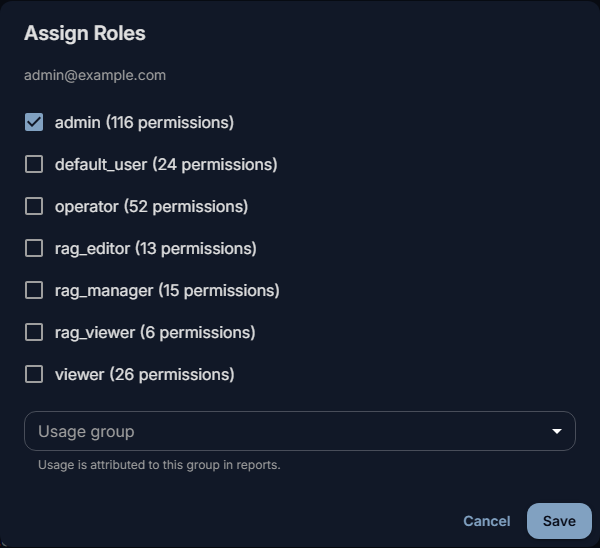
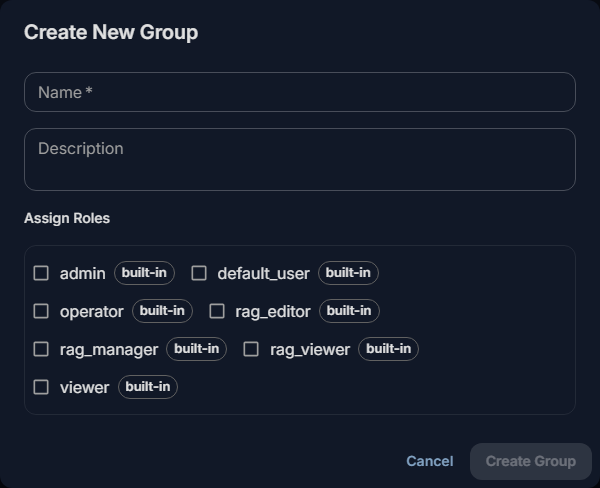
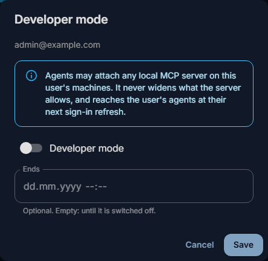
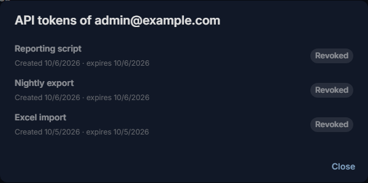
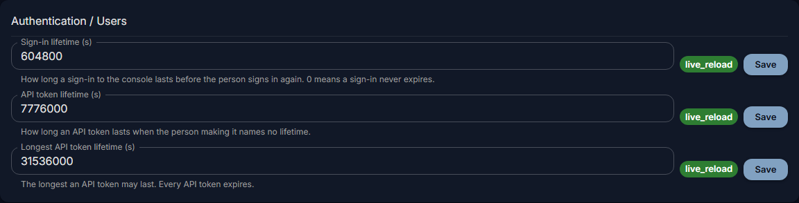
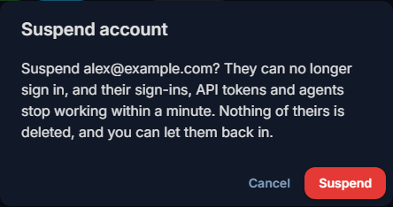

# Users, groups and roles

Everyone who uses Fadenstack signs in with an account. Create accounts, give people roles and groups, and end
someone's access.

## Before you start

- You are signed in to the console as a **Superuser**. The pages are under **Access Control**: **Users**,
  **Roles** and **Groups**.

## What the console and the roles are for

- **The console is for superusers.** Everyone else lands in the chat when they sign in, whatever their roles.
  A superuser can do everything: make someone one only if they set Fadenstack up with you.
- **Roles decide what everyone else may do**: in the chat, on their own **Skills** and **Agents** pages, and
  through the API. A role is a set of permissions; the built-in roles cannot be changed or deleted.

??? info "What each built-in role gives"
    | Role | Gives |
    |---|---|
    | `default_user` | The chat: chats, projects and attachments, their own skills (create and share), and reading the knowledge base's collections that are open to them. Every new account gets it unless you pick other roles. |
    | `viewer` | Reading the state of models, clusters, machines, containers and logs, through the API. |
    | `operator` | What `viewer` gives, and running models through the API: creating, changing, scaling, stopping and starting clusters and deployments. Not deleting. |
    | `admin` | Every permission, including deleting, making a skill visible to the whole organisation (`skills:publish`), administering every skill (`skills:manage`), and creating and deleting agents (`agents:create`, `agents:delete`). |
    | `rag_manager`, `rag_editor`, `rag_viewer` | Managing or editing the knowledge base (`rag_manager`, `rag_editor`: they see every collection and set who reads each), or reading it (`rag_viewer`). |

!!! note
    Roles you tick replace `default_user`. For someone who should also chat, tick `default_user` as well.

## Who reads which collection

Each collection of the knowledge base is open to **everyone who uses the chat**, or **only to the people and
groups** you choose.

1. Open **RAG → Knowledge Base** and point at the collection.
2. Select **Who can read it** (the lock icon).
3. Choose **Only these people and groups**, add people or groups, and **Save**.

A restricted collection shows a lock beside its name.

??? info "More about who reads a collection"
    A collection that is not open to someone hides everything inside it from them too, even a sub-collection that
    is open to everyone: their searches do not find its documents. Superusers and the knowledge base's managers
    (`admin`, `rag_manager`, `rag_editor`) see every collection. An agent searches only the collections chosen
    under **Knowledge** in its definition, and only those its user may read.

## Add a person

1. Open **Access Control → Users** and select **Create User**.
2. Enter their e-mail address and a first password of at least 6 characters.
3. Leave **Superuser** off, unless they administer Fadenstack with you.
4. Under **Assign Roles**, leave everything empty for people who only chat: they get `default_user`.
5. Select **Create User**.

The account is active at once. Pass the first password on in person or by phone; they sign in at
`https://ai.example.internal`, land in the chat, and can change it under **Manage Profile**.

??? info "Invitations and single sign-on"
    There are no invitations: you create each account. Signing in with your organisation's company account
    (single sign-on) is Planned: people will sign in with the account they
    already have, and get a Fadenstack account the first time they do. See also [Your account](../use/account.md).

## Change what someone may do

1. Open **Access Control → Users** and select **Edit Roles** in the person's row.
2. Tick or untick roles, and pick their **Usage group**: the group their usage counts towards (see [Groups](#groups)).
3. Select **Save**.

The search box above the table finds people by e-mail, role or permission.

## Roles of your own

When no built-in role fits, make one:

1. Open **Access Control → Roles** and select **Create Role**.
2. Give it a name and a description, and tick its **Permissions**, for example `agents:create` for people who
   may set up a browser agent for their team, or `skills:publish` for people who may share skills with the
   whole organisation.
3. Save it, and give it to people or to a group.

Deleting a role takes it from everyone who has it; the dialog says how many people that is.

## Groups

A group gathers people, for three things:

- **Roles.** A group's roles apply to all its members, on top of their own.
- **Sharing.** Skills and agents can be shared with a group (see [Skills](skills.md) and [Agents](agents.md)).
- **Usage.** A person's **Usage group** is the group their requests are counted towards (see
  [Usage and costs](usage.md)). It is set per person, on **Users**.

To make one: open **Access Control → Groups**, select **Create Group**, name it and tick its roles under
**Assign Roles**, save it, then select **Manage Members** and **Add Members**.

Removing someone from a group takes away the group's roles. Skills shared with the group stop reaching their
chats within a minute.

## Developer mode

**Developer mode** (the code icon in a person's row) lets agents attach any MCP server running on that
person's own computer. It is for people who build or test tools, and it can end at a time you set under
**Ends**. Leave it off for everyone else.

??? info "What developer mode does not do"
    It never widens what the server allows. It reaches the person's agents the next time their sign-in is
    refreshed.

## Sign-ins and API tokens

| | |
|---|---|
| **A sign-in** | lasts 7 days; then people sign in again. |
| **API tokens** | let scripts and applications use the models through the API. Each person makes their own under **Manage Profile** (or **My Profile** in the console), and can revoke it there. |
| **Every API token expires** | after 90 days unless its maker picks another lifetime, and after a year at most. |
| **Agents** (the browser agent, the Office add-ins) | have their own sign-ins on each device, shown on an agent's **Activity** tab (see [Agents and add-ins](agents.md)). |

To revoke someone else's token: in **Access Control → Users**, select **API tokens** (the key icon) in their
row, then **Revoke**. Applications using a revoked token stop working within a minute.

To change the lifetimes: **Settings → General**, **Sign-in lifetime (s)**, **API token lifetime (s)** and
**Longest API token lifetime (s)**.

## End someone's access

1. Open **Access Control → Users** and select **Suspend** (the person icon with a line through it) in their
   row.
2. Confirm.

Their sign-ins, API tokens and agents stop working within a minute. Nothing of theirs is deleted: **Let back
in** in the same place gives them their access back. You cannot suspend yourself, nor the last superuser.

**Delete** (the bin icon) removes the account and cannot be undone.

## When it does not work

| You see | What to do |
|---|---|
| **"User with email '…' already exists"** | There is already an account for that address. Find it in the list instead. |
| Someone lands in the chat when they open the console | They are not a superuser. Roles do not open the console. |
| Someone cannot chat after you gave them a role | The roles you ticked replaced `default_user`. Edit their roles and tick `default_user` as well. |
| Someone forgot their password | The console cannot set another person's password. If the server does not send reset e-mails, whoever runs it sets a new one, for example `faden admin reset-password --email alex@example.com` (it makes one up when none is given). Have the person change it under **Manage Profile**. |
