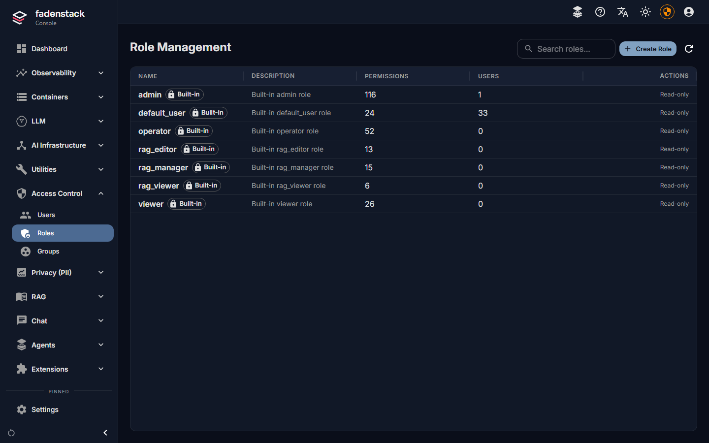
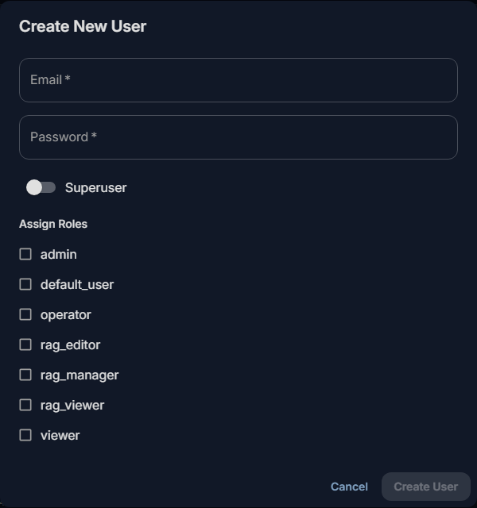
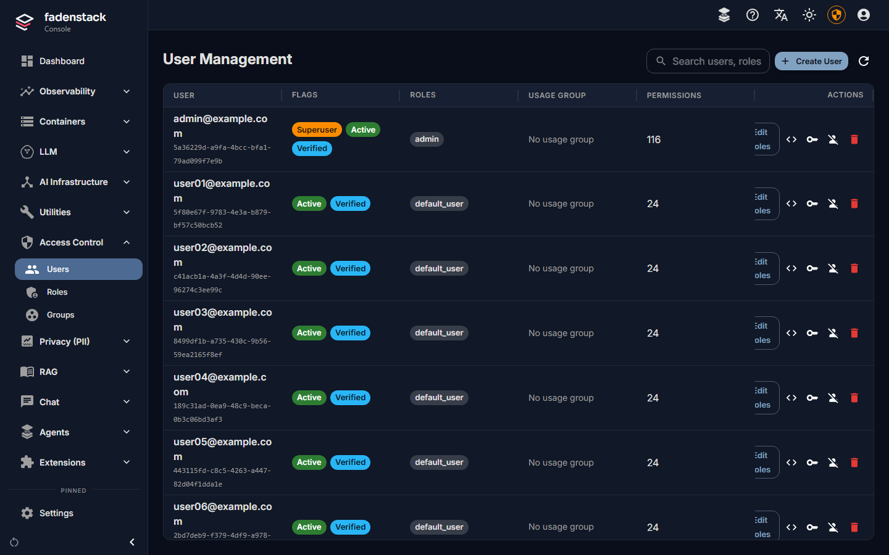

# Users, groups and roles

Everyone who uses Fadenstack signs in with an account. This page shows how to create accounts, what roles
and groups give people, and how to end someone's access.

## Before you start

- You are signed in to the console as a **Superuser**. The pages are under **Access Control**: **Users**,
  **Roles** and **Groups**.

## What the console and the roles are for

- **The console is for superusers.** Anyone who is not a superuser lands in the chat when they sign in,
  whatever their roles. Make someone a superuser only if they set Fadenstack up with you: a superuser can do
  everything.
- **Roles decide what everyone else may do**: in the chat, on their own **Skills** and **Agents** pages, and
  through the API with an API token. A role is a set of permissions. The built-in roles cannot be changed or
  deleted.

| Role | Gives |
|---|---|
| `default_user` | The chat: chats, projects and attachments, their own skills (create and share), and the knowledge base. Every new account gets it unless you pick other roles. |
| `viewer` | Reading the state of models, clusters, machines, containers and logs, through the API. |
| `operator` | What `viewer` gives, and running models through the API: creating, changing, scaling, stopping and starting clusters and deployments, and starting and stopping containers. Not deleting. |
| `admin` | Every permission, including deleting, making a skill visible to the whole organisation (`skills:publish`), administering every skill (`skills:manage`), and creating and deleting agents (`agents:create`, `agents:delete`). |
| `rag_manager`, `rag_editor`, `rag_viewer` | Managing, editing or reading the knowledge base's collections and documents. |

!!! note
    Roles you tick replace `default_user`. For someone who should also chat, tick `default_user` as well.

## Add a person

1. Open **Access Control → Users** and select **Create User**.
2. Enter their e-mail address and a first password of at least 6 characters.
3. Leave **Superuser** off, unless they administer Fadenstack with you.
4. Under **Assign Roles**, leave everything empty for people who only chat: they get `default_user`. Tick
   roles for anyone who needs more, and tick `default_user` too if they also chat.
5. Select **Create User**.

The account is active at once. Pass the first password on in person or by phone, not in the same e-mail as
the address. They sign in at `https://ai.example.internal`, land in the chat, and can change the password
under **Manage Profile** (see [Your account](../use/account.md)).

There are no invitations: you create each account. Signing in with your organisation's company account
(single sign-on) is Planned: people will sign in with the account they
already have, and get a Fadenstack account the first time they do.

## Change what someone may do

1. Open **Access Control → Users** and select **Edit Roles** in the person's row.
2. Tick or untick roles.
3. Pick their **Usage group**: the group their usage counts towards (see [Groups](#groups)).
4. Select **Save**.

The table shows each person's flags (**Superuser**, **Active**, **Verified**), roles, usage group and how many
permissions they have in all. The search box finds people by e-mail, role or permission.

## Roles of your own

When no built-in role fits, make one:

1. Open **Access Control → Roles** and select **Create Role**.
2. Give it a name and a description.
3. Tick its **Permissions**, for example `agents:create` for people who may set up a browser agent for
   their team, or `skills:publish` for people who may share skills with the whole organisation.
4. Save it, and give it to people or to a group.

Deleting a role takes it from everyone who has it; the dialog says how many people that is.

## Groups

A group gathers people, for three things:

- **Roles.** A group's roles apply to all its members, on top of their own.
- **Sharing.** Skills and agents can be shared with a group instead of with each person (see
  [Skills](skills.md) and [Agents](agents.md)).
- **Usage.** A person's **Usage group** is the group their requests are counted towards (see
  [Usage and costs](usage.md)). It is set per person, on **Users**.

To make one:

1. Open **Access Control → Groups** and select **Create Group**.
2. Name it, describe it, and tick its roles under **Assign Roles**.
3. Save it, then select **Manage Members** and **Add Members**.

Removing someone from a group takes away the group's roles. Skills shared with the group stop reaching their
chats within a minute.

## Developer mode

**Developer mode** (the code icon in a person's row) lets agents attach any MCP server running on that
person's own computer. It is for people who build or test tools. It never widens what the server allows,
reaches the person's agents the next time their sign-in is refreshed, and can end at a time you set under
**Ends**. Leave it off for everyone else.

## Sign-ins and API tokens

- **A sign-in lasts 7 days.** After that, people sign in again. You can change this under **Settings →
  General**: **Sign-in lifetime (s)**.
- **API tokens** let scripts and applications use the models through the API. Each person creates their own
  under **Manage Profile** in the chat (or **My Profile** in the console), gives it a name and a lifetime,
  and can revoke it there. Applications using a revoked token stop working within a minute.
- **An administrator can revoke someone else's token** through the admin API: list them with
  `GET /api/admin/users/{user_id}/api-tokens` and revoke one with
  `DELETE /api/admin/users/{user_id}/api-tokens/{token_id}`. The console has no page for this.
- **Agents** (the browser agent, the Office add-ins) have their own sign-ins on each device. You can see and
  sign out devices on an agent's **Activity** tab (see [Agents and add-ins](agents.md)).

## End someone's access

There is no switch to suspend an account. To end someone's access:

1. Open **Access Control → Users** and select **Delete** (the bin icon) in their row.
2. Confirm. This cannot be undone.

They can no longer sign in, and their API tokens stop working within a minute. Agents signed in on their
devices lose access within the **Agent access token lifetime** (**Settings → General**, ten minutes unless
changed).

## When it does not work

**"User with email '…' already exists".** There is already an account for that address. Find it in the list
instead.

**Someone lands in the chat when they open the console.** They are not a superuser. Roles do not open the
console.

**Someone cannot chat after you gave them a role.** The roles you ticked replaced `default_user`. Edit their
roles and tick `default_user` as well.

**Someone forgot their password.** The console has no button to set another person's password. If the
server does not send reset e-mails, whoever runs it sets a new one on the server, for example
`faden admin reset-password --email alex@example.com` (it makes up a password when none is given). Pass it on,
and have the person change it under **Manage Profile**.
