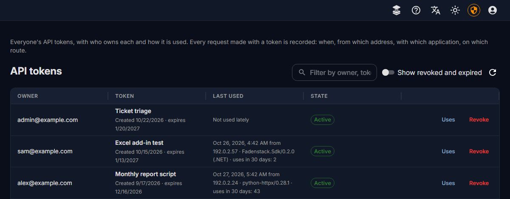
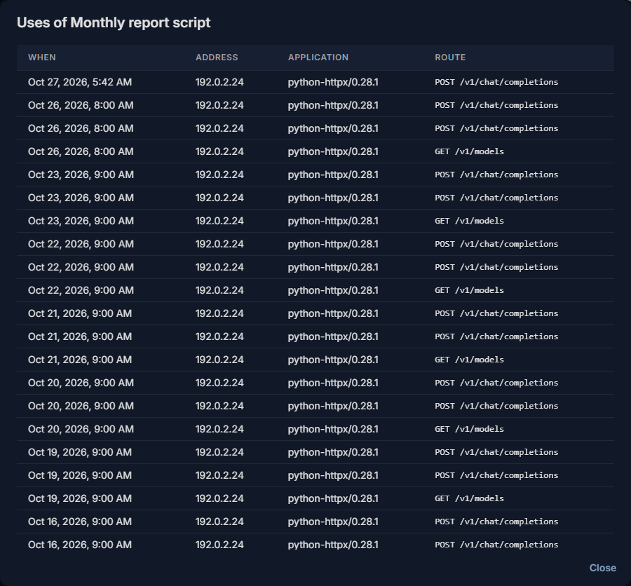
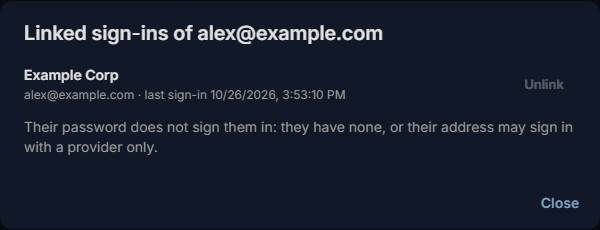

# Users, groups and roles

Everyone who uses Fadenstack signs in with an account. Create accounts, give people roles and groups, and end
someone's access.


## Before you start

- You are signed in to the console as a **Superuser**. The pages are under **Access Control**: **Users**,
  **Roles** and **Groups**.

## What the console and the roles are for

- **The console is for superusers.** Everyone else lands in the chat when they sign in, whatever their roles.
  A superuser can do everything: make someone one only if they set Fadenstack up with you.
- **Roles decide what everyone else may do**: in the chat, on their own **Skills** and **Agents** pages, and
  through the API. A role is a set of permissions; the built-in roles cannot be changed or deleted.


??? info "What each built-in role gives"
    | Role | Gives |
    |---|---|
    | `default_user` | The chat: chats, projects and attachments, in the chat and through the API, their own skills (create and share), and reading the knowledge base's collections that are open to them. Every new account gets it unless you pick other roles. |
    | `viewer` | Reading the state of models, clusters, machines, containers and logs, through the API. |
    | `operator` | What `viewer` gives, and running models through the API: creating, changing, scaling, stopping and starting clusters and deployments. Not deleting. |
    | `admin` | Every permission but one, including deleting, making a skill visible to the whole organisation (`skills:publish`), administering every skill (`skills:manage`), creating and deleting agents (`agents:create`, `agents:delete`), and the usage figures for groups (`usage:read`). Not the one that `usage_auditor` gives. |
    | `usage_auditor` | Looking at one person's usage figures while person-level reporting is on, with a reason each time (`usage.people:audit`). Nobody holds it at installation, and being a superuser does not give it. See [Usage and privacy](usage-privacy.md#looking-at-one-persons-figures). |
    | `rag_manager`, `rag_editor`, `rag_viewer` | Managing or editing the knowledge base (`rag_manager`, `rag_editor`: they see every collection and set who reads each), or reading it (`rag_viewer`). |

!!! note
    Roles you tick replace `default_user`. For someone who should also chat, tick `default_user` as well:
    without it, or a role of your own with the `chat.*` permissions, nobody chats, in the chat or through the
    API. Superusers need no role.

## Who reads which collection

Each collection of the knowledge base is open to **everyone who uses the chat**, or **only to the people and
groups** you choose.

1. Open **RAG → Knowledge Base** and point at the collection.
2. Select **Who can read it** (the lock icon).
3. Choose **Only these people and groups**, add people or groups, and **Save**.

A restricted collection shows a lock beside its name.

??? info "More about who reads a collection"
    A collection that is not open to someone hides everything inside it from them too, even a sub-collection that
    is open to everyone: their searches do not find its documents. Superusers and the knowledge base's managers
    (`admin`, `rag_manager`, `rag_editor`) see every collection. An agent searches only the collections chosen
    under **Knowledge** in its definition, and only those its user may read.

## Add a person


1. Open **Access Control → Users** and select **Create User**.
2. Enter their e-mail address and a first password of at least 8 characters.
3. Leave **Superuser** off, unless they administer Fadenstack with you.
4. Under **Assign Roles**, leave everything empty for people who only chat: they get `default_user`.
5. Select **Create User**.

The account is active at once. Pass the first password on in person or by phone; they sign in at
`https://ai.example.internal`, land in the chat, and can change it under **Manage Profile**.

??? info "Invitations and single sign-on"
    There are no invitations: you create each account, or people get one the first time they sign in with
    your organisation's account (see [Sign-in providers](sign-in.md)). See also [Your account](../use/account.md).

## Change what someone may do


1. Open **Access Control → Users** and select **Edit Roles** in the person's row.
2. Tick or untick roles, and pick their **Usage group**: the group their usage counts towards (see [Groups](#groups)).
3. Select **Save**.

The search box above the table finds people by e-mail, role or permission.

## Roles of your own

When no built-in role fits, make one:

1. Open **Access Control → Roles** and select **Create Role**.
2. Give it a name and a description, and tick its **Permissions**, for example `agents:create` for people who
   may set up a browser agent for their team, or `skills:publish` for people who may share skills with the
   whole organisation.
3. Save it, and give it to people or to a group.

Deleting a role takes it from everyone who has it; the dialog says how many people that is.

## Groups


A group gathers people, for three things:

- **Roles.** A group's roles apply to all its members, on top of their own.
- **Sharing.** Skills and agents can be shared with a group (see [Skills](skills.md) and [Agents](agents.md)).
- **Usage.** A person's **Usage group** is the group their requests are counted towards (see
  [Usage and limits](usage.md)). It is set per person, on **Users**.

To make one: open **Access Control → Groups**, select **Create Group**, name it and tick its roles under
**Assign Roles**, save it, then select **Manage Members** and **Add Members**.

Removing someone from a group takes away the group's roles, and the skills shared with the group stop
reaching their chats at once. Joining or leaving a group signs the person out, as any change of their
rights does (see [Sign-ins and API tokens](#sign-ins-and-api-tokens)).

## Developer mode


**Developer mode** (the code icon in a person's row) lets agents attach any MCP server running on that
person's own computer. It is for people who build or test tools, and it can end at a time you set under
**Ends**. Leave it off for everyone else.

??? info "What developer mode does not do"
    It never widens what the server allows. It reaches the person's agents the next time their sign-in is
    refreshed.

## Sign-ins and API tokens

| | |
|---|---|
| **A sign-in** | lasts 7 days; then people sign in again. **Logout** ends it at once. A password change or reset, a suspension, and any change of a person's rights end all of their sign-ins, the agents' on their devices too, at once: a role given or taken, joining or leaving a group, a change to the roles of their groups or to the permissions of their roles, the administrator right given or taken. They sign in again. Each is recorded in the audit log (`user.sign_ins.ended`, with the cause). |
| **API tokens** | let scripts and applications use the models through the API. Each person makes their own under **Manage Profile** (or **My Profile** in the console), and can revoke it there. |
| **Every API token expires** | after 90 days unless its maker picks another lifetime, and after a year at most. |
| **Agents** (the browser agent, the Office add-ins) | have their own sign-ins on each device, shown on an agent's **Activity** tab (see [Agents and add-ins](agents.md)). |


To revoke someone else's token: in **Access Control → Users**, select **API tokens** (the key icon) in their
row, then **Revoke**. Applications using a revoked token stop working at once.

Every request made with an API token is recorded: when, from which address, with which application, and on
which route; never what was sent. **Access Control → API tokens** lists everyone's tokens with their owner and
last use; **Uses** shows a token's latest 100 uses. A person sees the same for their own tokens under **Manage
Profile**. A token's use also counts as activity, so a provider's "suspend after days without use" does not
suspend people who work only through tokens. The uses are kept for 90 days, then deleted
(`FADEN_BACKEND_API_TOKEN_USE_RETENTION_DAYS` on the server; 0 keeps them).






To change the lifetimes: **Settings → General**, **Sign-in lifetime (s)**, **API token lifetime (s)** and
**Longest API token lifetime (s)**.

### Linked sign-ins



In **Access Control → Users**, **Linked sign-ins** (the link icon) in someone's row shows the sign-in providers
their account is linked to, and whether their password also signs them in. **Unlink** ends one: they can no
longer sign in with it until they link it again from **My Profile**. It is recorded in the audit log with your
name.

A person's last way to sign in cannot be unlinked, so nobody is locked out by mistake. To move someone from a
provider to a password, give them a [password reset link](#a-forgotten-password) first. To end their access,
suspend the account instead (see [End someone's access](#end-someones-access)).

## A forgotten password

When your server sends no e-mail, or the person cannot get it, give them a **password reset link**:

1. Start **Root Mode**.
2. In **Access Control → Users**, select **Password reset link** (the lock icon) in their row.
3. Choose how long it **Works for** (**1 hour**, or **24 hours** for someone you reach later) and give a
   **Reason** (at least 10 characters).
4. Select **Create link**, then **Copy link**, and give it to the person yourself, through a channel only they
   read: in person, by phone, a chat you trust.

The person opens it, sees their address, and chooses a new password; then they sign in with it. All their other
sign-ins end.

- Whoever has the link can take over the account, which is why it needs Root Mode and its reason is recorded in
  the audit log with your name, as is its use.
- It works once. A newer link replaces it, and so does a password change or a suspension.
- It is shown only when you create it; if it gets lost, create a new one.
- Not for your own account (change it under **Manage Profile**), nor for a suspended one.
- It also gives a password to an account made by a sign-in provider, which has none anyone knows.

From the server, `faden admin reset-password --email alex@example.com` sets a new password directly (for
example when no administrator can sign in).

## End someone's access


1. Open **Access Control → Users** and select **Suspend** (the person icon with a line through it) in their
   row.
2. Confirm.

Their sign-ins, API tokens and agents stop working at once. Nothing of theirs is deleted: **Let back
in** in the same place gives them their access back, but the sign-ins they had stay over: they sign in again.
You cannot suspend yourself, nor the last superuser.

**Delete** (the bin icon) removes the account and cannot be undone: its chats, projects, attached files and
what the assistant remembered for it are erased with it. You cannot delete yourself, nor the last active
superuser.

How long chats people delete themselves are kept before they are erased is under **Settings → Chat** (30 days
unless `faden deploy` was told otherwise). Chat data of accounts deleted before this release stayed on the
server; `faden chats orphans` lists it and `faden chats orphans --erase` erases it.

## Administrators and auditors

Two rights are about trust rather than work, and each can be given, taken back and handed over:

- An **administrator** (superuser) may do everything in the console.
- An **auditor** (the built-in role `auditor`) reads the audit log and the usage figures for groups
  (**Observability → Usage**), and changes nothing. Administrators read them too; viewers and operators do not,
  because the audit log holds e-mail and IP addresses.

To change them, start **Root Mode** first, then open **Access Control → Users** and select **Rights** (the
shield icon) in the person's row:

- **Make administrator** or **Remove administrator right** for that person.
- **Hand over**: the right (administrator or auditor) moves from this person to the one you choose, in one
  step. The person who had it loses it and is signed out.

Each change needs a reason of at least 10 characters. It is recorded in the audit log with both names and the
reason. The last administrator keeps the right.

If nobody can sign in as an administrator any more, someone with access to the server makes an account
administrator again (recorded too):

```bash
faden admin grant-admin --email person@example.com --reason "The only administrator left the company"
```

## The audit log

**Logs → Audit** (or **Audit** alone, for an auditor) lists who did what: every change in the
administration areas, refused attempts included, sign-ins and failed sign-ins, password changes and resets,
rights given and handed over, and reads of other people's things or of secrets: the chat overview, the
observability pages, the log viewer and the audit log itself. Each entry has the person's e-mail as it was
then, where the request came from (the address, and whether the console, the API, the CLI or the system), and
the time.

- **Filters**: person, action (a name, or a prefix ending in a dot, such as `user.`), result, severity, source
  and a time range.
- **Export CSV** downloads what the filters show (at most 100,000 entries); the export is recorded.
- The line above the table says whether the log is **intact**: every entry carries the hash of the one before
  it, so an entry changed, inserted or deleted afterwards breaks the chain where it happened. A copy of each
  entry is also kept in a file of its own, which every backup takes, and in the server's logs.

From the server, the same check:

```bash
faden audit verify
```

The CLI's own changes are recorded as well: backups, restores, key rotations, upgrades and password resets with
`faden admin reset-password`. The audit log is never deleted by Fadenstack; it survives upgrades, backups and
restores.

## When it does not work

| You see | What to do |
|---|---|
| **"User with email '…' already exists"** | There is already an account for that address. Find it in the list instead. |
| Someone lands in the chat when they open the console | They are not a superuser. Roles do not open the console. |
| Someone cannot chat after you gave them a role | The roles you ticked replaced `default_user`. Edit their roles and tick `default_user` as well. |
| Someone forgot their password | Without reset e-mails, give them a password reset link: see [A forgotten password](#a-forgotten-password). |
| **"Start Root Mode first: a password reset link is recorded with its reason."** | Start **Root Mode**, then create the link again. |
