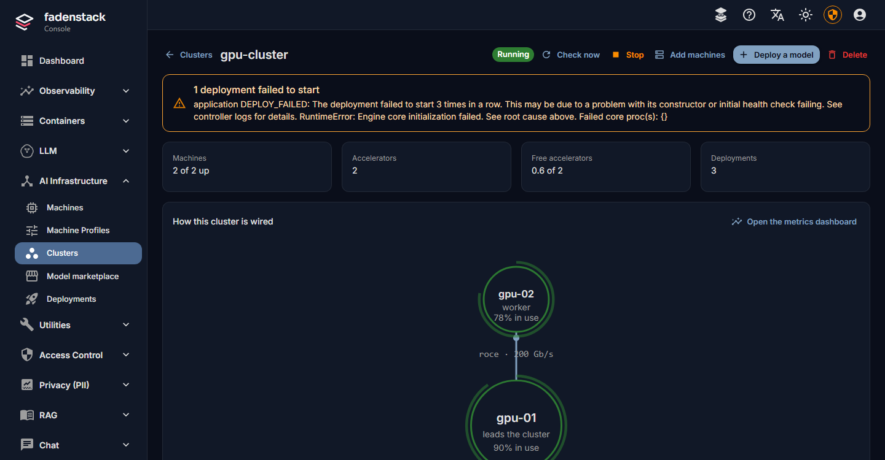

---
hide:
  - navigation
  - toc
---

# Fadenstack Help

Fadenstack is one AI system for an organisation, run by its own IT on its own servers. Ask a question, or start where your work starts.

  <label class="fs-ask__field">
    <svg viewBox="0 0 24 24" fill="none" stroke="currentColor" stroke-width="2" stroke-linecap="round" stroke-linejoin="round" aria-hidden="true"><path d="m21 21-4.34-4.34"/><circle cx="11" cy="11" r="8"/></svg>
    <input type="search" placeholder="Ask a question, for example: How do I add a user?" aria-label="Ask a question" autocomplete="off" spellcheck="false">
  </label>
  <ol class="fs-ask__results" aria-live="polite" hidden></ol>
  
Try:
    <a href="#" data-q="How do I add a user?">add a user</a>
    <a href="#" data-q="How do I connect a GPU machine?">connect a GPU machine</a>
    <a href="#" data-q="Is my personal data protected?">personal data</a>
    <a href="#" data-q="How do I upgrade Fadenstack?">upgrade</a>
  

## Common tasks

- [:lucide-message-circle: Start a chat](use/chat.md#start-a-chat)
- [:lucide-user-plus: Add a person](administer/users.md#add-a-person)
- [:lucide-boxes: Offer a model in the chat](administer/deployments.md#offer-it-in-the-chat)
- [:lucide-shield-check: Protect personal data](administer/policies.md#personal-data)
- [:lucide-plug: Connect a tool (MCP)](administer/mcp-servers.md#register-a-server)
- [:lucide-server: Add a GPU machine](operate/machines.md#add-a-machine)
- [:lucide-circle-arrow-up: Upgrade the server](operate/upgrading.md#upgrade-the-server)
- [:lucide-life-buoy: Troubleshooting](operate/troubleshooting.md)

## Where to start

-   { loading=lazy }

    :lucide-messages-square:{ .lg .middle } **Use**

    ---

    Chat with the organisation's models, use skills and tools, and bring the assistant into the browser and Office. What happens to what you type.

    [Start here](use/index.md)

-   { loading=lazy }

    :lucide-sliders-horizontal:{ .lg .middle } **Administer**

    ---

    For the IT administrator in the console: people and roles, models and where they run, tools, skills, agents, rules for personal data, and usage.

    [Start here](administer/index.md)

-   { loading=lazy }

    :lucide-server-cog:{ .lg .middle } **Operate**

    ---

    For whoever runs the server and the GPU machines: install, upgrade, secure, connect machines into clusters, and fix what fails.

    [Start here](operate/index.md)

Building on Fadenstack (the API, the SDKs, MCP servers)? That is on the [Developers](https://developers.fadenstack.com/) site.
