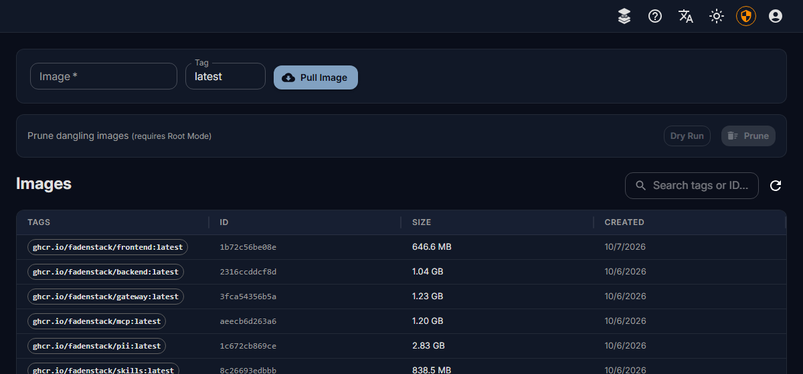
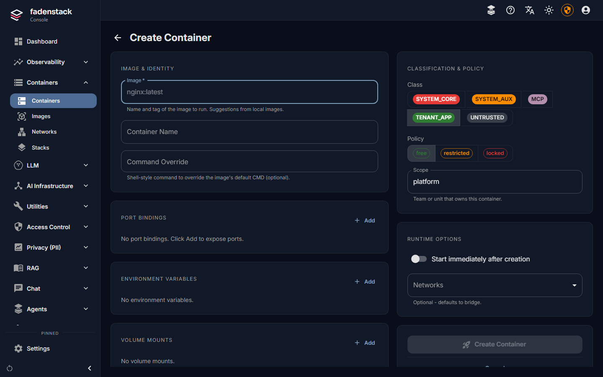
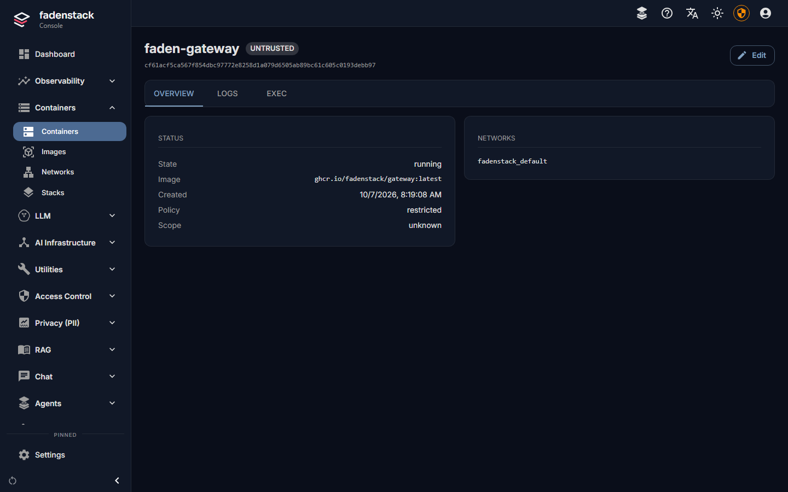
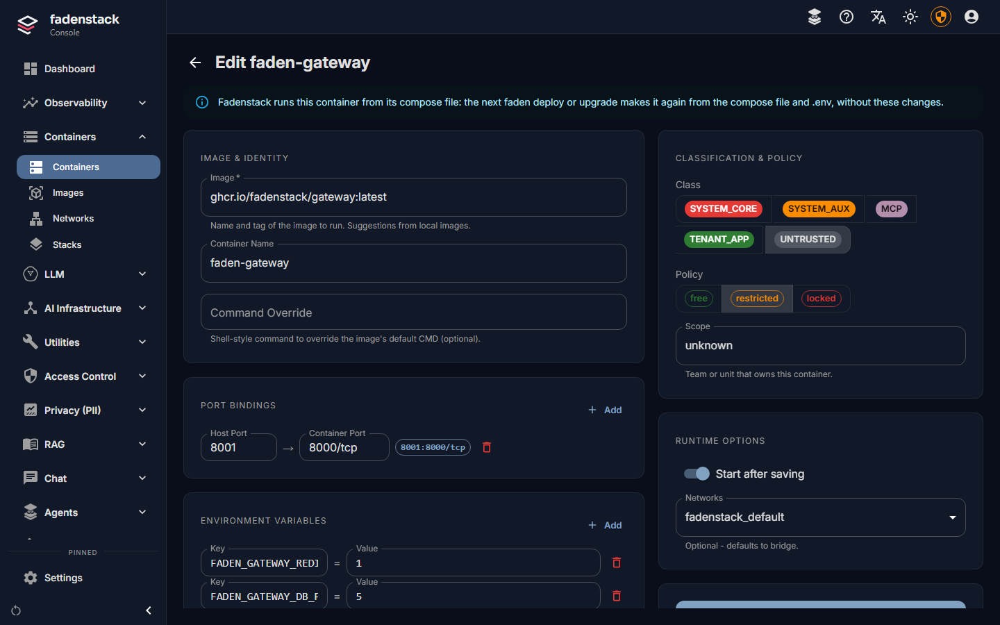
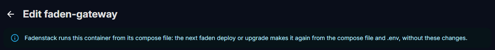

# Containers

The **Containers** pages of the console manage Docker on the server: the containers Fadenstack itself runs, and
any you add next to it, such as an MCP server or a small service your models call. They do not manage the GPU
machines; what runs there is managed through [clusters](clusters.md) and deployments.

## The list

Open **Containers → Containers**. It lists every container on the server, Fadenstack's own included. The four tiles
count them, and each is also a filter (select it again to list all).

The dashboard's **Needs attention** list reports containers that keep restarting.

??? info "What the tiles and the columns show"
    | Tile | Counts |
    |---|---|
    | **Running** | Running containers, of all listed |
    | **Not running** | Exited, created or paused |
    | **Unhealthy** | Running, but failing their health check |
    | **Restarting** | Restarting, often in a crash loop |

    | Column | What it shows |
    |---|---|
    | Name | The container's name and short ID |
    | **Image** | What it runs |
    | **State** | Running, exited or paused, and for how long |
    | **Class** | What the console may do with it (below) |
    | **Endpoint** | The host port it is published on, if any |
    | **Scope** | The team or unit that owns it |
    | Actions | Start, stop, pause, restart, delete, details: only those its class allows |

### Classes

A container's class decides what the console lets anyone do with it:

| Class | For | View, logs | Start, restart | Stop | Pause, exec, delete |
|---|---|---|---|---|---|
| `SYSTEM_CORE` | Postgres, Redis, the proxy, RabbitMQ, the logs and metrics stores | yes | yes | no | no |
| `SYSTEM_AUX` | Fadenstack's own services and modules | yes | yes | yes | no |
| `MCP` | MCP servers | yes | yes | yes | no |
| `TENANT_APP` | Containers you run | yes | yes | yes | yes |
| `UNTRUSTED` | Anything not classified | yes | no | no | no |

Change a container's class from its row; `SYSTEM_CORE` stays locked.

??? info "How a container made elsewhere gets its class"
    A container made elsewhere is classified by its name the first time the list sees it: a name that contains the
    name of one of Fadenstack's services or of the infrastructure above (`redis`, `postgres` and so on) makes a
    system container, a name that contains `mcp-` makes `MCP`, anything else is `UNTRUSTED`.

**Root Mode** lifts the class limits for the administrator who activates it, for system maintenance. Select
**Activate Root Mode**, and give a **Reason** and a **Duration**. Every action in root mode is audited at high
severity.

??? info "More about Root Mode"
    The **Reason** needs at least 10 characters; the **Duration** is 60 to 3600 seconds. A container whose policy is
    **locked** cannot be stopped, paused, edited or deleted even in root mode.

## Get an image

A container starts from an image on the server; creating one does not pull it.

1. Open **Containers → Images**.
2. Enter the image name and tag, and select **Pull Image**. The progress shows while it downloads.

**Prune dangling images** removes images no tag points to. It needs Root Mode; try **Dry Run** first.

## Create a container

1. On **Containers → Containers**, select **Create**.
2. Fill in **Image** and a **Container Name**.
3. Choose the **Class**: `TENANT_APP` for a container of your own, `MCP` for an MCP server.
4. Add **Port Bindings** only if something outside the server must reach it.
5. Add **Environment Variables** and **Volume Mounts** as needed.
6. Under **Networks**, choose `fadenstack_default` so the gateway, the console API and the MCP service can reach
   it by its name (for example `http://my-service:8080`).
7. Turn on **Start immediately after creation** and select **Create & Start**, or leave it off and select **Create Container** to
   create it stopped.

??? info "More about the fields"
    - **Image**: suggestions come from the images on the server.
    - **Command Override** is optional, written as in a shell.
    - **Policy** and **Scope**: set them if you use them.
    - **Port Bindings**: Fadenstack's services reach the container by name over its network without one. A host
      port must be free on the server.
    - **Networks**: without one, the container joins Docker's default bridge.

!!! note
    Environment variables are visible to anyone who can see the container. Do not put secrets there that those
    people should not see.

## Work with a container

Its page has three tabs:

| Tab | What it does |
|---|---|
| **Overview** | State, image, networks |
| **Logs** | The **Last 300 lines**, to refresh or download |
| **Exec** | Prepares a shell session in the container and shows its ID. There is no terminal on the page, and nothing in the console connects to the session yet. Exec needs the `TENANT_APP` class, or Root Mode |

Stop a container before you delete it: a running one is not deleted. Deleting asks for confirmation; the image stays
under **Images**.

??? info "When a container does not stop"
    A process that ignores the stop signal is killed after ten seconds and shows as `Exited (137)`.

## Edit a container

1. On the container's page, select **Edit**. The form opens with what the container was created with.
2. Change what you need, and select **Save and replace**.
3. Confirm.

Docker cannot change these settings in a container that exists, so **Save and replace** replaces it: a new container
is made with the new settings, on the same networks under the same name, and the old container is removed once the
new one runs.

!!! warning
    The container gets a new ID, and files it wrote outside its volumes are lost.

??? info "More about replacing a container"
    - What the form does not show is kept: GPU devices, restart policy, labels, health check.
    - If the new one cannot be made or started (an image that is not on the server, a host port in use), the old
      one is put back as it was, and the page says why.

Fadenstack's own containers can be edited too, for a test or a quick fix, but the next `faden deploy` or
`faden upgrade` makes them again from the compose file and `.env`, without your edits; the form says so. The
console API's own container cannot be edited from the console: change its settings in `~/fadenstack/.env` and run
`faden upgrade` (or `faden up`).

## Networks and stacks

**Containers → Networks** lists Docker's networks. `fadenstack_default` is Fadenstack's own; system networks are
read-only. You can create a network (optionally internal, without outbound access), inspect one, and delete the
ones you created.

**Containers → Stacks** keeps Docker Compose files under an ID. **Deploy Stack** saves one; saving again under the
same ID makes a new revision. Every revision is kept, two can be compared, and you can roll back to an earlier one.
Despite its name, **Deploy Stack** does not start the containers a file describes: run it with `docker compose` on
the server yourself.

## Related

- [MCP servers](../administer/mcp-servers.md): an MCP server can run as a container here and be registered by its
  name on the network.
