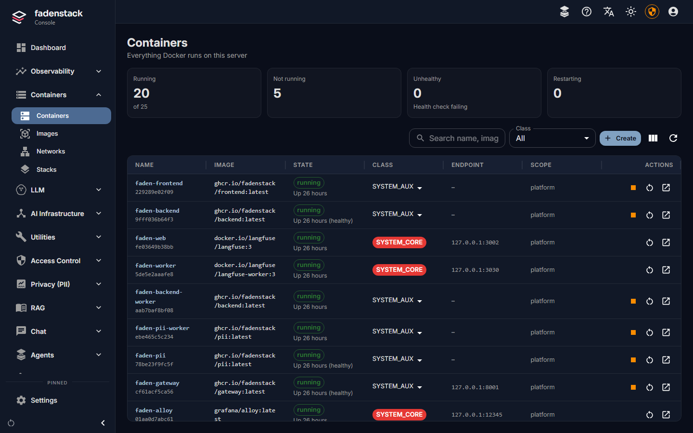

# Containers

The **Containers** pages of the console manage Docker on the server: the containers Fadenstack itself runs, and
any you add next to it, such as an MCP server or a small service your models call. They do not manage the GPU
machines; what runs there is managed through [clusters](clusters.md) and deployments.

## The list

Open **Containers → Containers**. It lists every container on the server, Fadenstack's own included. Four tiles
above the list count them, and each is also a filter (select it again to list all):

| Tile | Counts |
|---|---|
| **Running** | Running containers, of all listed |
| **Not running** | Exited, created or paused |
| **Unhealthy** | Running, but failing their health check |
| **Restarting** | Restarting, often in a crash loop |

| Column | What it shows |
|---|---|
| Name | The container's name and short ID |
| **Image** | What it runs |
| **State** | Running, exited or paused, and for how long |
| **Class** | What the console may do with it (below) |
| **Endpoint** | The host port it is published on, if any |
| **Scope** | The team or unit that owns it |
| Actions | Start, stop, pause, restart, delete, details: only those its class allows |

The dashboard's **Needs attention** list reports containers that keep restarting.

### Classes

A container's class decides what the console lets anyone do with it:

| Class | For | View, logs | Start, restart | Stop | Pause, exec, delete |
|---|---|---|---|---|---|
| `SYSTEM_CORE` | Postgres, Redis, the proxy, RabbitMQ, the logs and metrics stores | yes | yes | no | no |
| `SYSTEM_AUX` | Fadenstack's own services and modules | yes | yes | yes | no |
| `MCP` | MCP servers | yes | yes | yes | no |
| `TENANT_APP` | Containers you run | yes | yes | yes | yes |
| `UNTRUSTED` | Anything not classified | yes | no | no | no |

A container made elsewhere is classified by its name the first time the list sees it: Fadenstack's services and
the infrastructure above are system containers, a name starting with `mcp-` is `MCP`, anything else is
`UNTRUSTED`. Change a container's class from its row; `SYSTEM_CORE` stays locked.

**Root Mode** lifts the class limits for the administrator who activates it, for system maintenance. Select
**Activate Root Mode**, give a **Reason** (at least 10 characters) and a **Duration** (60 to 3600 seconds). Every
action in root mode is audited at high severity. A container whose policy is **locked** cannot be stopped,
paused, edited or deleted even then.

## Get an image

A container starts from an image on the server; creating one does not pull it.

1. Open **Containers → Images**.
2. Enter the image name and tag, and select **Pull Image**. The progress shows while it downloads.

**Prune dangling images** removes images no tag points to. It needs Root Mode; try **Dry Run** first.

## Create a container

1. On **Containers → Containers**, select **Create**.
2. Fill in **Image** (suggestions come from the images on the server), a **Container Name**, and optionally a
   **Command Override** written as in a shell.
3. Choose the **Class**: `TENANT_APP` for a container of your own, `MCP` for an MCP server. Set **Policy** and
   **Scope** if you use them.
4. Add **Port Bindings** only if something outside the server must reach it. Fadenstack's services reach it by
   name over its network without one. A host port must be free on the server.
5. Add **Environment Variables** and **Volume Mounts** as needed.
6. Under **Networks**, choose `fadenstack_default` so the gateway, the console API and the MCP service can reach
   it by its name (for example `http://my-service:8080`). Without one it joins Docker's default bridge.
7. Select **Create & Start**, or clear **Start immediately after creation** to create it stopped.

!!! note
    Environment variables are visible to anyone who can see the container. Do not put secrets there that those
    people should not see.

## Work with a container

Its page has three tabs:

- **Overview**: state, image, networks.
- **Logs**: the **Last 300 lines**, to refresh or download.
- **Exec**: starts a shell session for a websocket client and shows its ID. There is no terminal on the page.
  Exec needs the `TENANT_APP` class, or Root Mode.

Stop a container before you delete it: a running one is not deleted. A process that ignores the stop signal is
killed after ten seconds and shows as `Exited (137)`. Deleting asks for confirmation; the image stays under
**Images**.

## Edit a container

**Edit** on the container's page opens the form with what the container was created with. Docker cannot change
these settings in a container that exists, so **Save and replace** replaces it, after you confirm:

- a new container is made with the new settings, on the same networks under the same name;
- what the form does not show is kept: GPU devices, restart policy, labels, health check;
- the old container is removed once the new one runs. The container gets a new ID, and files it wrote outside
  its volumes are lost;
- if the new one cannot be made or started (an image that is not on the server, a host port in use), the old one is
  put back as it was, and the page says why.

Fadenstack's own containers can be edited too, for a test or a quick fix, but the next `faden deploy` or
`faden upgrade` makes them again from the compose file and `.env`, without your edits; the form says so. The
console API's own container cannot be edited from the console: change its settings in `~/fadenstack/.env` and run
`faden upgrade` (or `faden up`).

## Networks and stacks

**Containers → Networks** lists Docker's networks. `fadenstack_default` is Fadenstack's own; system networks are
read-only. You can create a network (optionally internal, without outbound access), inspect one, and delete the
ones you created.

**Containers → Stacks** deploys a Docker Compose stack from a compose file. Deploying again under the same ID
makes a new revision; every revision is kept, two can be compared, and you can roll back to an earlier one.

## Related

- [MCP servers](../administer/mcp-servers.md): an MCP server can run as a container here and be registered by its
  name on the network.
