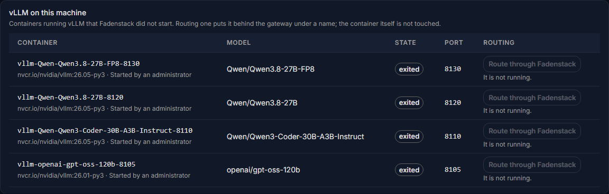

# Existing vLLM servers

Many GPU machines already run vLLM before Fadenstack arrives: containers started by hand or by another tool.
Fadenstack finds them on its machines and lets you put any running one behind the gateway, under a name, without
touching the container.

## Before you start

- The machine running the vLLM container is added to Fadenstack (see [GPU machines](machines.md)), with an
  up-to-date agent.
- The container publishes its port on the machine (for example `-p 8102:8000`).

## What is found

Each machine reports, about once a minute, the vLLM containers Fadenstack did not start, running or stopped. Its
page lists them under **vLLM on this machine**.

Containers Fadenstack started itself are not listed here; they are on the **Deployments** and **Providers** pages.

??? info "What each column shows"
    | Column | What it shows |
    |---|---|
    | **Container** | Its name and image, and the tool that started it, from the container's labels: "Started by …", or a Docker Compose project |
    | **Model** | The model, what it is for (**Chat**, **Embeddings** or **Scoring (rerank)**), and the name it answers to |
    | **State** | Running or stopped |
    | **Port** | The port it is published on at the machine |
    | **Routing** | Whether it is routed through Fadenstack, and under which name |

    What the model is for comes from the container's vLLM flags. When the flags say nothing, it is guessed from the
    model's name and marked "guessed from the model's name".

??? info "What finding reads, and what never leaves the machine"
    Finding is read-only. The agent reads the container list and each container's configuration, nothing else. Two
    things never leave the machine: the container's environment variables, where tokens usually live, and secret
    values on its command line (`--api-key` and any flag with key, token, secret or password in its name are
    reported as `***`).

## Route one through Fadenstack

1. Open **Machines** and select the machine.
2. Under **vLLM on this machine**, select **Route through Fadenstack** in the container's row.
3. Enter the **Name clients use**. The suggestion is the name the container answers to.
4. Select **Route through Fadenstack** in the dialog.

Requests for that name now go to the container, as it runs. It appears on the **Providers** page, linked to the
machine's page, which is where you manage it.

Nothing on the machine changes: not the container, its settings or its restart policy. Whoever started it still
starts and stops it.

**Stop routing** takes the name away again; the gateway then answers that the model does not exist. The container
keeps running.

??? info "More about a routed container"
    Chat offers it if it is a chat model; an embeddings model answers at `/v1/embeddings`, a scoring model at
    `/v1/rerank`. A request of the wrong kind is refused with a message that says where to send it. A routed
    container is listed with the remote providers (see [Remote providers](../administer/providers.md)).

### When the container stops

A routed container that stops is taken out of routing within about a minute ("Not routed while the container is
stopped"), and put back when it runs again. Requests for its name fail in between.

## What cannot be routed

**Route through Fadenstack** is disabled, with the reason below it, for a container that:

| Reason shown | What to do |
|---|---|
| It is not running. | Start it the way it is normally started |
| Its port is not published on the machine, so nothing outside the machine can reach it. | Publish its port when it is started |
| It asks for an API key, which routing a found container does not handle yet. | Start it without `--api-key`, or deploy the model on a cluster instead |
| No answer from … | Fadenstack asked it for its models and got no answer: it is still loading, or a firewall is in the way |

## Security

The gateway reaches a routed container over mutual TLS, through the same proxy on the machine that protects the
models Fadenstack runs, on the container's port plus 20000 (8102 becomes 28102). Allow the server to reach that
port, and the container's own port: the server asks the container there which models it serves, before routing it
and when the console lists it.

!!! warning
    The container's own port stays open: Fadenstack did not start the container and does not close it. vLLM often
    runs that port without any authentication. Firewall it so only the machine itself and the Fadenstack server
    reach it, or deploy the model on a cluster instead.

## When it does not work

| You see | What to do |
|---|---|
| **"This machine has not reported its containers."** | Its agent is too old to look for vLLM. Run the install line on it again to update it. |
| **"No vLLM containers found."** | The machine reports what it runs about once a minute; give it a minute. Only containers running vLLM are listed. |
