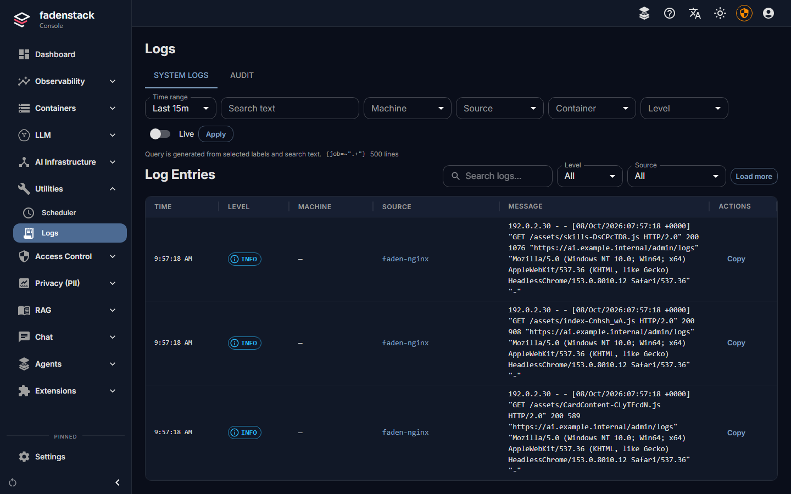

# Failures and logs

What Fadenstack repairs by itself when part of a cluster fails, what you see while it does, what is left to you,
and where to read the logs when you need them.

## What repairs itself

Every minute, Fadenstack looks at each running cluster and each serving model, and again when a machine
reconnects or the server starts.

??? info "When a look restarts something"
    A look restarts nothing unless something is wrong, and it looks a second time before it restarts anything: a
    busy head that was slow to answer is not a dead one.

| What fails | What you see | What Fadenstack does |
|---|---|---|
| A model copy crashes | The deployment reads fewer copies, then all again | Nothing: Ray restarts the copy |
| Ray stops on a machine that is not the head, or its network link goes down | The cluster reads **Needs attention**: "*machine* has dropped out of the cluster" | Takes the machine out of Ray and joins it again, once it can. Copies on the other machines keep serving |
| Ray's head stops | **Needs attention**: "Ray on *machine*, the cluster's head, is not running. Checking again before restarting anything", then "Restarting the cluster (attempt 1 of 3)" | Stops Ray everywhere, starts a new head, joins the other machines, applies the models again |
| The head machine reboots | The machine reads **Offline**, then as above once it is back | As above |
| A machine's agent restarts | Nothing | Looks at the cluster, finds it healthy, restarts nothing |
| The server's services restart, or the server is upgraded | Nothing on the clusters | Waits for the machines to reconnect, then looks. Nothing is restarted or applied again |
| The gateway restarts | Chat and API requests fail while it is down | Nothing needed |
| The connection between a machine and the server drops | The machine reads **Offline** if it stays away | What the machine was doing, such as copying a model, carries on; the result is reported when it reconnects |

While a cluster is restarted, its models read **Not serving** and the gateway stops sending them requests. Nothing
is applied to a cluster that is not ready, and nothing is applied while one of its machines is offline: the model
says "Waiting for *machine* to reconnect before applying." and goes ahead once it has.

??? info "How long an outage lasts"
    Most of an outage after a head failure is the models loading again; the cluster itself is back much sooner.

### When it cannot repair it

After three restarts that did not bring the head back, the cluster reads **Failed**:

> Ray on *machine*, the cluster's head, is not running. Fadenstack restarted it 3 times and it did not come back
> (last: …). It tries again every 15 minutes; use Try again once the cause is fixed.

Fix the cause, then select **Try again** on the cluster's page.

It does not restart anything when nobody answered its look: then nothing is known about Ray, and the model says
"Could not check the model just now; it is looked at again within a minute."

??? info "Why it keeps trying"
    It keeps trying every 15 minutes, because the cause may go away without anyone telling Fadenstack, such as a
    network link that comes back.

### What is left to you

- A machine that does not come back: a dead disk, a driver that broke, a cable. Repair it, or
  [remove it from the cluster](clusters.md#remove-a-machine-from-a-cluster).
- A cause that comes back on every attempt. Fadenstack stops retrying it and says so (below).
- The server itself: disk space, certificates, backups. The dashboard's **Needs attention** list shows what is
  wrong.

## What the deployment messages mean


A deployment's page says in one line what it is doing. The ones you will meet:

| Message | What it means | What to do |
|---|---|---|
| Downloading *model* to the Fadenstack server (…%). It is copied to the cluster as soon as it is there. | The server is fetching the model first | Wait; or download it ahead of time in the model marketplace |
| Downloading *model* to the Fadenstack server failed: … | A gated model without a token, a mistyped repository | Fix it, then retry the download under **Model marketplace → On this server** |
| Copying the model to the machines again after a failed attempt. | A copy to a machine failed and is retried | Wait; if it keeps failing, check the machine's disk |
| Serving on 1 of 2 copies; 1 more starting. | Some copies are up, the rest are loading | Wait |
| Serving on 2 of 3 copies. 1 cannot start: each copy needs 1 accelerator, and this cluster has 2, so 2 fit. Scale to 2, or add a machine to the cluster. | More copies were asked for than the cluster has room for | Scale down, or [add a machine](clusters.md#add-machines-to-a-running-cluster) |
| Waiting for *machine* to reconnect before applying. | A machine of the cluster is offline | Bring the machine back |
| The cluster was restarted: applying the model again; its copies are starting. | The cluster was repaired; the model loads again | Wait |
| A start failed: … Ray is trying again. | The engine failed to start; the reason is its own | Read the reason; if it is a setting, change it |
| Start failed: … Not tried again: this error comes back on every attempt. | The deployment reads **Failed** and stops retrying | Change what the reason names (for example the engine settings), and it is applied again |
| Port … is already in use on this machine by another program; publish this model on another port. | The model's port is taken on the machine | Free the port, or publish the model on another |

The most common start failures are a model that does not fit in the GPU's memory, and a number format the card
does not support. Changing a deployment's settings is the administrator's work: see
[Deployments](../administer/deployments.md). **Show the errors** on a failed deployment opens its log at the
errors.

## Reading the logs

### In the console



**Logs** (in the navigation) collects the logs of every machine and of the server's own services. On the
**System Logs** tab:

- choose a time range (**Last 15m** to **Last 24h**, or **Custom**), or select **Live** to follow new lines;
- narrow by **Machine**, **Source**, **Deployment**, **Component**, **Copy**, **Service**, **Container** and
  **Level**. The filters only offer what the chosen time range contains;
- search the text.

| Source | What it is |
|---|---|
| **System log** | A machine's own system journal: every service on it, the agent included |
| **Model serving** | The model copies on a cluster. **Deployment** and **Component** narrow it to one model |
| **Fadenstack services** | The server's own containers |
| **Model containers** | Models run one container per model, outside a cluster |

The **Audit** tab lists who changed what: the action, its target, its result and who did it.

Other places in the console show the same logs where you need them:

| Where | What it shows |
|---|---|
| A **machine's page** | Its **System Logs** of the last 15 minutes, and **Open in Logs** for the rest |
| A **deployment's page** | Its **Logs**, with the model serving and the engine (vLLM) lines, filtered by level, searchable, and with **Follow new lines**, **Copy the lines shown** and **Download the lines shown** |
| A **container's page** under **Containers** | Its last 300 lines |

Metrics dashboards are in Grafana, reached from the console at `/grafana/` (a cluster's page has **Open the
metrics dashboard**).

??? info "More about the logs"
    The model copies write a line when something happens (starting, stopping, an error), not for every request.

    Machines send their logs through the server's normal address, with their own credential; a line the server did
    not take is sent again later. Nothing has to be set up on the machines.

### On the server

```bash
faden status                          # which services run, and which are unhealthy
faden logs faden-backend              # the last 100 lines of one service
faden logs -f -n 200 faden-gateway    # follow it
faden logs --timestamps nginx postgres
```

Service names are those in `faden status`: `faden-backend`, `faden-backend-worker`, `faden-gateway`,
`faden-frontend`, `nginx`, `postgres` and so on. The scheduled jobs log to `~/fadenstack/backups/backup.log`
(backups) and `~/fadenstack/logs/tls-renew.log` (certificate renewal).

### On a machine

```bash
faden-agent status
journalctl -u faden-agent -f            # a system service
journalctl --user -u faden-agent -f     # a user service
```

`faden-agent run` runs the agent in the foreground, which shows at once why it does not connect. Stop the service
first.
