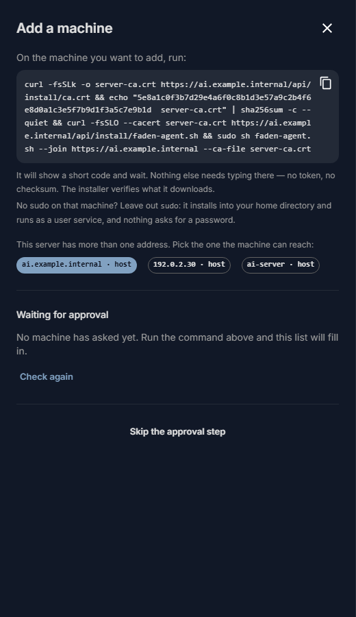
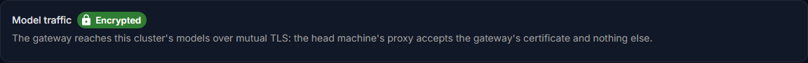
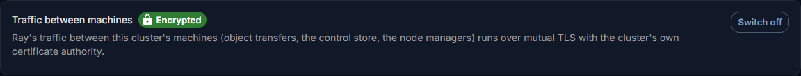

# HTTPS and trust

What Fadenstack encrypts, how browsers, API clients and the GPU machines come to trust the server, and the
commands that manage the certificate. A new install serves HTTPS from the start, with a certificate the server
makes for itself or with yours.

## What is protected

| Connection | Encrypted | Notes |
|---|---|---|
| Browsers to the console and `/api` | Yes, once HTTPS is on | Plain HTTP only redirects to HTTPS |
| API clients to the gateway (`/v1`) | Yes, once HTTPS is on | A request to the plain-HTTP port is redirected, method and body kept |
| GPU machines' agents to the server | Yes, once HTTPS is on | Commands, enrollment, downloads of models and runtime images, log pushes. An agent on HTTPS never falls back to plain HTTP |
| The gateway to the models on the machines | Yes, always | Mutual TLS: each machine only accepts the gateway's certificate. Independent of HTTPS on the server |
| Between a cluster's machines (Ray) | When switched on per cluster | Always authenticated with the cluster's token; encrypted once its **Traffic between machines** switch is on |
| GPU-to-GPU traffic inside a cluster | No | It cannot be encrypted. Keep that network to the cluster's machines |
| Containers on the server among themselves | No | Docker's internal network; it does not leave the server |

??? info "Signed commands"
    Every command the server sends a machine is signed, with or without HTTPS, and an agent refuses one without a
    valid signature. Signing keeps anyone else from sending a machine commands; it hides nothing.

!!! warning
    Keep HTTPS on. Without it, sign-ins, API keys, prompts and the machines' credentials cross the network in the
    clear.

Only ports 80 and 443 face the network on the server. Grafana, Langfuse, Postgres, Redis, RabbitMQ and the other
stores listen on the server's own loopback address only. See [Network and ports](network.md).

## Two kinds of certificate

**A certificate made on the server** (`generate`, the default). The tool creates a certificate authority for the
install and signs a certificate with it for the server's names and IPv4 addresses, plus names and addresses you add. Browsers
and API clients have to be told once to trust that authority. The machines learn it by themselves.

**Your own certificate** (`use`), from a public issuer or from your company's certificate authority. A public
issuer needs nothing else. For a company CA, give its root certificate too, so the machines trust it.

## Switch HTTPS on

On a new install, `faden deploy` has done this. On an install that runs plain HTTP:

```bash
faden tls generate --name ai.example.internal     # a certificate made here
# or
faden tls use fullchain.pem key.pem               # your own
```

The command checks the certificate, restarts the proxy (the only container it touches) and waits until the
console answers. It also schedules the daily renewal. Connected machines move to HTTPS by themselves (see
[The machines](#the-machines)).

### Trusting a certificate made on the server

What everyone trusts is one file, `~/fadenstack/tls/ca.crt`. It is public; its private key stays in
`~/fadenstack/tls-ca/`, readable by you only, and never enters a container.

| Who | What to do |
|---|---|
| **Browsers** | Import `ca.crt` as a trusted certificate authority, in the browser or the operating system, on the computers the console is used from. |
| **API clients** | `curl --cacert ca.crt https://ai.example.internal/v1/models`, or `SSL_CERT_FILE=ca.crt` for Python programs. |
| **Machines** | Nothing to do. |

??? info "Renewals and the authority's lifetime"
    Later certificates (a renewal, a new address) are signed by the same authority, so nothing has to be trusted
    again. The authority itself lasts ten years.

### Your own certificate

```bash
faden tls use fullchain.pem key.pem
faden tls use cert.pem key.pem --chain intermediates.pem
faden tls use cert.pem key.pem --ca company-root.pem
```

With `--ca`, the machines are given your company's root, so they trust the certificate without anyone copying
files to them.

There is no built-in ACME client. Use certbot, acme.sh or your company's tooling, and point `faden tls use` at the
files it renews in place, such as `/etc/letsencrypt/live/ai.example.internal/fullchain.pem` and `privkey.pem`.

??? info "What the tool checks, and when it waits"
    Before installing it, the tool checks that the key belongs to the certificate and has no passphrase, and that
    the certificate is valid today. A certificate that names none of the server's own names or addresses is
    installed with a warning, since the console may be reached by a name only DNS knows.

    When the machines have a new issuer to learn, the tool waits about a minute before switching, so connected
    machines fetch it first (`--no-wait` skips that).

## The commands

| Command | What it does |
|---|---|
| `faden tls status` | On or off, the certificate, until when, and how it is renewed |
| `faden tls generate [--name NAME]` | A certificate made here; `--name` adds a name or address, repeatable |
| `faden tls use CERT KEY [--chain FILE] [--ca FILE]` | Your own certificate |
| `faden tls renew [--force]` | Renew what is due; changes nothing otherwise. `--force` renews now |
| `faden tls off` | Back to plain HTTP. The authority is kept for next time |
| `faden tls machine-ca [--replace]` | The certificates behind the gateway-to-machines encryption (below) |
| `faden ports [--http N] [--https N]` | Show or change the ports the console, the API and `/v1` are served on |

??? info "Restarts and open connections"
    `generate`, `use` and `off` take `--no-restart` to write the files only; the proxy picks them up when it next
    starts. A new certificate while HTTPS stays on reloads the proxy instead of restarting it, so open connections,
    the machines' included, stay up.

## Renewal and warnings

Once HTTPS is on, `faden tls renew` runs every morning (a systemd user timer, `faden-tls-renew.timer`, or a crontab
line) and changes nothing until something is due:

| What | How it is renewed |
|---|---|
| **A certificate made here** | It lasts 825 days. It is issued again 30 days before it runs out, or as soon as the server has an address it does not list, from the same authority. |
| **Your own certificate** | It is taken again from the files you gave `faden tls use` whenever they change there. Renewed files that fail the checks are not taken; the old certificate stays. |
| **The authority** | It is replaced before it runs out; the old one stays trusted while it is valid. |

You are warned before a certificate runs out: by `faden tls status`, by `faden doctor`, and on the console's
dashboard under **Needs attention** ("HTTPS certificate runs out in … days"). A daily run that cannot renew a
certificate close to its end exits with an error, so `systemctl --user --failed` shows it; its output is in
`~/fadenstack/logs/tls-renew.log`.

## The machines

**They follow the server to HTTPS by themselves.** While connected, every agent fetches the server's certificate
authority, even while HTTPS is still off. When HTTPS is switched on, an agent on the plain-HTTP address is
redirected, checks the HTTPS address against the authority it holds, moves there and remembers it. Nothing has to
be done on the machines; `faden-agent show` on a machine says when it has moved.

**They never move back by themselves.** Plain HTTP after HTTPS would be a downgrade anyone between the machine and
the server could force. After `faden tls off`, point each machine back and restart its agent:

```bash
faden-agent configure --set BACKEND_URL=http://ai.example.internal
systemctl --user restart faden-agent     # or: sudo systemctl restart faden-agent
```

{ width="320" }

**Machines you add while HTTPS is on** get a longer install line from **Machines → Add a machine**. The line is
only as trustworthy as the console page it came from: open the console with the authority trusted, not by
clicking through a certificate warning. With a certificate from a public issuer, the line stays the short one.

??? info "How the longer line checks the server"
    It fetches the server's authority first, checks it against a fingerprint written into the line, and only then
    fetches the installer, verified against it. A fingerprint that does not match stops the line before anything
    runs.

An agent that cannot verify the server's certificate stays where it is and says why in its log.

## Model traffic: the gateway and the machines

Every prompt and every answer crosses the network between the gateway and the machines. That link is encrypted
with mutual TLS whether or not HTTPS is on: each machine runs a small proxy in front of its models that accepts
only the gateway's certificate, and the models themselves listen only on the machine's loopback address.

It looks after itself: the certificates are made, renewed and rotated by the server, and the machines fetch theirs
over their authenticated connection.



- A cluster started before this protection existed shows **Model traffic** with "not encrypted" on its page, and
  the dashboard lists it. **Encrypt model traffic**, then **Restart and encrypt**, moves its models behind the
  proxy; they are unavailable while they load again.
- `faden tls machine-ca` shows these certificates. If you suspect a leak, `faden tls machine-ca --replace` makes a
  new authority and distrusts every earlier one; model requests fail for about a minute while the gateway and the
  machines take new certificates.
- A remote provider an administrator pointed at a machine's model address directly stops working once that model
  is behind the proxy. Use the deployment's own name in the chat and the API instead.

## Ray between a cluster's machines

A cluster of several machines runs Ray across them: its control traffic, the data it moves, and the calls into a
model copy on another machine, prompts included. Ray always authenticates this traffic with the cluster's token.
To encrypt it too:



1. Open **Clusters**, then the cluster.
2. On the **Traffic between machines** card, select **Encrypt**.
3. Read the warning and select **Restart the cluster**.

Every machine of the cluster restarts its container, and every model on the cluster loads again. The card shows
**Encrypted** once all machines run with it. Every machine needs a recent agent; the card names the ones to update.

??? info "More about encryption between machines"
    Each cluster has its own certificate authority; each machine's key stays on the machine.

Encryption between machines slows down moving large amounts of data between them; serving and chat are not slowed.
GPU-to-GPU traffic is not Ray's and cannot be encrypted: keep the cluster's network to its machines, on a cable or
a network of its own.

## Hardening checklist

1. Serve HTTPS (`faden tls generate` or `faden tls use`) before adding machines.
2. Import `ca.crt` into the browsers the console is used from instead of accepting the warning.
3. Once HTTPS stays, turn on HTTP Strict Transport Security: set `FADEN_HSTS_MAX_AGE=31536000` in
   `~/fadenstack/.env` and apply it with `faden up nginx`. It is 0 (off) by default so that HTTPS can be switched
   off again without locking browsers out.
4. Leave Grafana and Langfuse on the server's loopback address (the default; do not set `GRAFANA_BIND` or
   `LANGFUSE_BIND`). Grafana is in the console at `/grafana/`, for signed-in users allowed to see it. Reach Langfuse
   through an SSH tunnel: `ssh -L 3002:localhost:3002 ai.example.internal`.
5. Keep the machines, and the network between them and the server, private. Switch **Traffic between machines**
   on for every cluster of more than one machine.
6. Keep every machine's agent up to date (see [Upgrading](upgrading.md#update-the-machines-agents)).
7. On each cluster's page, **Encrypt model traffic** where it says the traffic is not encrypted.
8. Keep the nightly backup, and keep backups private: they hold the keys.
9. Watch the dashboard's **Needs attention** list.

## Limits

| Limit | What it means |
|---|---|
| **No revocation.** | The server's authority publishes no revocation list. To withdraw it, move `tls-ca/` away and run `faden tls generate` again; every machine then has to be pointed at the server again, as after `tls off`. |
| **First trust over plain HTTP.** | A machine that joined while the server ran plain HTTP learnt its authority over plain HTTP. Add machines after HTTPS is on to avoid that. |
| **A vLLM Fadenstack found running keeps its own port open.** | The gateway reaches it through the proxy, but its original port stays reachable on the network. Firewall it (see [Existing vLLM servers](existing-vllm.md)). |
| **Some traffic around the machines is plain.** | The server's metrics collection from the machines, and the runtime image copied between machines (checked against its digest). Neither carries prompts. |

## Check it yourself

```bash
faden tls status
faden doctor
curl -sI http://ai.example.internal/v1/models                    # a redirect to https
curl --cacert ca.crt https://ai.example.internal/api/health       # answers
openssl s_client -brief -connect ai.example.internal:443 -tls1_1  # refused: TLS 1.2 and 1.3 only
faden-agent show                                                 # on a machine: its server address and trust
```
