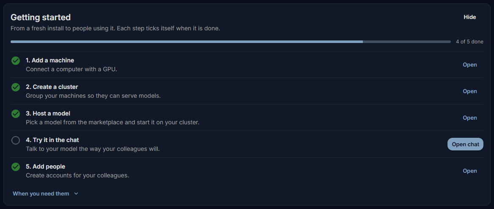

# Installing the server

You install Fadenstack on one Linux server with its command-line tool, `faden`. One command sets up the
containers, HTTPS, the first administrator and a nightly backup; you then sign in to the console in a browser.

## Before you start

- A Linux server that meets the [System requirements](requirements.md): x86_64, Docker Engine 24 or later with
  Compose v2, Python 3.12 or later with `pipx` or `uv`.
- Your user can run Docker without `sudo` (it is in the `docker` group).
- Ports 80 and 443 are free, or you know which other ports to use.
- The server can reach the internet to pull its images.
- Optional: a DNS name for the server, such as `ai.example.internal`, and a certificate for it if you want to use
  your own (see [HTTPS and trust](https.md)).

Run `faden doctor` after installing the tool to check the host first.

## Install

1. Install the command-line tool:

    ```bash
    pipx install fadenstack        # or: uv tool install fadenstack
    ```

2. Run the deployment:

    ```bash
    faden deploy
    ```

3. Answer its questions (below). When it finishes, it prints the addresses the console is reached at and, for a
   certificate it made, the file to trust.

??? info "What `faden deploy` does"
    `faden deploy` checks Docker, writes the deployment into `~/fadenstack` (or the directory you name:
    `faden deploy /opt/faden`), generates `.env` with random passwords and keys, sizes the services for the host,
    pulls the images for the tool's own release, starts everything, and creates the first administrator. The admin
    sign-ins of Grafana, RabbitMQ and Langfuse get the first administrator's e-mail and password.

### What it asks

| Question | What to answer |
|---|---|
| **HTTPS** | `generate` (the default): a certificate made on this server for its names and addresses. `own`: your certificate and key as PEM files. `off`: plain HTTP. |
| Other names or addresses | With `generate`: names the console is reached by that the server does not know itself, such as `ai.example.internal`. Comma-separated, blank for none. |
| A port to use instead | Only when port 80 or 443 is taken by something else. |
| Check for new releases? | Yes (the default): once a day the server and `faden` read the public list of releases and tell the administrators when one is out. Nothing about the server is sent. See [Upgrading](upgrading.md#how-you-hear-about-a-new-release). |
| Admin email | The first administrator's sign-in. |
| Admin password | At least 8 characters, and not the e-mail address. Leave blank to have one generated. |
| Save to file? | Saves the credentials to `~/fadenstack/.bootstrap-credentials` (readable by you only). |
| Back up every night? | Yes (the default) runs `faden backup` at 03:00 and keeps the last 7. See [Backups](backups.md). |

The credentials are shown once. Store them in a password manager.

### Without questions

`faden deploy -y` asks nothing: HTTPS with a certificate made here, the administrator `admin@localhost` with a
generated password, saved to `~/fadenstack/.bootstrap-credentials`, the nightly backup and the update check on. Store the
credentials somewhere safe, then delete that file.

Choices can be given up front:

```bash
faden deploy --tls generate --tls-name ai.example.internal
faden deploy --tls own --tls-cert fullchain.pem --tls-key key.pem
faden deploy --tls off
faden deploy --http-port 8080 --https-port 8443
faden deploy --runtime-images x86_64
```

`--runtime-images` says which runtime images the server keeps for the machines: `all` (the default), `none`, or
`x86_64`, `aarch64` (NVIDIA DGX Spark), comma-separated. The choice is remembered for upgrades.

### The runtime images

At the end, `faden deploy` pulls the runtime images: the containers the GPU machines run models in. The machines
download them from this server, not from the internet, so the server keeps one per kind of machine. This is the
largest download of the install. If it fails, the services are already running; retry it with:

```bash
faden runtime-images            # fetch what this release needs
faden runtime-images --check    # what the server holds, and what is missing
```

## Sign in for the first time

1. Open the address `faden deploy` printed, such as `https://ai.example.internal`.
2. With a certificate made on the server, the browser warns that it does not know the issuer. Import
   `~/fadenstack/tls/ca.crt` into the browser (or the operating system) as a trusted certificate authority,
   then reload. See [HTTPS and trust](https.md#trusting-a-certificate-made-on-the-server).
3. On **Sign in to Fadenstack**, enter the administrator's **Email** and **Password**, and select **Sign In**.



The console opens on the **Dashboard**, with a **Getting started** list: add a machine, create a cluster, host a
model, try it in the chat, add people. Each step ticks itself when it is done.

Next: [add the GPU machines](machines.md).

## Where things are

| Path | What it is |
|---|---|
| `~/fadenstack/` | The deployment: compose file, `.env`, service configuration |
| `~/fadenstack/.env` | Every password, key and setting, readable by you only. Keep it private, and keep a copy with your backups |
| `~/fadenstack/tls/`, `~/fadenstack/tls-ca/` | The served certificate, and the server's own certificate authority with its key |
| `~/fadenstack/backups/` | Backups |
| `~/fadenstack/logs/` | The log of the daily certificate renewal (the nightly backup logs to `~/fadenstack/backups/backup.log`) |
| `~/.config/faden/faden.yaml` | The tool's own settings: where the install is, which modules are on |

The data lives in Docker volumes named `fadenstack_*`, such as `fadenstack_pg_data`.

### Where the company data is kept

| Data | Where | In a backup |
|---|---|---|
| Databases (users, chats, settings) | `fadenstack_pg_data` | As dumps |
| Files attached to chats | `fadenstack_faden_chat_files` | With `--include-volumes` |
| Files uploaded to the knowledge base | `fadenstack_faden_rag_lite` | With `--include-volumes` |
| Models | `fadenstack_faden_models` | No |

Before release 0.4.4, chat attachments had no volume: they lived inside the gateway container and were lost when
an upgrade or restore replaced it. `faden upgrade` copies the files the old container holds into the volume before it
replaces the container, so nothing is lost on that first upgrade.

To keep the chat attachments in a directory of your own, for example on storage your company manages, set it in
`.env`:

```bash
FADEN_DATA_DIR=/srv/fadenstack
```

or give it at install time: `faden deploy --data-dir /srv/fadenstack`. The attachments are then in
`/srv/fadenstack/chat-files` instead of the volume. Use an absolute path in POSIX form (on Windows, `/c/data`).
Empty, the default, keeps the Docker volume. A change takes effect when the gateway is recreated; files already in
the volume are not moved, so set this before the first upgrade to this release, or copy the files over yourself.

### Docker logs

Each container's Docker log rotates: at most 5 files of 50 MB per container, the oldest dropped. Without a limit
the logs fill the disk. Change it in `.env`, or with `faden deploy --log-max-size 100m --log-max-file 10`:

```bash
FADEN_LOG_MAX_SIZE=50m
FADEN_LOG_MAX_FILE=5
```

Then run `faden upgrade` or `faden rebuild` so the containers are recreated with it. The logs you read in Grafana
are kept in Loki and are not rotated away: Alloy reads each container's log through Docker, which carries on across
a rotation. Keep the limits generous, as Docker keeps only what fits in them and Alloy has to be running to collect a line.

Settings you change belong in `.env`. The other deployment files, such as `nginx/nginx.conf`, are replaced by the
next upgrade.

## Secrets in .env

`faden deploy` writes every password, key and token the services need into `~/fadenstack/.env`, each one random
and this install's own; `faden upgrade` adds the ones a new release needs. The compose file has no fallback for
any of them: started without one, `docker compose` stops and names it ("required variable ... is missing a
value").

Started by hand with `docker compose` instead, set them yourself, each to a long random value of its own
(`openssl rand -base64 48`):

| Variable | What it protects |
|---|---|
| `POSTGRES_PASSWORD` | The database login every service uses |
| `FADEN_BACKEND_SETTINGS_MASTER_KEY` | The secrets the console stores, and the machines' credentials |
| `FADEN_MCP_ENCRYPTION_KEY` | The credentials of MCP servers |
| `FADEN_GATEWAY_MCP_SERVICE_TOKEN`, `FADEN_BACKEND_MCP_SERVICE_TOKEN`, `FADEN_MCP_SERVICE_TOKEN` | Calls to the MCP service. One value for all three |
| `FADEN_GATEWAY_SKILLS_SERVICE_TOKEN`, `FADEN_BACKEND_SKILLS_SERVICE_TOKEN`, `FADEN_SKILLS_SERVICE_TOKEN` | Calls to the skills service. One value for all three |
| `FADEN_GATEWAY_PII_SERVICE_TOKEN`, `FADEN_BACKEND_PII_SERVICE_TOKEN`, `FADEN_MCP_PII_SERVICE_TOKEN`, `FADEN_PII_SERVICE_TOKEN` | Calls to the PII service, which refuses every call without it (only its health check is open). One value for all four |
| `LANGFUSE_SALT`, `LANGFUSE_ENCRYPTION_KEY` (64 hex characters: `openssl rand -hex 32`), `LANGFUSE_NEXTAUTH_SECRET` | Langfuse's API keys, stored keys and sign-ins |
| `REDIS_AUTH`, `MINIO_ROOT_PASSWORD`, `CLICKHOUSE_PASSWORD`, `GRAFANA_ADMIN_PASSWORD` | The stores and Grafana |
| `RABBITMQ_ADMIN_PASS`, `RABBITMQ_BACKEND_PASS`, `RABBITMQ_API_PASS`, `RABBITMQ_PII_PASS` | The message broker. Its users come from `rabbitmq/definitions.json`, which `faden deploy` writes from these |

Outside development, the backend, the gateway and the MCP and skills services do not start on the development
values that are published with the source code, and say what to set.

### An install started by hand before release 0.4.2

Until then the compose file fell back to fixed values when `.env` had none, the same for every install and
published with the source code. Most of them you can simply set to new random values. These seal stored data,
which is readable only with the value it was stored under: set them to the old value.

| Variable | The old value |
|---|---|
| `POSTGRES_PASSWORD` | `postgres`, or a new value that you also set in Postgres: `docker exec -i faden-postgres psql -U postgres -c "ALTER USER postgres PASSWORD '<new value>'"` |
| `FADEN_BACKEND_SETTINGS_MASTER_KEY` | `dev-settings-master-key-change-me` |
| `FADEN_MCP_ENCRYPTION_KEY` | `dev-mcp-encryption-key-change-me-32b`, if MCP was on; otherwise a new random value |
| `LANGFUSE_SALT` | `mysalt` |
| `LANGFUSE_ENCRYPTION_KEY` | 64 zeros |

With the old settings master key or MCP key, also set `FADEN_ALLOW_PUBLISHED_KEYS=true`. The backend, the gateway
and MCP then start on it and warn at every start; without it they refuse. `faden upgrade` does the same by itself
for an install whose `.env` lacks one of these keys.

Changing such a key later makes what is stored under the old one unreadable; there is no re-encryption yet.
Under a new settings master key, the secrets saved in the console (the Hugging Face token, sign-in providers and
the like) have to be entered again, everyone signs in again, and the machines have to be added again. Under a
new MCP key, the MCP servers' credentials have to be entered again. A new install has none of this to do.

## Optional modules

Three modules can be added to the core services: `pii` (finds and masks personal data), `mcp` (tool servers for
chats and agents) and `skills` (saved instructions). They need more memory (see
[System requirements](requirements.md)).

```bash
faden module list
faden module enable pii mcp skills
faden up
```

`faden module disable pii`, then `faden down` and `faden up`, takes one away again.

## Everyday commands

| Command | What it does |
|---|---|
| `faden status` | Every service, running or not, and healthy where it has a check |
| `faden logs -f faden-backend` | Follow one service's log (all services without a name) |
| `faden up` / `faden down` | Start or stop the services; the data stays |
| `faden doctor` | Check the host, the ports and the certificate |
| `faden config show` | Where the install is and how the tool is set up |
| `faden admin reset-password --email alex@example.com` | Set a new password for a user who cannot sign in |
| `faden --help` | Every command; `faden <command> --help` for its options |

## Removing Fadenstack

`faden down` stops and removes the containers and keeps the data volumes, so `faden up` brings everything back.

!!! warning
    `faden down --volumes` also deletes the data volumes: the database, every chat, the model store. It cannot be
    undone. Take a backup first and copy it off the server.

## When it does not work

| You see | What to do |
|---|---|
| **`Docker is not available`** or **`Docker daemon is not running`** | Install Docker Engine with the Compose plugin, start it, and make sure your user is in the `docker` group (log out and in again after adding it). |
| **`HTTP port 80 is in use by something else.`** | Another program holds the port. Free it, or run `faden deploy --http-port 8080 --https-port 8443`. `faden doctor` lists every port the install publishes and whether something else holds it. |
| **`Backend did not become healthy in time — skipping admin setup.`** | The services started but the console API did not answer in time. Check `faden status` and `faden logs faden-backend`, fix what they show, then run `faden deploy` again: it keeps the `.env` and creates the administrator. |
| **`The backend refused to create the administrator`** | The backend creates the first administrator only for whoever sends the install's bootstrap token, `FADEN_BACKEND_BOOTSTRAP_TOKEN` in `~/fadenstack/.env`. `faden deploy` writes one when `.env` has none. An install started some other way may lack it, and a backend started before it was set does not know it yet: run `faden up`, then `faden deploy` again. |
| **`Some images failed to pull.`** | The server could not reach a registry. Check its internet access and proxy, then run `faden deploy` again. |
| The browser refuses the certificate | The server's certificate authority is not trusted on that computer yet. Import `~/fadenstack/tls/ca.crt`, or use a certificate from your own issuer (see [HTTPS and trust](https.md)). |
| **`required variable ... is missing a value`** from `docker compose` | `.env` lacks a password, key or token the compose file requires. `faden upgrade` adds them; for an install started by hand, see [Secrets in .env](#secrets-in-env). |
| A service stops at start with **`... is the development default published with Fadenstack's source code`** | The backend, the gateway, MCP or the skills service found a published development value. The message says what to set; [Secrets in .env](#secrets-in-env) has the details, also for an install that has stored data under it. |
| The console says **"This server still uses the default settings master key"** | The install runs on the published development key, kept with `FADEN_ALLOW_PUBLISHED_KEYS=true` because its stored secrets are sealed with it. See [Secrets in .env](#an-install-started-by-hand-before-release-042) for what changing it means. |
