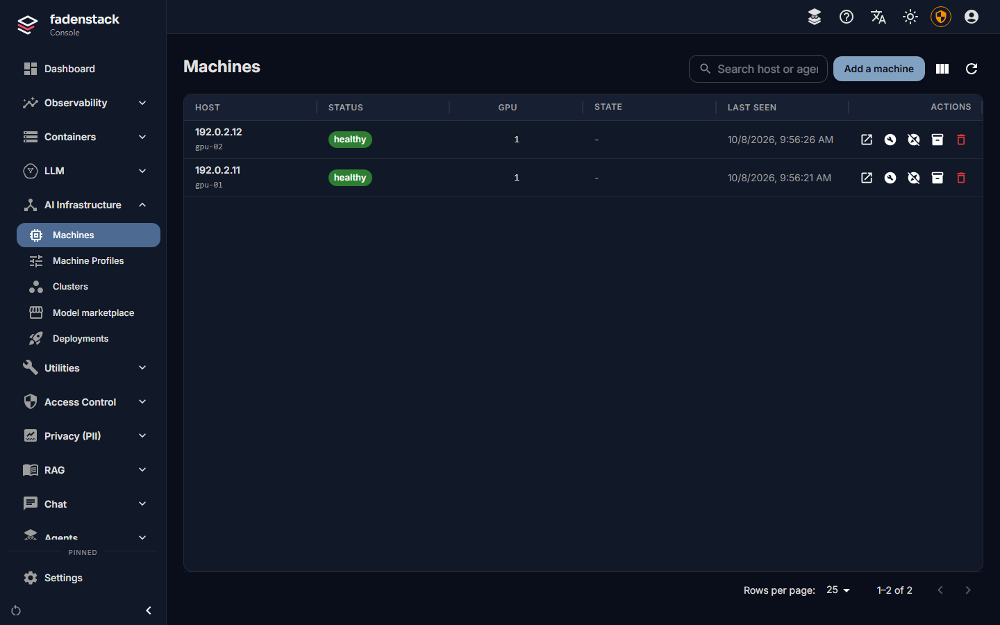
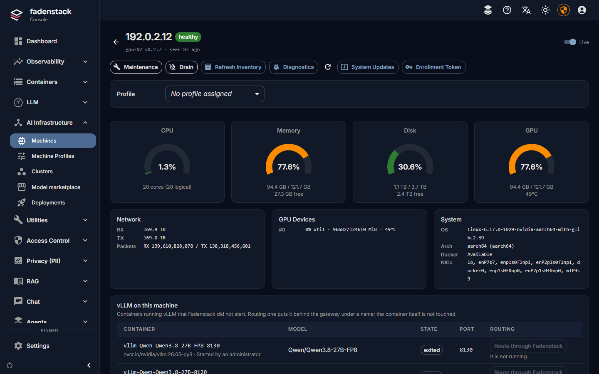

# GPU machines

A GPU machine joins Fadenstack by running one command on it and being approved in the console. From then on you
manage it from the console: its hardware, its logs, maintenance, draining, and the clusters it belongs to.

The console calls them **Machines**. The agent, the API and some messages still say *node*; it is the same thing.

## Before you start

- You are signed in to the console as an administrator.
- The machine meets the [System requirements](requirements.md#gpu-machines): Linux, x86_64 or aarch64, an NVIDIA
  GPU, Docker or Podman.
- `nvidia-smi` on the machine prints your card. A machine that cannot see its GPU still joins, but cannot be put
  in a cluster.
- The machine can reach the server at an address you know, such as `https://ai.example.internal`.

## Add a machine

1. In the console, open **AI Infrastructure → Machines** and select **Add a machine**.

    

2. If the panel says the server has more than one address, pick the one the machine can reach. Each address is
   listed with its network interface; the command changes with your choice.
3. Select **Copy command**.
4. Run the command in a terminal on the machine. It installs the agent, shows a short code and waits.
5. Back in the console, the waiting machine appears under **Waiting for approval** in the panel, and the
   **Machines** page shows how many machines are waiting, with **Review**.
6. Check that the code matches the one on the machine, and select **Approve**. **Not this one** refuses it.

The machine is listed as **healthy**, and its page shows its GPUs. Next: put it in a [cluster](clusters.md).



### The install line

```bash
curl -fsSLO https://ai.example.internal/api/install/faden-agent.sh && sudo sh faden-agent.sh --join https://ai.example.internal
```

The installer is generated by your server: it already knows the server's address and which agent version the
server expects. It lands on disk before it runs, so you can read it first. It downloads the agent, installs it,
and asks to join. When the server holds its own copy of the agent builds, the download is checked against it (see
[Machines without internet access](#machines-without-internet-access)).

While the server uses a certificate it made itself, the console's line is longer: it first fetches the server's
certificate authority and checks it against a fingerprint written into the line, so nothing is trusted that did
not come from your server (see [HTTPS and trust](https.md#the-machines)).

### Without sudo

Leave `sudo` out of the line. Run as yourself, the installer puts the agent in `~/.local/bin` and runs it as a
systemd user service. Nothing asks for a password. Your user still needs to be able to use Docker (or Podman).

A user service stops when you log out unless *linger* is on for your user. The installer turns it on; where the
machine does not allow that, it says so and names the command an administrator runs once:

```bash
sudo loginctl enable-linger <user>
```

If your user has passwordless `sudo` but you want a user service anyway, add `--user` to the line.

### Without approving each machine

For Ansible, cloud-init, image builds or many machines at once:

1. In **Add a machine**, select **Skip the approval step**.
2. Optionally write a **Note** (which machine or rack it is for), and select **Create a token**.
3. Copy the command. It carries a single-use token that expires; it is shown once.

A machine that runs it joins on its own, with nothing to approve.

### Machines without internet access

The installer tries the project's published release first and falls back to the server's own copy of the agent.
A server holds a copy when you put the builds in `~/fadenstack/agent-binaries/`: `faden-agent-linux-x86_64` and
`faden-agent-linux-aarch64`, with their `.sha256` files, from the project's releases page. Replace them after every
server upgrade.

With that copy, every download, from either source, is checked against it. Without it, the installer says
`this backend published no digest, so nothing was verified`, and a machine without internet access stops with
`could not download the agent`.

## What a machine's page shows

Open **Machines** and select a machine.



- **Status**: **healthy**, **degraded**, **unhealthy** or **offline**, with chips for **maintenance**, **draining**,
  and **Agent *version* available** when the server expects a newer agent. The agent's own version is shown under
  the name. **Live** refreshes the page by itself.
- **Hardware**: **CPU**, **Memory**, **Disk**, **GPU** and **Network** use, the **GPU Devices** and **System**
  (operating system, architecture, Docker, network interfaces).
- **System Logs**: the last 15 minutes of the machine's own logs. **Open in Logs** opens the full **Logs** page for
  this machine.
- **Deployments on this machine**: what its clusters serve.
- **vLLM on this machine**: vLLM containers Fadenstack did not start (see [Existing vLLM servers](existing-vllm.md)).
- **Commands** and **Timeline**: what the server asked the machine to do, and what happened.
- **Raw Inventory & Utilization**: everything the agent reports, as data.

And its actions:

| Action | What it does |
|---|---|
| **Maintenance** / **Exit Maintenance** | Marks the machine for servicing (below) |
| **Drain** / **Stop Drain** | Moves its model copies to the cluster's other machines (see [Clusters](clusters.md#drain-a-machine)) |
| **Refresh Inventory** | The agent reads the hardware again |
| **Diagnostics** | Collects the agent's diagnostic logs and system state |
| **System Updates** | Checks for and installs the machine's operating-system packages and firmware updates, and can reboot it |
| Enrollment token | A one-time token for this machine |

**System Updates** runs the package manager with `sudo`, so it works only where the agent's user may do that
without a password.

## Maintenance and draining

**Maintenance** marks a machine for servicing: nothing new is placed on it, it cannot be added to a cluster, and
what already runs on it keeps running. Use it while you work on a machine.

**Drain** empties a machine: its model copies move to the cluster's other machines, each serving until its
replacement is up, and no new copies land on it. You see first which copies can move and which cannot. Drain a
machine before you reboot it, change its hardware, or take it out of its cluster. Details:
[Drain a machine](clusters.md#drain-a-machine).

Both are also on the **Machines** list, as the row's **Enable maintenance** and **Enable drain** buttons.

## Update the agent

When a machine shows **Agent *version* available**, run the same install line on it again, the same way as the
first time (with or without `sudo`). The agent restarts on the new build; nothing needs approving, and the models
keep running. See [Upgrading](upgrading.md#update-the-machines-agents).

## On the machine itself

`faden-agent` with no arguments offers a menu. The commands:

| Command | What it does |
|---|---|
| `faden-agent status` | Whether the service runs |
| `faden-agent show` | The configuration in use, the server's address, and whether it moved to HTTPS |
| `faden-agent configure --set KEY=VALUE` | Change one setting, such as `BACKEND_URL` or `ADVERTISE_HOST` |
| `faden-agent stop` | Stop the service and remove it (with `sudo` for a system service) |
| `faden-agent run` | Run in the foreground, to watch what goes wrong |
| `faden-agent scan` | List the models already in the machine's model store |

The agent's own log is in the system journal: `journalctl -u faden-agent` for a system service,
`journalctl --user -u faden-agent` for a user service. After changing a setting, restart it:
`sudo systemctl restart faden-agent`, or `systemctl --user restart faden-agent`.

### A machine with several networks

The address a machine is listed with is the one it tells the server and the other machines to use. If it names an
address they cannot reach (a VPN, a container bridge), set the right one and restart the agent:

```bash
faden-agent configure --set ADVERTISE_HOST=192.0.2.21
```

The network a cluster runs on is chosen separately, when you create the cluster.

## Remove a machine

1. If the machine is in a cluster, take it out first: on the cluster's page, select the machine and
   **Remove from cluster** (see [Clusters](clusters.md#remove-a-machine-from-a-cluster)).
2. On the machine, stop the agent: `sudo faden-agent stop` (or `faden-agent stop` for a user service).
3. Check that nothing is left running: `pgrep -af faden-agent` prints nothing.
4. In **Machines**, select **Delete machine** on its row, type its name to confirm, and select **Delete**. If
   runtimes or providers were set up on it, you can delete them with it.

Deleting a machine revokes its membership. Run the install line on it again to bring it back; it asks to join as
it did the first time.

!!! warning
    Delete a machine only after its agent is stopped. A machine deleted while its agent still runs keeps asking to
    join.

## When it does not work

**The installer asks for a `sudo` password you do not have.** Leave `sudo` out of the line (see
[Without sudo](#without-sudo)).

**`ERROR: this backend publishes no agent build for linux-…`.** The server has no agent build for this kind of
machine and the release could not be reached. Put the builds in `~/fadenstack/agent-binaries/`.

**`ERROR: the download does not match the expected digest.`** The download is not the build the server expects,
usually because the copy in `~/fadenstack/agent-binaries/` is from an older release. Replace it with the current
release's builds.

**The machine never shows up for approval.** A request expires if nobody approves it in time; run the line again
for a new code. If the machine cannot reach the server at all, the installer says `could not reach` with the
address: pick another address in **Add a machine**.

**The machine joined but shows no GPU.** The driver works in your shell but not for the service. Check that
`nvidia-smi` is on a standard path, and that the service runs the agent you installed:
`sudo systemctl show faden-agent -p ExecStart` (or `systemctl --user show faden-agent -p ExecStart`).

More: [Troubleshooting](troubleshooting.md).
