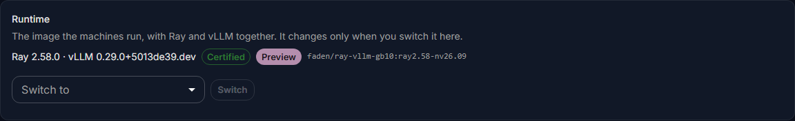

# Upgrading

How to move the server to a new release, then the agents on the GPU machines, and how to move a cluster to a
newer runtime. Each is a separate step that you start; nothing upgrades itself.

| What | How | What it interrupts |
|---|---|---|
| The server | `faden upgrade` | The console and the gateway, for the minutes the services restart. Models keep running |
| A machine's agent | Run the install line again on the machine | Nothing: the agent restarts, the models keep running |
| A cluster's runtime | **Runtime** on the cluster's page | Every model on that cluster, while it loads again |

## How you hear about a new release

Once a day the server reads the public list of Fadenstack releases, `https://fadenstack.com/updates/v1/index.json`.
Nothing about your server is sent: the list is fetched like any file and compared on the server. When a newer
release is out, the administrators see it:

| Where | What |
|---|---|
| **Updates** in the console | The release this server runs, the newest one and what it fixes, the commands to run for this install, and what each part runs: the services, every machine's agent, every cluster's runtime |
| **Needs attention** on the dashboard | An item for each newer release; a release that fixes security problems as a warning |
| A banner on the console's pages | For a release that fixes security problems, and when the release this server runs no longer gets fixes |
| E-mail | One message to the administrators for a release that fixes security problems, when e-mail is set up |
| The `faden` command | One line after a command, at most once a day: `Fadenstack <new> is available` |

Nothing is installed by itself: you run the commands, as described below.

??? info "More about the update check"
    - `faden deploy` asks whether to check; `--update-check` or `--no-update-check` answers without asking.
      Change it later in the console under **Settings**, **Updates** (**Check for new releases**), and for the
      command line with `update_check: false` in `faden.yaml` or `FADEN_NO_UPDATE_CHECK=1`.
    - **Release channel** `preview` also announces release candidates, to try a release before it is out.
    - The list is signed. The server and `faden` accept only a list signed by the Fadenstack project, and never
      an older list than the one they have, so a changed list can neither hide a release nor invent one.
    - `faden version` and `faden doctor` check at once and say how to upgrade.
    - Some releases cannot be skipped. **Updates** and `faden version` then name the releases to install one after
      the other, and `faden upgrade` refuses to skip one.
    - On a command line that is not a terminal (scripts, the backup timer) `faden` says nothing.

### A server without internet access

- **Behind a proxy:** set **Proxy for the release list** under **Settings**, **Updates**.
- **With a web server of your own:** copy `index.json` and `index.json.sig` from `https://fadenstack.com/updates/v1/`
  to it, unchanged, and set **Release list address** to the copy's address.
- **With neither:** download the two files on another computer and upload them on **Updates**, under **No internet
  on this server?**

Or switch the check off: **Updates** still shows what each part of the install runs.

## Before you start

- **Free disk space.** The new images need a few GB, a new runtime image up to about 15 GB per kind of machine,
  and the backup the upgrade takes needs room for the databases. Check with `df -h`.
- **Know which install the tool is set up for:** `faden config show` names it (`install_dir`).
- **Pick a time.** People see a maintenance page while the services restart.

## Upgrade the server

1. Upgrade the command-line tool. It carries the release:

    ```bash
    pipx upgrade fadenstack        # or: uv tool upgrade fadenstack
    ```

    **Updates** in the console shows this command for the way the tool was installed on this server, and the
    exact version when a release cannot be skipped.

2. See what the upgrade would do:

    ```bash
    faden upgrade --dry-run
    ```

    It names the release it moves to (`Release: <current> -> <new> (pull published images)`).

3. Run it:

    ```bash
    faden upgrade -y
    ```

4. Check it (below).

??? info "What the upgrade does, in order"
    1. checks Docker, and that no container it is about to replace was created by something else;
    2. backs up every database, the `.env` and the certificate material into `~/fadenstack/backups/<time>/`, and
       stops if nothing could be backed up;
    3. replaces the deployment files with the new release's, and adds to `.env` only the settings the release
       introduces: every value you set is kept, except the sizing of the services, which is worked out again for
       the host as `faden tune` does. A key that seals stored data and is missing gets the value the install ran
       on, never a new one, and the upgrade says so (see [Secrets in .env](installing.md#secrets-in-env));
    4. pulls the new release's images;
    5. restarts the services behind the maintenance page; the database migrations run here, and the two Postgres
       logins with fixed passwords that earlier releases made (`llm_user`, `faden_backend`, used by nothing) are
       switched off;
    6. waits for the console API to answer, then lifts the maintenance page;
    7. fetches the runtime images the new release names. Only what changed is downloaded. A failed pull stops
       nothing: retry it with `faden runtime-images`.

| Option | What it does |
|---|---|
| `--dry-run` | Show what would happen, change nothing |
| `-y` | Do not ask before starting |
| `--backup-dir PATH` | Put the pre-upgrade backup elsewhere |
| `--no-backup` | Skip the backup. Only when you have a current one |
| `--runtime-images ARCHS` | Which runtime images to fetch: `all`, `none`, `x86_64`, `aarch64`. Remembered |

!!! note "The chat checks roles since release 0.4.2"
    Before, every active account could chat. Now people chat with `default_user` or a role that has the
    `chat.*` permissions. After the upgrade, an account you gave only other roles, such as `operator` or
    `viewer`, no longer chats: tick `default_user` for it as well (see [Users](../administer/users.md)).

!!! warning
    An upgrade only moves forward: the databases are migrated to the new release. The tool refuses to move an
    install to an older release, and going back to the release before is not possible yet (see
    [Going back](#going-back)).

Changes you made to the deployment files themselves, such as `nginx/nginx.conf`, are replaced. Keep your changes
in `.env`.

### What people see meanwhile


| Who | What they see while the services restart |
|---|---|
| People in the console | Every page of the console shows "Fadenstack is being updated" and reloads itself into the console once it is back. |
| Scripts and SDKs | The API (`/api`) and the gateway (`/v1`) answer `503` with `Retry-After: 30`, so scripts and SDKs can wait and retry. |
| A console page left open | It notices the new version and offers **Reload**; a page with text typed and not sent is never reloaded by itself. |

The models on the clusters keep running throughout: a cluster runs on its machines, not on the server.

### Maintenance by hand

The same maintenance page can be switched on for your own work. The services keep running; only the front door
changes.

```bash
faden maintenance on -m "Back at 15:00"   # the note is shown on the page
faden maintenance status
faden maintenance off
```

An upgrade leaves maintenance you switched on by hand switched on.

### Check it

```bash
faden status                                           # every service up; healthy where it has a check
curl --cacert ~/fadenstack/tls/ca.crt https://ai.example.internal/api/health   # 200
```

Then sign in to the console. The machines and clusters are as they were.

## Update the machines' agents

A new release may expect a newer node agent than the machines run. The **Machines** list and each machine's page
then show **Agent *version* available** on that machine, with the version the server expects. Agents never update themselves, and the server never
updates them: you pick the window.

{ width="360" }

1. In the console, open **Machines** and select **Add a machine**, and copy the install line.
2. On each machine, run the line again, the same way you ran it the first time: with `sudo` for an agent that runs
   as a system service, without it for one that runs as a user service.

The installer downloads the agent the server now expects, sees that the machine is already a member, and
restarts the agent on the new build. There is nothing to approve. The models on the machine keep running.

??? info "Why the models keep running"
    The agent is the machine's link to the server, and the cluster's containers do not depend on it running.

Update the agents soon after an upgrade. Some features need a recent agent on every machine of a cluster, and
the console names the machines to update when one is missing (for example on the cluster's **Traffic between
machines** card, or in a drain plan).

### Machines without internet access

Machines without internet access install the agent from the server's own copy in `~/fadenstack/agent-binaries/`.
Replace those files after every server upgrade with the new release's builds (`faden-agent-linux-x86_64`,
`faden-agent-linux-aarch64`, with their `.sha256` files), from the project's releases page. Nothing replaces them
for you, and an old copy holds back the machines that rely on it.

## Move a cluster to another runtime

A runtime is the image a cluster's machines run: Ray and vLLM together, built for that kind of machine. When a
newer certified runtime is out, the cluster's **Runtime** card says so. Nothing changes until you switch.



1. Open **Clusters**, then the cluster.
2. On the **Runtime** card, choose the runtime under **Switch to** and select **Switch**.
3. Read the warning and select **Restart on this runtime**.

Each machine's container is made again from the new image (a machine that does not hold it yet fetches it first),
and every model on the cluster loads again. Plan a window for it.

??? info "More about runtimes"
    The cluster's **Runtime** card says whether it is certified: **Certified**, **Partly certified** or **Not
    certified**. A release ships a **Recommended** runtime for each kind of machine, can ship a newer **Preview**,
    and keeps an older one to go back to. A new cluster gets the recommended one.

    A cluster keeps the runtime it was started with: through restarts, through recovery after a fault, and through
    server upgrades that ship a newer one.

    A **Preview** runs models the recommended runtime cannot; choose it for a cluster that needs those models. The
    model marketplace says **Cannot run here** for a model that needs a newer runtime than the cluster runs (see
    [Models](../administer/models.md)).

## Going back

!!! warning "Under testing"
    Going back after an upgrade is being tested, and goes back only part of the way. A restore puts the data
    back as it was before the upgrade, but the server stays on the new release: its programs and deployment
    files stay as the upgrade left them, and the databases are migrated to the new release again when the
    services start. Going back to the earlier release itself is not possible yet. The sure way back is a
    snapshot of the whole server, taken before the upgrade: a virtual machine snapshot or a disk image.

Every upgrade leaves a backup in `~/fadenstack/backups/<time>/`. To put the data back as it was before the
upgrade, restore that backup:

```bash
faden restore ~/fadenstack/backups/<time>
```

The restore puts back every database, the `.env` and the certificate material, and restarts the services.
Anything done after the backup is lost. A cluster created after the backup keeps running on its machines; take it
over instead of creating it again (see [Taking over clusters](taking-over.md)). More on restoring:
[Backups](backups.md#restore).

## When it does not work

| You see | What to do |
|---|---|
| **`These containers have names this installation uses, but it did not create them`** | A container with one of Fadenstack's names was made some other way, by hand or by another compose project. The message lists them and the command to remove them (`docker rm -f <name>`). Removing a container keeps its data volumes. Then run the upgrade again. |
| **`This CLI (<version>) is older than the install (<version>).`** | The tool is older than the release the install runs. Upgrade the tool first. |
| **`<version> cannot upgrade straight to <version>: <version> has to come first.`** | A release in between cannot be skipped. Install the tool of the release named, run `faden upgrade`, then install the newer tool and run `faden upgrade` again. The message gives the commands. |
| **Updates** says the release list could not be read | The server has no internet, or needs a proxy. See [A server without internet access](#a-server-without-internet-access). |
| **`Backup failed — aborting upgrade.`** | Usually a full disk, or Postgres not running. Free space, check `faden status`, and run it again. Use `--no-backup` only if you have a current backup. |
| **`Backend did not become healthy within 120 s.`** | The services were restarted but the console API does not answer yet. Read `faden logs faden-backend`. The maintenance page is lifted anyway, so whatever runs can be reached. |
| **`... this release names a build that is on no registry.`** | A runtime image for one kind of machine is not published. The upgrade is not affected and running clusters keep their images. A machine of that kind can still get the image from another machine of its cluster that holds it. |
| The disk is full: Postgres, the log store and the other stores restart over and over | Nothing works until there is space: remove images no container uses (`docker image prune`), move old backups off the server, then run the upgrade again. The dashboard warns earlier: **Disk space low**. |
