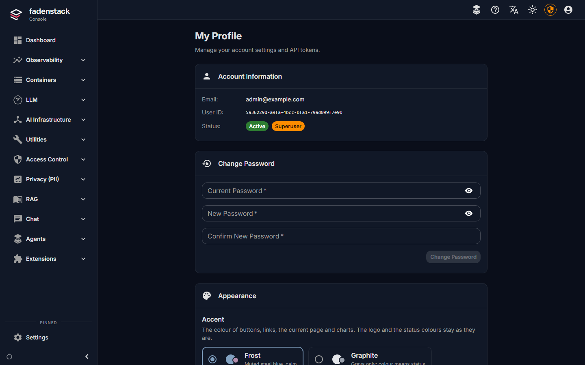

# Your account

Your account is how Fadenstack knows you: your sign-in, your chats, your skills, and the API tokens your scripts and applications use. This page covers your profile, your password, the language and look of the console, how long a sign-in lasts, and personal API tokens.

## Your profile

1. Select your avatar in the top bar.
2. Select **Manage Profile**.

**My Profile** opens with:

| Section | What is in it |
|---|---|
| **Account Information** | Your **Email**, your **User ID** and your **Status** |
| **Change Password** | See [Change your password](#change-your-password) |
| **Appearance** | The **Accent** colour (**Frost**, **Graphite** or **Aurora**) and the **Theme** (**Light** or **Dark**). They are saved in this browser. |
| **API Token** | Your personal API tokens (see [API tokens](#api-tokens)) |

Your e-mail address and what you may do are set by your administrator. See [Users, groups and roles](../administer/users.md).

## Change your password

1. In **My Profile**, under **Change Password**, enter your **Current Password**.
2. Enter the **New Password** twice. It needs at least 8 characters.
3. Select **Change Password**.

You see **Password changed successfully. Your other sign-ins were ended.** Every other browser and app signed in as you has to sign in again; this browser stays signed in. Your API tokens keep working: revoke them below if someone else may have one.

## Forgot your password

1. On the sign-in page, select **Forgot password?**.
2. Enter your e-mail address.
3. Select **Send reset link**.

If your organisation's server sends e-mail, a link to set a new password arrives. If nothing arrives, ask your administrator to set a new password for you.

## Language and theme

| To change | Use |
|---|---|
| **Language** | The button with the translation symbol in the top bar. English, German, Spanish, French and Chinese are available. The choice changes the console's labels, not the language the model answers in. It is kept for your account: the console on your other computers, the browser agent and the Office add-ins follow it. |
| **Light or dark** | The sun or moon button in the top bar. |

A language you pick in the settings of the browser agent or an Office add-in is kept the same way, so the console follows it too. In those panels, **Automatic** goes back to the language of the browser or of Office. If your organisation set a language, the panels show it with **Set by your organisation** and you cannot change it there.

## How long a sign-in lasts

A sign-in lasts seven days, unless your organisation set another length. Then you are asked to sign in again. To end it sooner, select your avatar, then **Logout**: that sign-in is over at once, also for anyone who copied it. Changing your password, or an administrator suspending your account or taking a role away, ends all your sign-ins. Sign out on any computer others use.

If your organisation connected its own sign-in, the sign-in page offers it: **Sign in with** and your
organisation's name, or a choice between **Fadenstack account** and your organisation's directory, where you
type your **Account name** and your usual password. A sign-in that way may last less than seven days, as your
organisation set it.

## API tokens

An API token lets a script or an application use your organisation's models in your name, through the API that works like OpenAI's for chat, embeddings and rerank. It acts as you: what it sends counts as your usage, under the same rules as your chats. You do not need a token for the chat, the browser agent or the Office add-ins.

### Create a token

1. In **My Profile**, go to **API Token**.
2. Enter a **Name** after what will use the token, for example `report script`.
3. Choose the **Token Expiry**.
4. Select **Generate Token**.
5. Copy the token with the copy button and keep it somewhere safe.

??? info "More about the fields"
    | Field | What to know |
    |---|---|
    | **Name** | Name the token after what will use it, so you know which one to revoke later. |
    | **Token Expiry** | **1 hour**, **24 hours**, **7 days**, **30 days**, **90 days** or **1 year**. Every token expires; shorter is safer, and you can always make a new one. |

!!! warning "Shown once"
    The token is shown only this once. Once you leave the page, it cannot be shown again; create a new one if you lose it. Anyone who has the token can use the models in your name.

The application also needs the API's address, which your administrator can give you. How to call the API is on the [Developers](https://developers.fadenstack.com/) site.

### See and revoke your tokens

**Your tokens** lists every token with its name, when it was created and when it expires. Expired and revoked ones are marked **Expired** or **Revoked**.

1. Select **Revoke** beside the token.
2. Confirm with **Revoke**.

Applications that use it stop working within a minute. Revoke a token as soon as it is no longer needed, or if it may have been seen by someone else.

??? info "Other ways a token stops working"
    Your administrator can also revoke your tokens. If your account is deactivated, your tokens stop working too.

## When it does not work

| You see | What to do |
|---|---|
| You are sent back to the sign-in page | Your sign-in ended. Sign in again. If your password is no longer accepted, ask your administrator: your account may have been changed or deactivated. |
| **New passwords do not match.** or **Password must be at least 8 characters.** | Enter the new password again. It may not be your e-mail address either. |
| **Too many attempts from this address. Wait a minute, then try again.** | The server counts sign-in and password-reset attempts per address. Wait a minute. If it happens to many people at once, they may all reach the server through one address (a proxy); tell your administrator. |
| An application says its token is revoked or out of date | Create a new token and give it to the application. |
