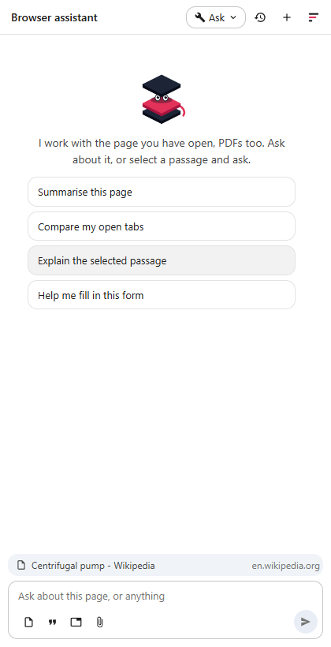
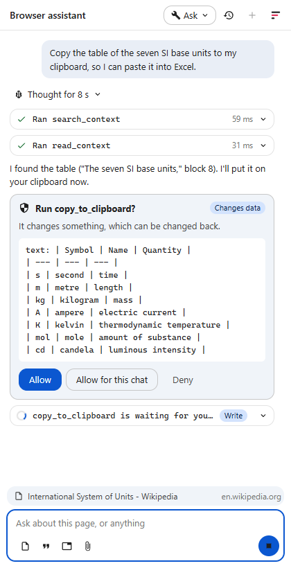

# The browser agent

The browser agent is Fadenstack in Chrome's side panel. It works with the page you have open: it answers questions about it, shows you where something is, copies tables out, compares tabs, reads PDFs, and writes into the mail or ticket you are working on. It answers with your organisation's model, through your Fadenstack server, and in the **Ask** tool mode, where every chat starts, it asks before it changes anything.

## Before you start

- **The extension** is installed in Chrome. Your IT department installs it for you, or tells you where to get it.
- **Access**: your administrator has given you the browser agent. See [Agents and add-ins](../administer/agents.md).
- **The server's address and the agent's name**, unless your IT department set them for you.

## Open the panel and sign in

1. Select the Fadenstack button in Chrome's toolbar, or press Alt+Shift+F.
2. The first time, **Connect to Fadenstack** asks for the **Server** (for example `https://ai.example.internal`) and the **Agent** (its address, as the console shows it under **Agents**; `browser-assistant` unless you were told otherwise). Select **Connect**, and allow the access when Chrome asks.
3. Enter your **E-mail** and **Password** (your Fadenstack account) and select **Sign in**.

If your IT department set the server and agent, you only sign in.

## Ask about a page

Type your question in the panel, for example "Summarise this page" or "What does this contract say about notice periods?". The bar above the message box names the page the agent works with.

The agent reads the page itself when you ask about it: its text, headings, lists and tables, the visible part, without menus, footers and side bars, and without text the page marks as hidden. A long page is read in parts.

The buttons under the message box add something to your next message:

| Button | Adds |
|---|---|
| **Add this page** | The page you are on |
| **Add the selection** | What you selected on the page |
| **Add tabs** | Tabs of this window you pick, to compare them (**All readable tabs** takes all of them) |
| **Add a PDF from this computer** | A PDF file; you can also drop it on the panel |

You can also right-click a selection and choose **Ask Fadenstack about "…"**, or right-click a page and choose **Ask Fadenstack about this page**.

**New chat** at the top of the panel starts a fresh conversation; **Chat history** lists your earlier ones in this browser.

## What else it can do

- **Show you where.** Ask where something is on the page: the agent marks the passage and scrolls to it. In a PDF it opens the PDF at the right page.
- **Copy a table.** Ask it to copy a table or text: it goes on your clipboard as text and as a table, so it pastes into Excel as cells and into Word or Outlook as a table. Every table in an answer also has a copy button.
- **Write into a mail, a ticket or a form.** The agent fills form fields, and writes formatted text into the editor on the page, such as a mail in Outlook on the web or Gmail, a ticket, or a note. Say where: at your cursor, below the greeting, at the end, or replacing everything.
- **Read PDFs** open in Chrome, and PDFs you add. Long PDFs are read page by page as needed.

## What it asks first

The **Tool mode** at the top of the panel decides what runs without asking:

| What | Off | Read only | Ask (default) | Auto |
|---|---|---|---|---|
| Read the page, tabs, PDFs, the selection; search; show where | no | runs | runs | runs |
| Fill a field, write into an editor, copy to the clipboard, open a page | no | no | asks | runs |
| Press a button or follow a link | no | no | asks | asks |

When it asks, a card shows **Run …?** with the action and what it is given; for a field or a button that is the page's internal reference, not its label. Select **Allow**, **Allow for this chat**, or **Deny**.

## What it never does

- It never reads the content of a site you have not allowed; only the titles and addresses of this window's tabs reach the model. On such a site the bar says **The agent cannot read …**; select **Allow on this site** (or **All sites**) to let it.
- It never reads out or fills in password fields, nor card fields the site marks as such. A payment field the site does not mark is read and filled like any other field.
- It never presses a button, such as **Send**, without asking you separately.
- It is told never to take instructions from the page: text on a page is something to read, not an order to follow. A page can still mislead a model, so read what a card asks before you allow it.
- It never reaches files on your computer that you did not add.

## Permissions it asks for

At installation, Chrome lets the extension open its side panel, keep its settings and your sign-in, add its right-click items, read the titles and addresses of your tabs, and read and act on pages, but only on sites you allow. It asks separately to reach your Fadenstack server (when you select **Connect**) and for each site you allow. You can take any site back in Chrome's settings for the extension.

## Where your data goes

- What you ask, and what the agent reads to answer (the page, tabs, PDF pages), goes to your organisation's server and to the model your administrator chose for the agent.
- PDFs are read inside your browser.
- Your conversations stay in this browser. The server records which tools ran and how long they took, not what they read.
- Your sign-in is kept in this browser and is not encrypted there. On a computer others use, sign out when you are done: select the Fadenstack mark at the top of the panel, then **Sign out on this device**.

More on what is kept and who sees it: [Your data and privacy](privacy.md).

## What it cannot read

| What | What happens |
|---|---|
| A scan (pages that are pictures) | It says so |
| A PDF with a password | It says so: open it in a PDF reader instead |
| A PDF over 50 MB | It says so |
| A PDF on your computer opened in Chrome | Add it with **Add a PDF from this computer** instead |
| A selection inside Chrome's PDF viewer | Copy the passage into your message |
| Chrome's own pages and the Chrome Web Store | Chrome does not let extensions read them |

## When it does not work

**… does not answer. Check the server's address, and that this computer trusts its certificate.** The address is wrong, or your computer does not trust the server's certificate. Check the address, or tell your IT department.

**There is no agent '…' on …** The **Agent** name is wrong. Use **Change server or agent** and enter it as your administrator gave it.

**You have no access to '…'. Ask your administrator to grant it to you or your team.** You are not yet allowed to use this agent.

**'…' has no published version yet.** or **'…' is retired.** The agent is not available. Ask your administrator.

**Your account is deactivated.** Ask your administrator.

**Fadenstack needs to reach the server. Allow it when Chrome asks.** You declined Chrome's question. Select **Connect** again and allow it.
