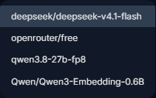
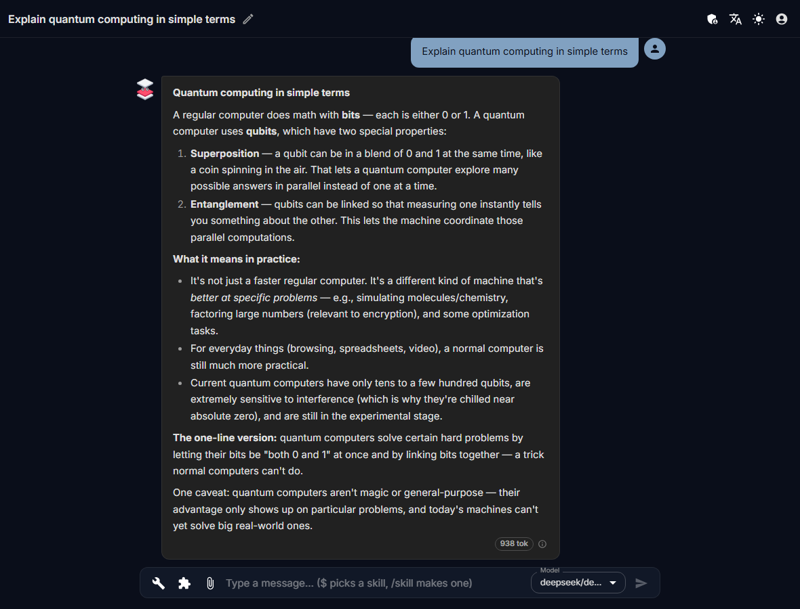
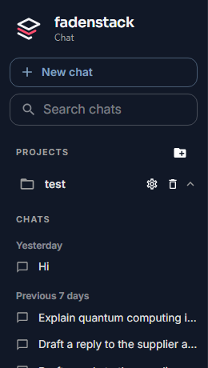
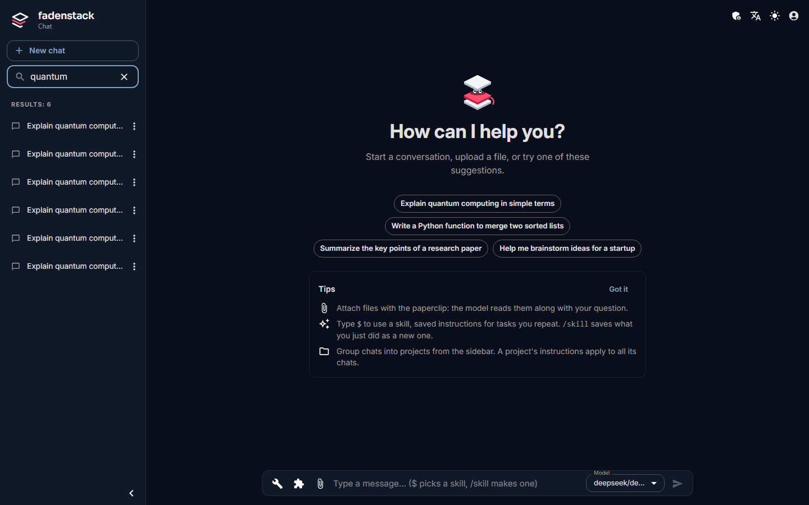
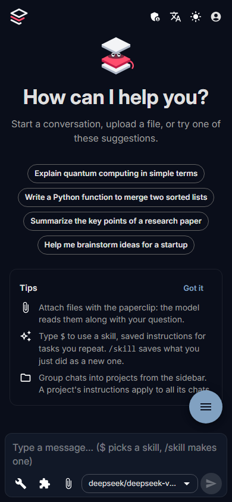

# Chat

Talk to your organisation's models: start a chat, pick a model, and find your chats again.

## Start a chat

1. Select **New chat** in the sidebar.
2. Pick a model in the **Model** picker.
3. Type your message and press Enter. Shift+Enter starts a new line.

The reply appears as it is written. To add a file, select the paper clip before you send.

??? info "More about starting a chat"
    A model is already picked: the first in the list, or the one you picked last. A new chat is named after the start of your first message. The model reads an attached file along with your question, and can use it for the rest of the chat. What files you can add, and the limits, are on [Knowledge](knowledge.md).

## Choose a model

You can switch models in the middle of a chat: the next reply comes from the model now picked, and it sees the conversation so far.

??? info "Where does a model run?"
    Some models run on your organisation's own machines, others at an outside provider. The name in the list does not always say which; ask your administrator if it matters for what you write. See [Your data and privacy](privacy.md).

## While a reply is written

| To | Do this |
|---|---|
| Stop the reply | Select the square that replaces the send button. What was written stays, marked **Stopped**. |
| Read earlier messages | Scroll up; the chat stops following the reply. **Jump to the latest message** (the round arrow button) takes you back down. |
| See how the model thought | Some models think first: **Thinking…** shows the last lines, then folds into **Thought for N s**, which you can select. It is not saved with the chat. |

## Leave while a reply is written

You can: the reply keeps being written when you open another chat, go to another page, reload or close the tab. Come back and it shows the reply from its start. A chat whose reply is still being written has a small spinner in the sidebar.

??? info "How many replies at once"
    - One reply at a time in a chat: send the next message once the reply is done.
    - Replies in up to three chats at once, unless your administrator set another number. A fourth is refused until one of them finishes; then select **Retry**.

## When a reply fails

A failed reply stays in the chat with the reason. Select **Retry** under the chat's last reply to ask again with the model now picked; the new reply takes its place.

??? info "What the model sees afterwards"
    A failed reply is not sent to the model with your later messages. A stopped reply is. If you stopped the last reply, **Retry** is beside it too.

## Details of a reply

Under each reply: how long it took (if you had the chat open), its size in tokens (point at the badge for the prompt, the reply and the total), and an ⓘ that names the model. To use an answer elsewhere, select its text and copy it.

## Titles, projects and search

- **Rename a chat:** select the pencil beside its title in the top bar.
- **Projects** group chats. Select **New project** beside **Projects**. A project's **Project Settings** hold a description and a **System prompt**: instructions that go before every message in its chats.
- **Move a chat into a project:** drag it onto the project, or use **Move to project**.
- **Search chats** finds chats by their title as you type, not by what was said in them.

??? info "More about the sidebar"
    The sidebar lists your most recent chats by when you used them (**Today**, **Yesterday**, **Previous 7 days**, **Previous 30 days**, **Older**); **Show more** loads older ones. **Collapse** (the arrow at the bottom) folds it into a narrow strip, and the logo opens it again. **No project** in **Move to project** takes a chat out of its project. Chats are yours: there is no way to share a chat with a colleague from the chat.

!!! warning "Deleting has no undo"
    **Delete** on a chat removes it at once, without asking, and it cannot be brought back. Deleting a project erases all the chats in it, also without asking. What happens to deleted chats on the server is on [Your data and privacy](privacy.md#deleting).

## On a phone

{ width="280" }

The sidebar opens from the round menu button in a bottom corner, or from the logo. **Menu button** (**Left** or **Right**) in the sidebar puts it on the side of your thumb. On a phone, Enter starts a new line and the send button sends; a chat's actions (**Move to project**, **Delete**) are behind its ⋮ button.

## When it does not work

| You see | What to do |
|---|---|
| **No models** next to the message box | No model is offered to you yet. Tell your administrator. |
| **A reply is still being written in this chat. Wait for it, or stop it.** | Wait for the reply, or stop it, then send again. |
| **Rate limit reached** with **Replies are being written in 3 of your chats. Wait for one to finish.** | You reached the number of replies you can have at once. Select **Retry** once one is done. |
| **Rate limit reached** with **Try again in N s.** | Your organisation limits how many requests can be sent in a given time. Wait, then select **Retry**. |
| **The model did not start its reply within … s; it may be busy.** | Many people are using that model. Select **Retry**, try again later, or pick another model. |
| **The server restarted while this reply was being written.** | Select **Retry**. |
