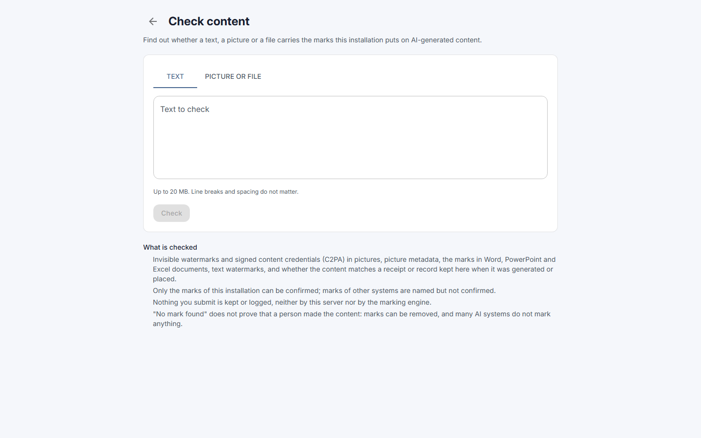
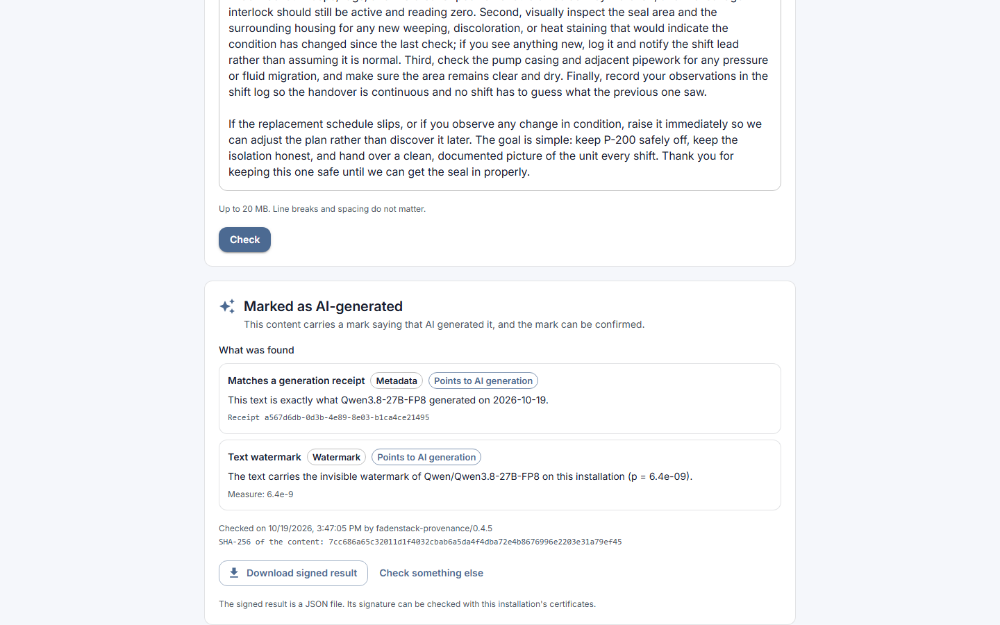
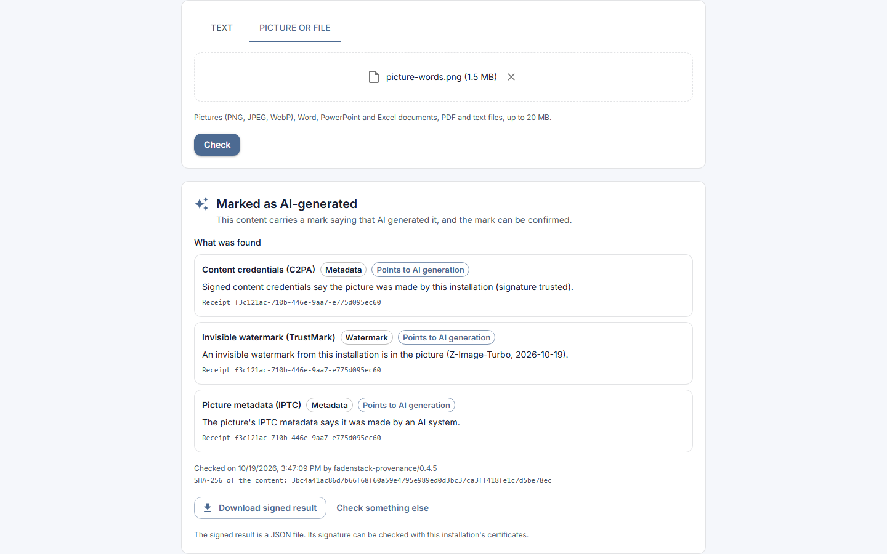
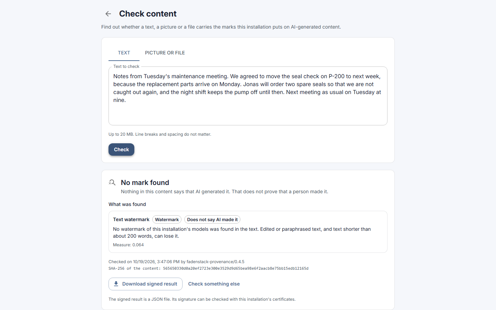
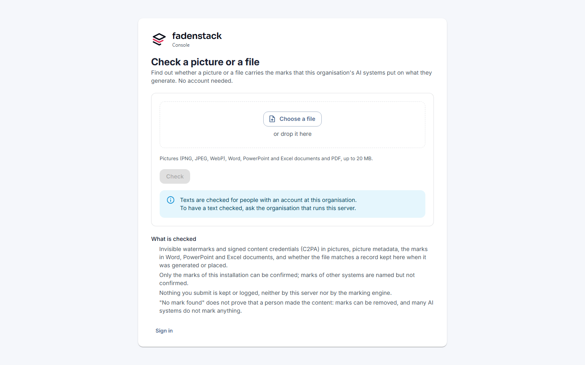

# Checking content

Find out whether a text, a picture or a file carries the mark that Fadenstack puts on what your organisation's
models generate. You get a verdict in plain words, what was found, and, if you need it, a signed result to show
someone else.

## Before you start

**Check content** is in your avatar menu at the top right of the chat. If it is not there, ask your
administrator.

## Check a text, a picture or a file

1. Open your avatar menu and select **Check content**.
2. Choose **Text** and paste the text, or choose **Picture or file** and select **Choose a file**, or drop the
   file on the box.
3. Select **Check**.

??? info "What you can check"
    - Texts you paste. Line breaks and spacing do not matter.
    - Pictures: PNG, JPEG and WebP.
    - Word, PowerPoint and Excel documents, PDF, and text files (`.txt`, `.md`, `.html`).

    Up to 20 MB at a time. Administrators also find the same check in the console under
    **Utilities → Check content**.

## Read the result

| You see | It means |
|---|---|
| **Marked as AI-generated** | A mark of this installation was found and confirmed. |
| **No mark found** | Nothing in the content says that AI generated it. |
| **Inconclusive** | There are signs that AI generated it, for example another system's mark, but none that can be confirmed here. |

Under **What was found**, each finding names what was looked for, such as **Invisible watermark (TrustMark)**,
**Content credentials (C2PA)**, **Picture metadata (IPTC)**, **Text watermark** or **Matches a generation
receipt**, and says whether it **Points to AI generation**. A receipt or record that was found shows its id.

??? info "How a text is checked"
    A text is compared with the receipts and records this installation keeps of what its models wrote. That
    still works when the text was reformatted, but not once it is reworded. The text is also checked for the
    invisible text watermark, which needs roughly 200 words or more and weakens when the text is heavily edited,
    translated or paraphrased.

!!! note "No mark found is no proof"
    **No mark found** does not prove that a person wrote it: marks can be removed, and content from other systems
    carries none of this installation's marks.

!!! tip "Keep the marks"
    Do not remove the marks from what you take out of Fadenstack: keep a picture's metadata and content
    credentials, and do not rewrite a text only to lose its watermark. When you publish a picture, audio or video
    that could pass as real, or an AI-written text to inform the public, say visibly that AI made it, unless a
    person reviewed the text and someone answers for publishing it; your administrator can tell you your
    organisation's rules.

## Show the result to someone else

**Download signed result** saves the result as a JSON file signed by this installation. Whoever you give it to
can check the signature with this installation's certificates. **Check something else** clears the page.

## What is kept

Nothing you submit is kept or logged: the text or file is checked and then dropped.

## Without an account

Your organisation can offer a public check page, for example at `https://ai.example.internal/check`. There,
anyone can check pictures and files without signing in. Texts are checked only for people with an account; the
page names whom to ask. Administrators switch it on: see [Content marking](../administer/content-marking.md#the-public-check-page).

## When it does not work

| You see | What to do |
|---|---|
| **Check content** is not in your menu | The check is not offered to you. Ask your administrator. |
| **You do not have the right to check content. Ask your administrator.** | Your role lacks the permission `provenance:check`. Ask your administrator. |
| **Content cannot be checked here: the provenance module is switched off.** | Your organisation switched content marking off. Ask your administrator. |
| **This is larger than 20 MB and cannot be checked.** | Check a smaller file, or a part of the text. |
| **Too many checks in a minute. Wait a moment and try again.** | Wait, then select **Check** again. |
| **The marking engine is busy. Try again in a moment.** or **The marking engine is not available right now. Try again later.** | Try again later. If it stays, tell your administrator. |
| **The result cannot be signed right now: the marking engine has no signing key.** | The result is shown, but cannot be downloaded signed. Tell your administrator. |
