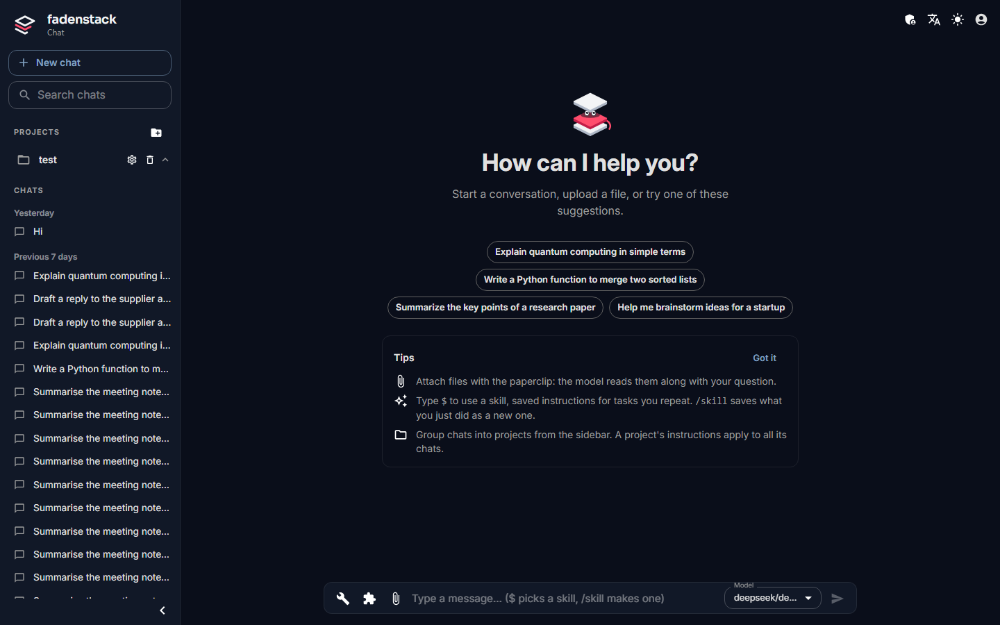

# Using Fadenstack

Fadenstack is your organisation's own AI assistant. You chat with the models your IT department offers, in the browser, and you can bring the same assistant into Chrome and into Word, Excel, PowerPoint and Outlook. It runs on your organisation's server, under your organisation's rules.

## What you can do

| You can | See |
|---|---|
| **Chat** with a model: ask questions, have a text drafted or checked, attach a file and ask about it | [Chat](chat.md) |
| **Use tools** your administrator connected, such as a ticket system or a file store, so the model can look things up or act for you, with your approval | [Tools in the chat](tools.md) |
| **Use skills**: saved instructions for tasks you repeat, such as "review this the way our team does" | [Skills](skills.md) |
| **Ask about your organisation's documents**: the model can search the knowledge base your administrator filled | [Knowledge](knowledge.md) |
| **Work in Chrome** with the browser agent, which reads the page you are on | [The browser agent](browser-agent.md) |
| **Work in Office** with the add-ins for Word, Excel, PowerPoint and Outlook | [Office add-ins](office-add-ins.md) |

## Before you start

You need an account. Your administrator creates it and gives you the server's address, your e-mail address as your user name, and a first password.

## Sign in

1. Open the address your administrator gave you, for example `https://ai.example.internal`.
2. On **Sign in to Fadenstack**, enter your **Email** and **Password**.
3. Select **Sign In**.

You land in the chat.

??? info "How long a sign-in lasts"
    A sign-in lasts seven days unless your organisation set another length; then you are asked to sign in again. Your password, the sign-in length and API tokens are on [Your account](account.md).

## Where things are in the chat

| Where | What is there |
|---|---|
| The sidebar on the left | **New chat**, the search, your **Projects** and your **Chats** |
| The bar at the top | The chat's title (the pencil renames it), **Language**, the light or dark theme, and your avatar with **Manage Profile**, **Skills**, **Help**, **About Fadenstack** and **Logout** |
| The box at the bottom | Where you type. Beside it: the tools button (a wrench), the skills button (a puzzle piece), the paper clip for files, the **Model** picker and the send button |

??? info "If you are an administrator"
    Administrators also see a shield in the top bar, which opens the admin console. Everything about the console is in [Administer](../administer/index.md).

## Your data

What you type, and the files you attach, go to your organisation's server and to the model you picked. What is kept, who can see it, and what reaches models outside your organisation is on [Your data and privacy](privacy.md).
