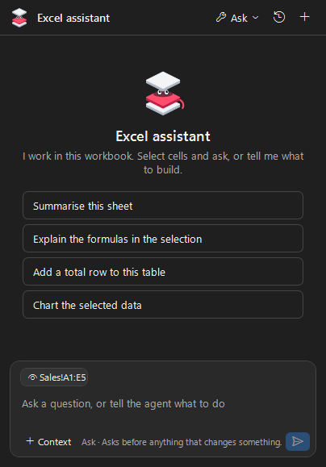
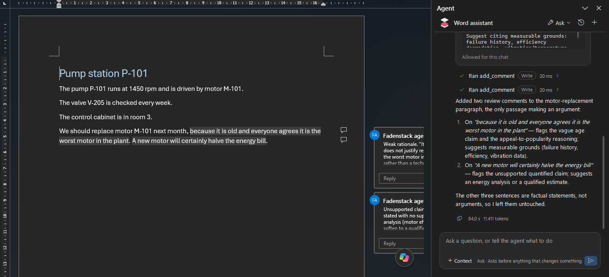
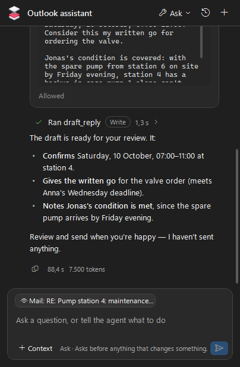
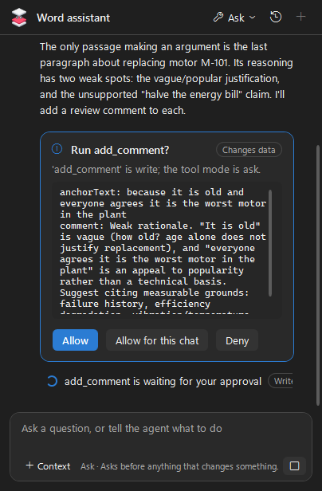

# Office add-ins

The Office add-ins put a Fadenstack agent in a pane beside your document in Word, Excel, PowerPoint and Outlook. The agent sees what you select, reads the document when it needs to, and changes it only when you allow it. Every answer comes from your organisation's model, through your Fadenstack server.

## Before you start

- **Windows and desktop Office.** The add-ins work in the desktop versions of Word, Excel, PowerPoint and Outlook on Windows. They do not work in Office on the web or on a Mac. They are tested with the Microsoft 365 desktop apps only.
- **Classic Outlook.** In Outlook, the add-in works only in classic Outlook, not in the new Outlook for Windows, which runs no add-ins of this kind. If you use the new Outlook, switch back to classic Outlook to use the agent.
- **Installed by IT.** Your IT department installs the add-ins and usually sets the server's address for you.
- **Access.** Your administrator has given you the agent for each application you use. See [Agents and add-ins](../administer/agents.md).

## Open the agent and sign in

1. On the **Home** tab (in a message opened in its own window: the **Message** tab), select **Agent** in the **Agent** group. The pane opens beside the document.
2. The first time, **Sign in to your agent** asks for your **E-mail** and **Password** (your Fadenstack account), and the **Server** if IT has not set it. Select **Sign in**.

One sign-in covers Word, Excel, PowerPoint and Outlook on this computer. Each document window has its own pane and its own chat; hiding the pane keeps its chat.

## Give the agent context

- **Your selection.** What you select is offered as a chip (**Current selection**) in the message box. It follows your selection, and you can switch it off. Its content is read when you send.
- **Context.** The **Context** button lists the parts of the document (sheets, tables, sections, slides, messages) to add to your message.
- **Ask about selection** on the ribbon, or **Ask the agent about this** and **Add to agent chat** when you right-click, add the selection to the chat. In Outlook, a message opened in its own window has **Ask about this message**.
- The agent can also read the document by itself when your question needs it. A long document is read in parts.

## What it can do in each application

| Application | It reads | It can change (asks first in **Ask**) | It asks every time before it | Taking a change back |
|---|---|---|---|---|
| **Word** | The document, its sections, tables and comments, your selection | Insert or replace text, add comments, apply styles, insert tables | Deletes text | Word's own Undo. By default every change is also a tracked change you accept or reject. Comments are by "Fadenstack agent" |
| **Excel** | The workbook, sheets, tables, charts, named ranges, any range, with formulas | Write cells, add sheets, format cells, create tables and charts | Clears cells, deletes a sheet | **Undo agent change** on the ribbon, one change at a time. Formatting changes and a deleted sheet are not covered |
| **PowerPoint** | The presentation, slides, shapes and their text, tables, alt text of pictures, speaker notes | Add slides, set slide text and speaker notes, add text boxes, move slides | Deletes a slide | PowerPoint's own Undo, one change at a time |
| **Outlook** | The selected messages or the open one, their conversation, the folder in view (for a calendar: its next 14 days), the draft you are writing; it can also search your Inbox and Sent Items | Draft a reply or a new mail, insert text into a draft, create an appointment, set categories, flag or move a message | Deletes a message (to Deleted Items) | **Undo agent change** on the ribbon: a draft or appointment is deleted, a move or delete goes back, categories and flags are restored |

!!! note "The agent never sends"
    In Outlook the agent writes drafts and opens them for you; you send them. An appointment it creates is saved in your calendar and opened; a meeting with attendees waits in its window for you to send it.

## What it asks first

Every chat starts in the **Ask** tool mode: the agent reads without asking, and asks before it changes anything. When it asks, a card shows **Run …?** with what it will do. Select **Allow**, **Allow for this chat**, or **Deny**. Change the mode in the pane: **Off**, **Read only**, **Ask** or **Auto**. Even in **Auto**, the agent asks before it deletes or clears anything. More on tool modes: [Tools in the chat](tools.md#choose-the-tool-mode).

## Where your data goes

- What you ask, and the parts of the document the agent reads to answer, go to your organisation's server and to the model your administrator chose for the agent.
- Your conversations stay on your computer, encrypted. The server records which tools ran, not what they read.
- Your sign-in is kept on your computer, protected by Windows.

More: [Your data and privacy](privacy.md).

## Sign out

On the ribbon, select **More**, then **Sign out**. This signs you out of all four applications on this computer.

## When it does not work

**The Agent button is greyed out.** The document is open in Protected View. Select **Enable Editing**, then **Agent**.

**There is no Agent group in Outlook.** You are in the new Outlook for Windows. Switch back to classic Outlook.

**The e-mail or password is not right.** Check them, and sign in again. Forgot your password? See [Your account](account.md#forgot-your-password).

**You have no access to this agent.** Your administrator has not given it to you yet, or the agent's address set for this application is wrong.

**Office is busy (a cell may be in edit mode, or a dialog is open). Finish that and try again.** Leave the cell, or close the dialog, and ask again.

**The agent could not start**, with a reason. Select **Try again**. If it keeps failing, tell your IT department what the reason says.
