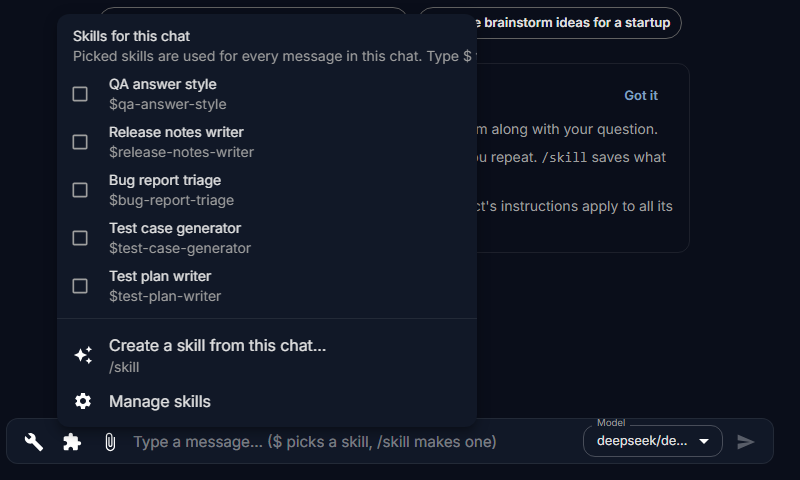
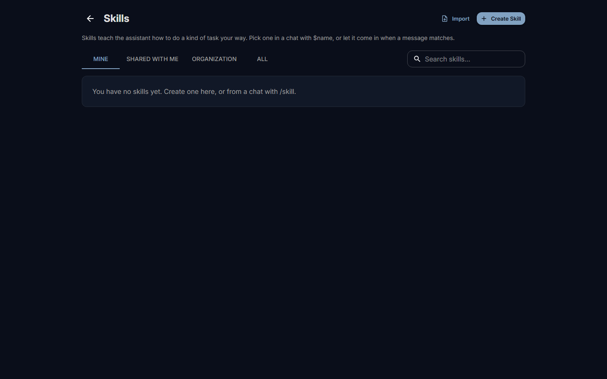

# Skills

A skill teaches the assistant how to do one kind of task the way your team does it: a review checklist, a report layout, the steps of an incident write-up. You pick it once in a chat, and the model follows it for every message there. This page shows how to use skills and how to save your own from a chat.

## Before you start

Skills are an optional part of Fadenstack. If the chat has no puzzle-piece button beside the message box, skills are switched off for your organisation, or your account may not use them; ask your administrator.

## What a skill does to a reply

A skill is a set of written instructions. While it is picked, they go to the model with each of your messages, so the reply follows them: the steps, the format, the checks, the tone.

??? info "More about what a skill does"
    A skill can also bring files, such as a template, which the model can read when it needs them.

    A skill does not add to what the model knows or what it may do: documents come from [Knowledge](knowledge.md), actions from [Tools](tools.md). A skill can keep some tools out of the chat while it is used.

## Use a skill in a chat

Either way works, also before your first message:

- **Type `$`** in the message box, then part of the skill's name, for example `$incident`. Matching skills are listed as you type. Use the arrow keys and press Enter or Tab to pick one.
- **Select the puzzle piece** beside the message box. **Skills for this chat** lists the skills you can use; tick the ones you want.

A picked skill shows as a chip above the message box. It is used for every message in this chat until you take it off with the × on its chip.

??? info "More about picked skills"
    Each chat has its own picks, remembered in this browser: on another computer, pick them again.

## Skills that come in on their own

Some skills are set up to come into a chat without being picked: when your message contains certain words, when the chat has a file of a certain type, or always. They do not show as a chip. If a reply follows a format you did not ask for, a skill like that may be the reason; your administrator can tell you which skills your organisation uses this way.

## Save a skill from a chat

When a conversation went the way you want it to go next time, save it as a skill:

1. Type `/skill` in the message box and press Enter. Or select the puzzle piece and **Create a skill from this chat…**.
2. In **New skill**, select **Draft from this chat**, or **Write it myself**.
3. Read the draft and change what is needed. The model is asked to leave out names, passwords and other details of the conversation, but check for them yourself.
4. Choose a **Short name**: it is what you type after `$`.
5. Select **Save skill**.

Nothing is saved before you select **Save skill**. New skills are private: only you, and administrators, see them until you share them.

??? info "More about saving a skill"
    - After `/skill` you can add what the skill should do, for example `/skill review pull requests the way we just did`.
    - With **Draft from this chat**, the chat's model reads the conversation and writes a draft: a name, a description and the instructions.
    - **Use it in this chat now** is ticked, so the skill is picked straight away; untick it if you do not want that.

## Your skills

1. Select your avatar in the top bar.
2. Select **Skills**.

The page lists the skills you can use, in **Mine**, **Shared with me** and **Organization**. Open one to read its instructions or change one of your own. Each save is kept as a version.

??? info "Sharing, versions and the skill format"
    Who can see a skill, how sharing works and how versions are published is on [Skills for the organisation](../administer/skills.md). The skill format, for writing or importing skills by hand, is on the Developers site: [Skills](https://developers.fadenstack.com/skills/).

## When it does not work

| You see | What to do |
|---|---|
| The list after `$` is empty | There is no skill you can use with that name. Check **Skills** in your avatar menu, or ask whoever owns the skill to share it with you. |
| The reply ignores the skill | Check that its chip is above the message box. Smaller models follow long instructions less reliably; try a larger model. |
| **You do not have access to skills. Ask an administrator for the skills permissions.** | Your account may not use skills. Ask your administrator. |
| **The Skills module is switched off. An administrator can switch it on.** | Skills are not in use in your organisation. |
