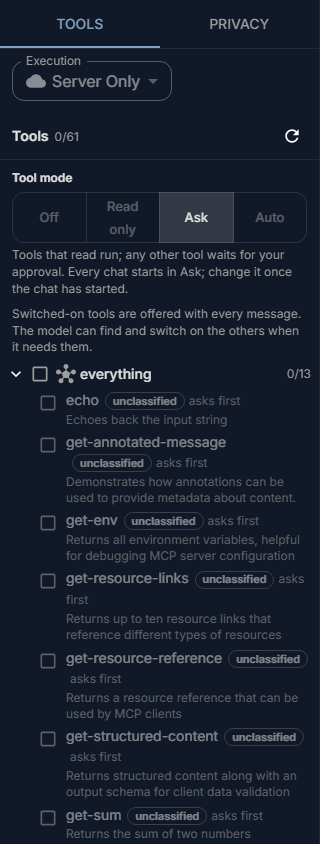
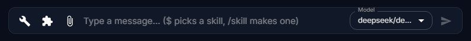

# Tools in the chat

Tools let the model do more than write: look something up in a service your organisation uses, read a ticket, search files, or change something for you. This page shows how to switch tools on in a chat and how you stay in control of what they do.

## What tools there are

- **Tools your administrator connected.** Each service (a ticket system, a code host, a file store, a search engine) brings a group of tools. Which services there are is your administrator's choice; see [MCP servers](../administer/mcp-servers.md) for how they are connected.
- **Tools that are always there.** The model can read the current date and time, look for a fitting tool among the ones your chat may use, and search your organisation's knowledge base and long files you attached (see [Knowledge](knowledge.md)). They only read.

Every tool has a class that says what it does:

| Class | Meaning |
|---|---|
| **read** | Only reads; changes nothing |
| **write** | Changes something that can be changed back |
| **destructive** | Deletes, or does something that cannot be undone |
| **unclassified** | Nobody has said what it does yet |

## Open the tools

Select the wrench beside the message box. The panel that opens has two tabs: **Tools** for the tools, and **Privacy** for the protection of personal data in this chat (see [Your data and privacy](privacy.md)).

## Switch tools on

The services' tools start off in every chat.

1. Open the tools panel.
2. Tick a tool to switch it on, or tick a group to switch on all its tools.

Switched-on tools are offered to the model with every message. The count beside **Tools** says how many are on.

??? info "More about switching tools on"
    - You can tick tools before your first message; they apply to the chat once it starts.
    - You do not have to switch on everything you might need. When no tool it has fits your question, the model can look for one among the tools your chat may use and switch it on itself. It then stays on for the rest of the chat, and the panel shows it ticked. Untick it to switch it off again.
    - A tool with a note under it cannot be used right now, and the note says why: for example, its service is not reachable, your organisation does not allow it, or the tool mode leaves it out.

## Choose the tool mode

The **Tool mode** decides what tools may do in this chat without asking you:

| Mode | What happens |
|---|---|
| **Off** | No tools are used in this chat, not even the knowledge base. |
| **Read only** | Only tools that read are used; the others are not offered. |
| **Ask** | Tools that read run; any other tool waits for your approval. |
| **Auto** | Tools that read or write run; destructive and unclassified tools wait for your approval. |

Every chat starts in **Ask**. You can change the mode once the chat has started; it stays with that chat. A tool that will ask first says **asks first** in the list.

No mode up to **Auto** runs a destructive or unclassified tool without asking you. Only [Bypass](#bypass), which your administrator must allow, does.

??? info "Why many tools ask first"
    Many services' tools are unclassified until your administrator says what they do: they always ask, and **Read only** leaves them out.

## Approve a tool

When a tool needs your approval, the reply pauses and a card shows **… wants to run**, with what the tool is about to do.

| Select | What happens |
|---|---|
| **Approve** | The tool runs. The reply goes on with its result. |
| **Decline** | The tool does not run, and the model is told so and carries on without it. |

??? info "More about approving tools"
    - If you leave the card unanswered for a few minutes, the tool does not run.
    - Your organisation can also have rules for single tools: some never run, some always ask first. When a rule stops a tool, you see **Not run** with the tool's name and the reason while the reply is written.

## Bypass for long, repetitive work {#bypass}

**Bypass** is a fifth level above **Auto**, for a long task you trust, such as going through hundreds of files the same way. In one conversation, destructive and unclassified tools run without asking, for a time you choose. Many organisations leave it off.

It is there only when your administrator has allowed it, the agent offers it as its highest level, and the agent's app supports it. You switch it on yourself, in the agent's app. No conversation starts in it.

1. Choose **Bypass** in the agent's tool mode.
2. Read the confirmation. It says what will no longer be asked, what still asks, what the server records, and for how long. You may add why; your administrators see it.
3. Select **Switch Bypass on** on the card. Your browser opens at Fadenstack's page **Sign in again**. Sign in there again, even if you are already signed in to the console: with your password, or with your organisation's sign-in, which asks you again (with its multi-factor step, if it has one). The page shows what you approve: the agent, the device, "switch approvals off in one chat" and the longest time. Select **Approve** or **Deny**.
4. Meanwhile the app waits. Its card asks you to sign in again in your browser and shows a code; compare it with the code on the page. **Open the page again** opens the page once more.

Bypass starts only once you have approved and the server has recorded it: when you are offline, the server refuses, you select **Deny** or nobody answers within 10 minutes, there is no Bypass, and you are told so.

While it runs, a marker shows the time left. Select **Stop** to end it at once. Leaving Bypass ends it too, and so does the end of the time. The reason field takes up to 500 characters.

Bypass stays with its chat. Starting a new chat or switching to another does not end it. The chat list shows which chats run in Bypass and the time left; when you open such a chat, its band shows again.

Bypass skips questions, never rules. These still ask, or are refused:

- tools that are hidden or refused for you, and tools your administrator denies;
- anything your administrator wants asked first;
- tools the agent's author marked **Always ask**.

??? info "More about Bypass"
    - A new conversation never inherits Bypass, and neither does an agent you delegate to or one that receives work from yours. The model, a tool, a skill or another agent cannot switch it on for you.
    - The longest time is set by your administrator.
    - One sign-in covers switching Bypass on in other chats with the same app on the same computer for 5 minutes.
    - When the app quits, a running Bypass pauses, and its time runs on. Start the app again within 30 minutes and it resumes, with no new card and no new sign-in. Later than that, it has ended, and the app says why. If your organisation narrowed Bypass meanwhile, it ends instead of resuming.
    - When Bypass ends, the agent is told that tools ask again. It may say so and suggest switching Bypass on again, but it cannot do that itself. Only you can: select **Switch on again** on the line that says it ended. The card and the second sign-in follow.
    - A Bypass is not extended. When its time is up it ends; more time is a new Bypass, confirmed again.
    - Every call that runs under Bypass is recorded on the server: the tool and the time and, unless your organisation records less, its arguments, with personal data masked. Your organisation may also keep a short summary of each result. The confirmation says which. Reads and writes are included. After each turn your device also reports what it ran, and the server flags any difference. Only people your organisation has named as approvals auditors can read these records, and every look is recorded too.
    - If your administrator turns Bypass off, it acts as **Auto** at once and any running Bypass ends. When the server ends a Bypass (its time, an administrator, Bypass turned off), the marker goes and the app says why.

More for administrators: [Bypass](../administer/policies.md#bypass).

## Execution

**Execution**, above the tool list, chooses where tools come from. Leave it on **Server Only** unless your administrator tells you otherwise.

??? info "More about Execution"
    | Setting | Tools |
    |---|---|
    | **Server Only** (the default) | The tools of the services your organisation connected |
    | **Local Only**, **Hybrid** | For tools on your own computer, which work only when an application your organisation provides offers them |

## What tools receive

A tool gets what the model passes to it: often a search term, a ticket number, or text from your conversation. Your administrator decides, per service, how personal data in those calls is handled. See [Your data and privacy](privacy.md).

## When it does not work

| You see | What to do |
|---|---|
| **No tools available. Check that the MCP services are set up and running.** | No service is connected for you, or none is reachable. Tell your administrator. |
| The model does not use a tool you switched on | Not every model can use tools. Try another model, or say in your message which tool to use. |
| **Not run** with a tool's name | The tool mode or a rule of your organisation kept it from running. Change the tool mode if the reason says so; otherwise ask your administrator. |
