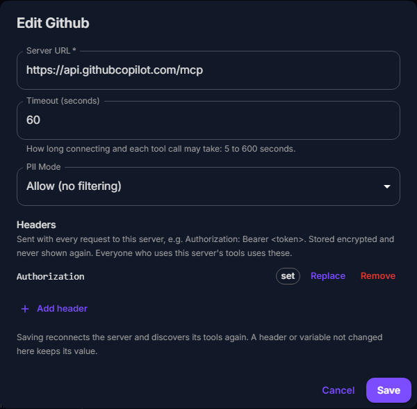

# MCP servers

An MCP server gives chats tools: search a repository, read a file, add two
numbers. LLM.Port's MCP module connects to the servers you register, lists
their tools, and runs a tool when a model asks for it; the gateway offers each
chat the tools switched on for it. The module needs `llmport module enable mcp`.

Everything below was taken on the test install (Ubuntu VM, 2026-09-25/26) with
two servers: GitHub's hosted one, and `server-everything`, a test server run as
a container next to LLM.Port.

---

## Running a server as a container

A server that speaks MCP over HTTP can run on the LLM.Port server itself, from
the Containers pages ([Containers](containers.md) has the whole flow). For
`server-everything`:

- image `node:22-alpine` (pull it under Images first);
- command `npx -y @modelcontextprotocol/server-everything streamableHttp`
  (it listens on port 3001);
- network **`llm_port_shared_default`**, and no port binding: the MCP service
  reaches it by name, as `http://mcp-everything:3001/mcp`. Publishing 3001 on
  the host would clash with Grafana on the shared install.

A container named `mcp-...` is classified `MCP`; see
[Classes](containers.md#classes) for what that allows.

---

## Registering a server

**Extensions → MCP Hub → Register Server**:

| Field | What it is |
|---|---|
| Server Name | Shown in the console |
| Transport | **Streamable HTTP** (current), **SSE** (older HTTP servers) or **Stdio** (a command the MCP service runs itself) |
| Server URL | For HTTP: the server's MCP endpoint, usually ending `/mcp` (or `/sse`) |
| Command | For stdio: the command line, e.g. `uvx mcp-server-time` |
| Tool Prefix | Tools are named `mcp.<prefix>.<tool>`; unique per server |
| PII Mode | What the server may see of personal data (below) |
| Timeout | How long connecting and each tool call may take, 5 to 600 s |

**Headers** (HTTP) and **environment variables** (stdio) carry what a server
needs to let you in, such as a token:

They are stored encrypted and never shown again; the console lists their
names only. Everyone who uses the server's tools uses these credentials.

On **Register** the MCP service connects and lists the server's tools. If it
cannot, the server is saved all the same, in "error", with the reason, for
example:

- `... answered 401 Unauthorized: it needs credentials. Add them as a header,
  for example Authorization: Bearer <token>.`
- `... has no MCP endpoint (it answered 404). Streamable HTTP endpoints usually
  end in /mcp, SSE endpoints in /sse.`
- `Cannot reach ...: Connection refused`

Fix it with **Edit** and it connects again.

---

## A server's page

The page shows the server's status, transport, prefix, PII mode, timeout and
which headers are set, the reason its last connection failed if it did, and
its **Discovered Tools**: each can be switched off for everyone. **Refresh**
lists the tools again; **Test** checks the connection.

**Edit** changes the URL or command, timeout, PII mode, and headers or
variables:

A stored header is **replaced** or **removed** without the others being
entered again. Saving reconnects the server and lists its tools again.

**GitHub's hosted server** (`https://api.githubcopilot.com/mcp/`) has 48 tools;
every tool a chat has switched on costs prompt tokens on every turn (all 48:
about 14.7k). Narrow it with headers: `X-MCP-Toolsets: repos` (or `issues`,
`pull_requests`, ...), `X-MCP-Tools: get_file_contents,search_repositories`,
`X-MCP-Readonly: true`.

---

## In a chat

A new chat has every MCP tool switched off: each tool offered costs prompt
tokens on every message (the 13 of `server-everything` about 1,500, GitHub's
48 about 14,700). The model always gets LLM.Port's own tools:

| Tool | What it does |
|---|---|
| `get_available_tools` | Searches the tools the chat may use by what they do, and switches on what it finds |
| `current_time` | The date and time, in UTC or in a time zone (`Europe/Berlin`) |
| `knowledge_search`, `knowledge_open` | Search the knowledge base, when RAG Lite is on |
| `attachment_search` | Search files attached to the chat that were too long to include |

An MCP tool is switched on for the chat when:

- the user switches it on in the chat's **Tools** panel (the wrench);
- the message names it: "use the get-sum tool" offers `get-sum` from the
  start, and it stays on once the model has used it;
- the model finds it with `get_available_tools`, or calls it by a name close
  to its own (`get_sum`): it is offered from the next step, and stays on.

Switched-on tools are offered with every message, and the panel shows them
on, those the model switched on too. Switching one off saves its tokens; the
model can still switch it on again when it needs it. To keep a tool out of
every chat, switch it off on the server's page (Discovered Tools).

Tools go only to a model whose route can call tools, and not when the
request sets `tool_choice` to `none`.

The gateway runs the calls between rounds of the answer; the reply streams
once the tools are done:

What the chat keeps: each reply stores the tool calls and results that led to
it, and they go back to the model with the history, so later turns still call
tools (each result is kept up to 4,000 characters). The page shows the reply
only.

A small model may name a tool wrong or quote a number (`"25"`). A name close
to a tool's (`get_sum` for `get-sum`) runs that tool; a made-up one
(`add_numbers`) is searched for, and the model is told what it found and
switched on. The MCP service reads a quoted number or boolean in the type the
tool declares.

---

## Personal data (PII mode)

With the PII module on, the chat's policy may replace personal data with
placeholders (`[PERSON_1]`) before a model sees it. What a tool gets depends
on its server's mode:

| Mode | The tool gets |
|---|---|
| Allow | The real values: the gateway puts them back before the call |
| Redact | The placeholders; the MCP service also redacts what it finds in the arguments |
| Block | The call is refused if the arguments contain personal data |

The modules work independently: without the PII module, or when it cannot be
reached, the MCP service lets the call through and logs a warning.
