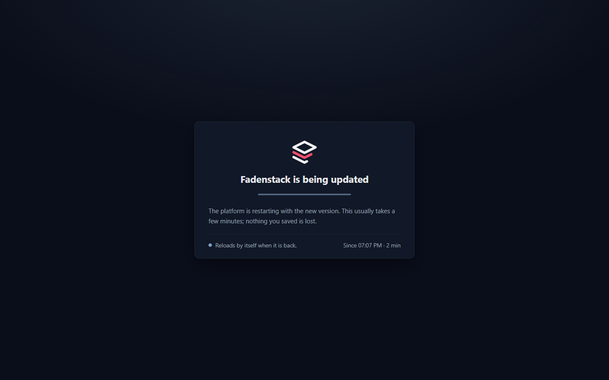

# Upgrading Fadenstack

How to move an installation to a newer version, keeping its data. Written
from upgrading a real installation twice -- a 13 September build on an
Ubuntu VM to the `ray` branch, then that VM to release 0.3.0 while it ran a
model on two DGX Spark machines -- and every problem those upgrades hit is in
[If the upgrade stops](#if-the-upgrade-stops).

## From LLM.Port 0.3 to Fadenstack 0.4

Release 0.4.0 renamed everything an installation carries (compose project,
volumes, containers, databases, `LLM_PORT_*` variables, the `llmport` CLI and
the `llmport-agent`). `faden upgrade` does not do that move: the migration
tool does, once, and keeps every row, file and setting:
[llm-port/migrate-to-fadenstack](https://github.com/llm-port/migrate-to-fadenstack).

```bash
# 1. every machine: stop the old agent
python3 migrate_to_fadenstack.py machine
# 2. the server (a checkout install: fetch the new code first, pass --git-ref)
python3 migrate_to_fadenstack.py server
# 3. every machine again: installs faden-agent from the migrated server
python3 migrate_to_fadenstack.py machine
```

Tried on the release VM and its two DGX Spark machines (28 September 2026):
the server's rows were all kept, and the Ray cluster -- with TLS between the
machines -- formed again by itself once the agents were back, its model
serving again after its usual reload. Every later upgrade is `faden upgrade`
as below.

## Chats encrypted from the October 2026 upgrade on

`faden deploy` has always written a chat encryption key into `.env`
(`FADEN_GATEWAY_ENCRYPTION_KEY`), but the gateway was never given it, and
chats were stored in plain text. From the upgrade that passes it on, new
messages and titles are encrypted with it; chats from before stay readable
as they are, unencrypted. Nothing has to be done, except to keep the `.env`
with the backups: without that key the encrypted chats cannot be read (see
[Back up and restore](installing.md#back-up-and-restore)).

## What `faden upgrade` does

It upgrades the installation the CLI is configured for
(`install_dir` in `~/.config/faden/faden.yaml`), in this order:

1. **Checks** Docker, and that no container it is about to replace was
   created by something else (see below).
2. **Backs up** every database on the Postgres server and the `.env` file,
   to `<install_dir>/backups/<time>/`. It stops if nothing could be backed up.
3. **Refreshes the deployment files and `.env`.** An install made from the
   published images gets the new release's deployment files. `.env` keeps
   every value it has; a release only adds the settings it introduces. Then
   RabbitMQ's users are written from it (`rabbitmq/definitions.json`).
4. **Gets the new images.** An install made from the published images pulls
   the images of the CLI's version. An install from a source checkout builds
   them from the checkout (`--no-build` skips this).
5. **Restarts** everything: infrastructure, then the migrations, then the
   application and modules. Database migrations run here. From here until
   step 7 passes, the platform is in [maintenance mode](#maintenance-mode):
   users see "Fadenstack is being updated" instead of errors.
6. **Clears ClickHouse's old diagnostic logs** (see
   [The disk is full](#the-disk-is-full)).
7. **Waits for the backend** to report healthy, then lifts maintenance mode.
8. **Gets the runtime images** this release pins -- the containers the
   machines run models in, which they download from this server. Read out
   of the new backend image, so they are exactly the builds it will hand
   out; only what changed is downloaded. A failed pull stops nothing:
   services are already up, and `faden runtime-images` retries it.
   `--runtime-images x86_64` (or `aarch64`, `none`) limits it, and is
   remembered. A release whose runtime images are not published yet says so
   here (see [Runtime images "on no registry"](#runtime-images-on-no-registry)).

The new version comes from the CLI (published images) or from the
checkout (source), so put that in place first.

Which of the two an install is depends on how it was made, not on where the
CLI came from: `faden deploy` from the published CLI marks the install
(`.faden-release`), and only a marked install pulls published images. An
install made from a checkout keeps building from it, even with the published
CLI -- so its checkout has to be at the new release too. `faden upgrade
--dry-run` says which it is: `Release: 0.3.0 -> 0.3.1 (pull published
images)`, or `Build images: yes`.

Machines are updated separately: see [Update the machines' agents](#update-the-machines-agents).

## Maintenance mode

While the services restart, nginx -- the front door, restarted first and on
its own -- answers every page with a maintenance page instead of the console:
"Fadenstack is being updated", in the browser's language and in the light or
dark theme the console was last used in. The page checks every few seconds
and reloads itself into the console once it is back, on the new version. A
console left open reloads into the page at its next call.




The APIs answer `503` with `Retry-After: 30` and `X-Faden-Maintenance:
maintenance` (`/v1` in the OpenAI error format), so SDKs and scripts can
wait and retry. `/api/health` stays open.

The upgrade lifts it once the backend is healthy, and also when it fails:
whatever runs then is better reached than hidden.

It can be switched on by hand -- the services keep running, only the front
door changes:

```bash
faden maintenance on -m "Back at 15:00"   # the note is shown on the page
faden maintenance status
faden maintenance off
```

An upgrade leaves maintenance that was switched on by hand on. The switch is
the file `nginx/maintenance.flag` in the install; nginx needs no restart.
A service that does not answer at all gets the same page (saying it is not
reachable, not that it is being updated), and API calls a `503` with
`X-Faden-Maintenance: unavailable`.

### Open consoles move to the new version

A console page that was open during the upgrade notices the new version by
itself: it asks the server which build it runs every two minutes, and when
its tab comes back to the front. A tab in the background reloads at once; the
page in front says "Fadenstack has been updated" with **Reload**, and loads the
new version at the next click to another page. Nobody needs to force a
reload. A page with text typed and not sent is never reloaded on its own --
nothing would keep the text.


## Before you start

**Free disk space.** The new images need a few GB (building them from
source, about 10 GB), a new runtime image about 10 GB per kind of machine,
and the backup needs room for your databases. Check with `df -h /`.

If the disk is already full -- Postgres, ClickHouse, Loki and Grafana
restarting over and over is the sign -- see [The disk is full](#the-disk-is-full)
first. Nothing else will work until there is space.

**Know where the installation is.**

```bash
faden config show        # install_dir is the shared directory
```

## Installed with `pipx install fadenstack`

```bash
pipx upgrade fadenstack        # or: uv tool upgrade fadenstack
faden upgrade --dry-run       # shows the release it moves to
faden upgrade -y
```

Then [check it](#check-it). The CLI refuses to move an install to an
older release than the one it runs: the databases were migrated forward.
Going back is a [restore](#going-back).

## Installed from a source checkout

### 1. Put the new version in place

For an installation made with `faden dev init` or `git clone`:

```bash
cd ~/fadenstack
git stash push -m "local edits before upgrade"   # only if `git status` shows changes
git fetch
git checkout <release tag or branch>
```

Local edits are kept in the stash (`git stash list`); re-apply them with
`git stash pop` after the upgrade if you still need them.

### 2. Update the CLI

The upgrade logic is in the CLI, so update it before running it -- either
the published CLI of the release you checked out, or the one in the checkout:

```bash
uv tool install --force fadenstack==0.3.0            # the published CLI
uv tool install --force ~/fadenstack/cli  # or: from the checkout
faden --version
```

Either way the install builds its images from the checkout; the dry run
says `Build images: yes`.


(`FADEN_CONFIG` points the CLI at this VM's install; one with a single
install doesn't need it.)

### 3. Upgrade

```bash
faden upgrade --dry-run   # what it would do
faden upgrade -y
```


On an 8-core VM the first upgrade from a 13 September build took about 15
minutes for the image builds and a few minutes for the rest. The next one, to
0.3.0, took 2 minutes 49 seconds in all: Docker's build cache still held the
layers whose sources had not changed. The two warnings at the end are
expected for 0.3.0 (see [Runtime images "on no registry"](#runtime-images-on-no-registry)).

## Check it

```bash
faden status                          # every service running; healthy where it has a check
curl -s -o /dev/null -w "%{http_code}\n" http://localhost/api/health   # 200
```


Then sign in to the console. What the VM showed after the upgrade to 0.3.0
(25 September):

- All 18 services up (the two migrators exit once they have run).
- The database migrations ran forward: backend `h1br1dsrch` to `r3s1d3nc3`,
  gateway `6k7l8m9n0p1q` to `7l8m9n0p1q2r`.
- Every row kept, compared table by table before and after: users,
  providers, models, runtimes, both machines and their credentials, the
  cluster and its deployment, settings and secrets, the gateway's routes.
  The request log had one more row -- the test chat.
- The model kept serving throughout. The cluster on the two DGX Spark
  machines is run by the machines, not by the server, so restarting the
  server's services did not touch it: the deployment was observed, not
  applied again (generation 1 of 1, one copy ready), and chat through the
  upgraded gateway answered.


Some pages show what the new version changed. The data residency map, for
example, placed providers by how they were added: the model served by the
DGX pair on the LAN counted as **Cloud**, and the one Fadenstack runs on its
own cluster counted nowhere. After the upgrade it places them by where they
are -- both on your machines, and the setup is air-gapped:


The upgrade from the 13 September build, the first time round, showed the
same: every row kept (the only additions were the permissions new features
need, 99 to 114), and ClickHouse's old diagnostic logs dropped, taking the
disk to 51%.

## Update the machines' agents

A release can expect a newer node agent than the machines run -- 0.3.0
expects agent 0.1.13. The **Machines** list and each machine's page mark a
machine whose agent is older with **Agent <version> available**. The server
doesn't update its machines, and an agent never updates itself: you pick
the window. Each one is updated by running its install line again, on the
machine:

```bash
curl -fsSLO http://<server>/api/install/faden-agent.sh && sh faden-agent.sh --join http://<server> --user
```

Use the line from **Machines → Add a machine**, as you ran it the first time
(the DGX pair's agents run as user services, hence `--user`). The script
downloads the agent the server now expects, checks it, sees the machine is
already a member -- nothing to approve -- and restarts the agent on the new
build.


A running model is not interrupted: the agent is only the machine's link to
the server, and the cluster's containers keep running while it restarts. On
the VM's DGX pair both agents went from 0.1.12 to 0.1.13 this way, and chat
answered throughout. The machine's page shows the version it runs:


**If the server keeps its own agent builds** -- `agent-binaries/` in the
install, for machines without internet -- replace them with the new release's
builds after the upgrade (`faden-agent-linux-x86_64` and
`-linux-aarch64` from the release, with their `.sha256` files to check them).
Nothing replaces them for you, and the server's copy is what the install line
checks the download against. On the VM, 0.3.0 kept a 0.1.12 copy from an
earlier test, so the 0.1.13 download would have stopped with
`the download does not match the expected digest` -- and a machine without
internet would have been given the 0.1.12 copy. From the release after 0.3.0,
a server that can reach GitHub notices a copy that is not the expected
version's build, sets it aside for the release, and says so in its log.

## Switch a cluster to another runtime

A runtime is the image a cluster's machines run: Ray and vLLM together. A
release ships up to three per kind of machine, each certified on that
hardware before it ships:

- **Recommended**: the certified, stable runtime. A new cluster gets it.
- **Preview**: certified, and newer. It loads models the recommended one
  cannot. A cluster gets it only when you choose it.
- **An older one**: to go back to.

A cluster keeps the runtime it was started with. That holds through
restarts, through a recovery after a fault, and through an upgrade of this
server that ships a newer one. When a newer certified runtime is out, the
cluster's page says so under **Runtime**. It changes nothing until you
switch.

To switch, open **Clusters → the cluster → Runtime**, choose the runtime,
and confirm **Restart on this runtime**. The cluster restarts on it:

1. Each machine's container is made again from the new image. A machine
   that does not hold the image yet fetches it first, from this server or
   from a machine that has it.
2. Every model on the cluster loads again.

Plan a window for it, as for the agents. Any agent can follow a switch, so
switching needs no agent update.

On the DGX pair, the recommended GB10 runtime is NVIDIA vLLM 26.08
(vLLM 0.27.1). The preview is 26.09 (vLLM 0.29), and it is the one that
loads Qwen3.8 (`qwen4_exp`). The marketplace says **Cannot run here** for
that model until the cluster runs the preview. See
[Can the cluster run it?](model-marketplace.md#can-the-cluster-run-it).

## If the upgrade stops

### Runtime images "on no registry"

```
⚠ faden-ray-runtime-x86_64:2.58.0 (x86_64): this release names a build that is on no registry.
```

The release names runtime images that were never published, so there is
nothing to pull. 0.3.0 does this for both kinds: its runtime images are built
and published (`runtime-v2.58.0-1`) but not yet certified on their hardware,
so the manifests it carries still name the local builds they were made
from. The upgrade is not affected -- the services are up by then -- and
clusters that already run keep their images. A new machine gets its image
from a cluster peer that has it, or you load one on the server with
`docker load -i <file>`. A release that carries certified manifests names the
published images, and this step pulls them.

### Settings missing after an earlier upgrade

Before this release, `faden upgrade` rewrote `.env` from the defaults and
kept only the passwords. Everything else was lost, including `HF_CACHE_DIR`
(the host's model cache, set by `faden deploy`), the admin name synced to
Grafana, and any port you had changed. Upgrades now keep every value.

To get the lost values back, compare `.env` with the copy the upgrade saved
in its backup, and copy the missing lines back:

```bash
diff <(grep -o '^[A-Z_]*=' .env.bak) <(grep -o '^[A-Z_]*=' .env)   # in backups/<time>/ and the install dir
```

Then run `faden up` to apply them.

### "These containers have names this installation uses, but it did not create them"

A container with one of Fadenstack's names (`faden-prometheus`, ...) was
created some other way -- by hand with `docker run`, or by another compose
project. Compose cannot replace it, and before this check the upgrade
stopped on it only after building every image. The message lists the
containers and the command to remove them:

```bash
docker rm -f faden-prometheus
faden upgrade -y --no-build     # the images are already built
```

Removing a container keeps its data volumes.

### "Bind for 127.0.0.1:9090 failed: port is already allocated"

Before this release Prometheus and MinIO both took host port 9090, and
only a hand-edited `.env` kept them apart. Prometheus is now on
`127.0.0.1:9099` on the host (still `prometheus:9090` inside the stack).
If you had set `PROM_PORT` yourself, that still wins.

### The gateway or backend never becomes healthy: "RabbitMQ not ready", "invalid credentials"

RabbitMQ creates its users from `rabbitmq/definitions.json` every time it
starts, and the services log in with the passwords in `.env`. Before this
release only `faden deploy` wrote that file, so an installation upgraded
with an older CLI kept a file with other passwords: RabbitMQ was healthy,
and refused the gateway and the backend. The upgrade now writes the file
from `.env`. Update the CLI first (step 2) and run the upgrade again.

To check by hand (the password is `RABBITMQ_API_PASS` in `.env`):

```bash
docker exec faden-rmq rabbitmqctl authenticate_user faden-gateway '<password>'
```

### The disk is full

Up to this release ClickHouse (which stores Langfuse's traces) kept its own
diagnostic logs forever. On the upgraded VM `system.trace_log` alone held
41 GB of a 98 GB disk; Langfuse's actual data was a few kilobytes. On a
busy workstation it grew about 3 GB a day.

This release turns those logs off
(`shared/clickhouse/config.d/system-logs.xml`) and the upgrade
drops what they hold. But an installation whose disk is already full cannot
get that far. Free space by hand first:

1. Remove ClickHouse images no container uses -- earlier versions pile up:

   ```bash
   docker images clickhouse/clickhouse-server
   docker image rm clickhouse/clickhouse-server:<old tag> ...
   ```

2. Once ClickHouse is running again, empty its diagnostic logs (they are
   ClickHouse's own, not your data):

   ```bash
   docker exec faden-clickhouse sh -c \
     'for t in trace_log text_log metric_log asynchronous_metric_log; do
        clickhouse-client -u "$CLICKHOUSE_USER" --password "$CLICKHOUSE_PASSWORD" \
          -q "TRUNCATE TABLE IF EXISTS system.$t"; done'
   ```

On the VM this took the disk from 100% to 51% used.

## Going back

Every upgrade leaves a backup in `<install_dir>/backups/<time>/`: a dump of
each database, the `.env`, and the migration versions it was taken at.

```bash
faden restore <install_dir>/backups/<time>
```

It puts back every database and the `.env`, and restarts the services.
Checked on the upgraded VM: a chat deleted and a setting changed after the
backup were both back as they had been, and chat still answered.

To go back to the version you came from as well, check it out and run
`faden upgrade --no-backup` to rebuild it.

A backup older than a cluster doesn't have that cluster in it, but the
machines are still running it. Take it over from **Clusters** instead of
recreating it. See [Taking over clusters your machines still run](taking-over-clusters.md).
